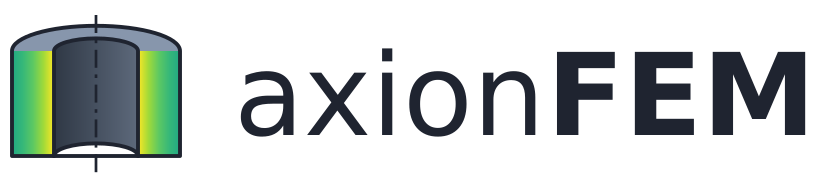
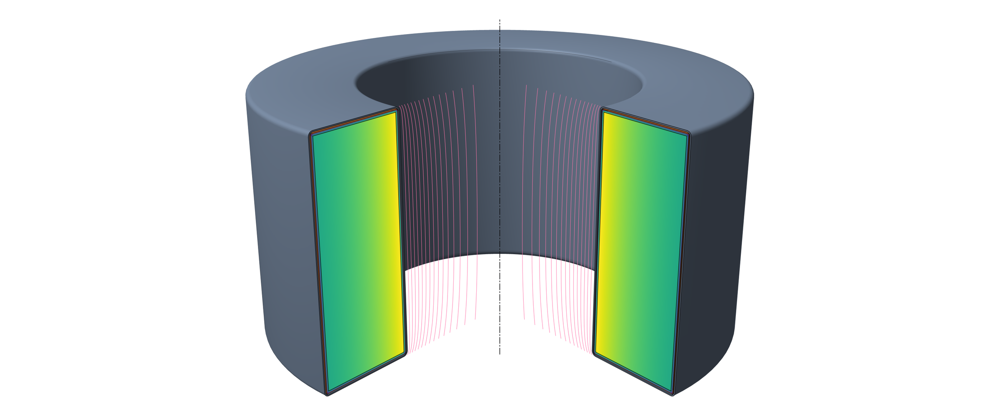
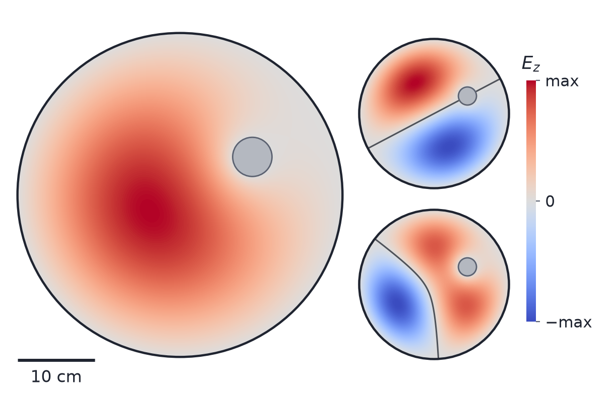
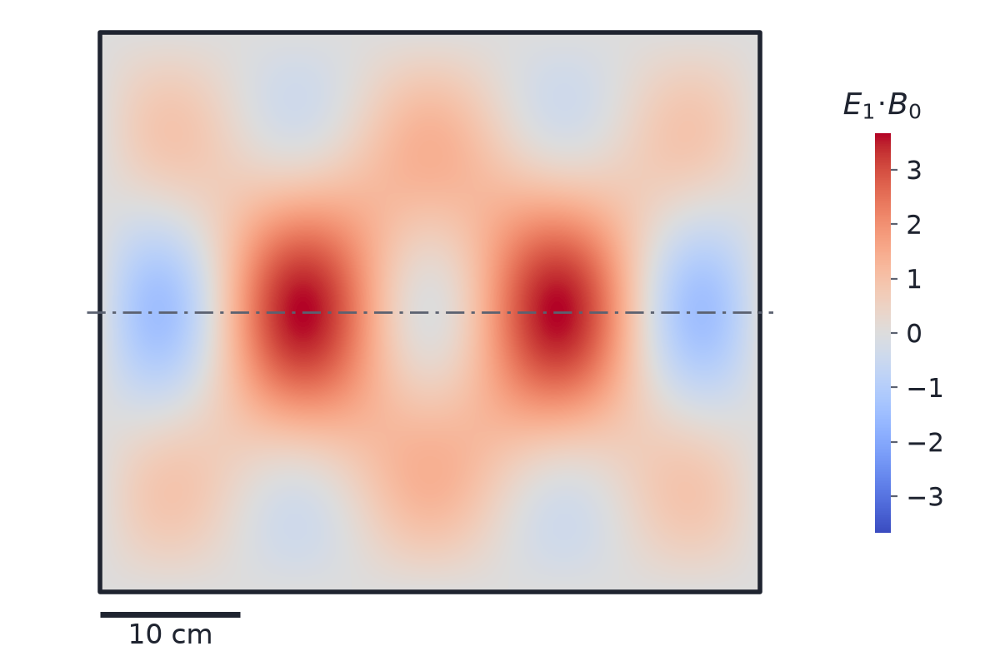
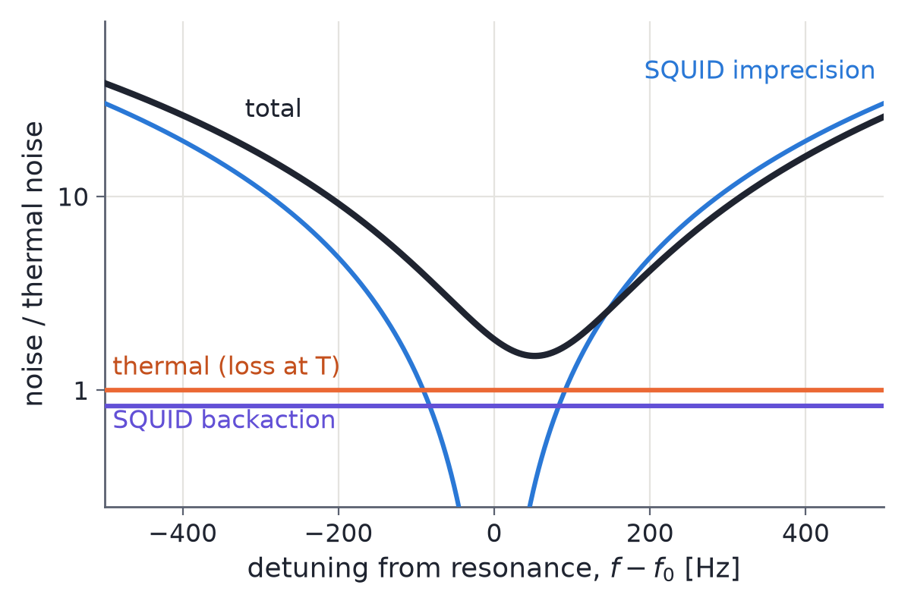
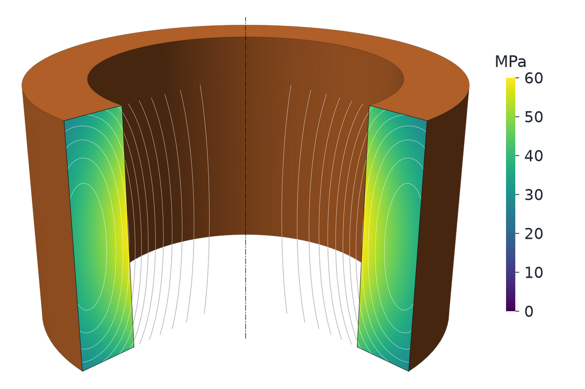
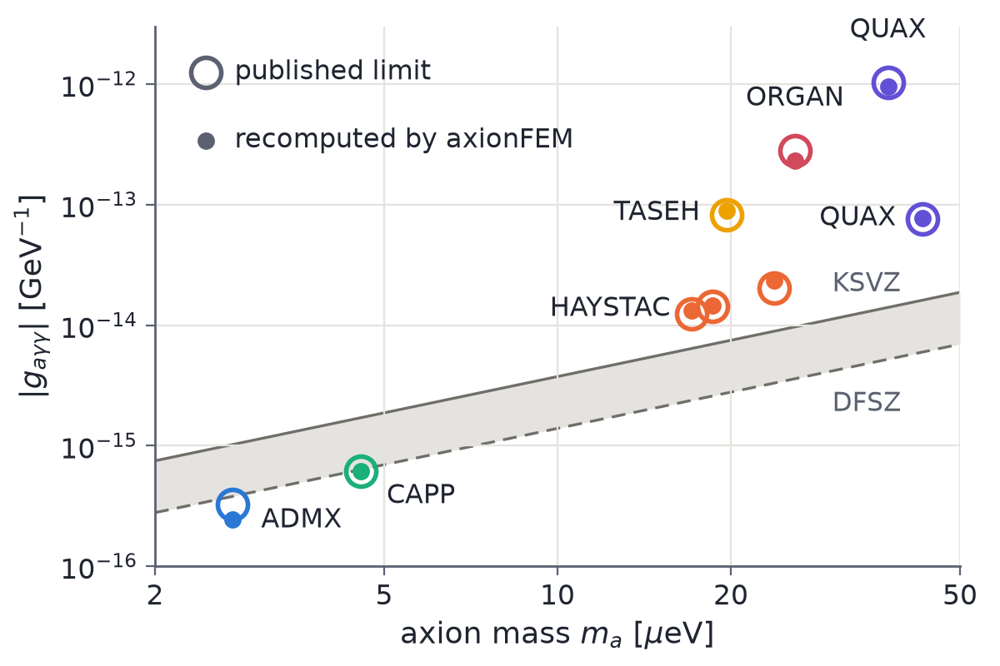
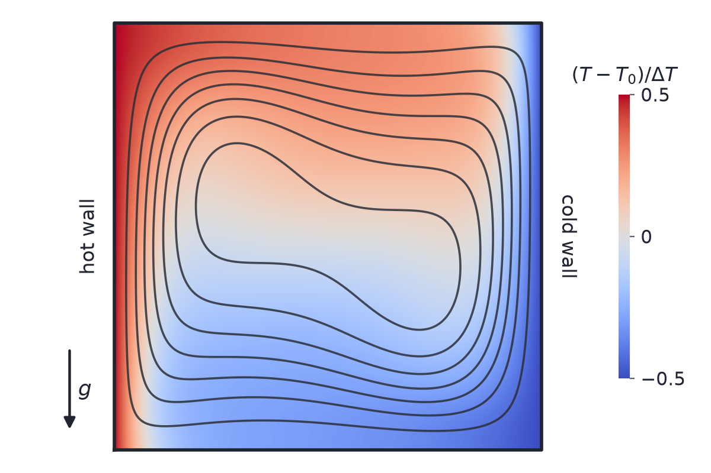

<p align="center">
  <picture>
    <source media="(prefers-color-scheme: dark)" srcset="docs/images/logo/axionfem_wordmark_dark.svg">
    
  </picture>
</p>

<p align="center">
  <b>Finite-element simulation for axion dark-matter detectors</b><br>
  lumped-element detectors · cavity haloscopes · SRF heterodyne cavities · SQUID readout
</p>

<p align="center">
  <a href="https://bsafdi.github.io/axionFEM/">Documentation</a> ·
  <a href="docs/guides/install.md">Install</a> ·
  <a href="#quick-start">Quick start</a> ·
  <a href="docs/guides/index.md">User guide</a> ·
  <a href="docs/validation/index.md">Validation</a> ·
  <a href="#citing">Citing</a>
</p>

<p align="center">
  <picture>
    <source media="(prefers-color-scheme: dark)" srcset="docs/images/home/hero_toroid_dark.png">
    
  </picture>
</p>

<sub>The toroidal lumped-element detector of the quick start (R = H = 2.0 m, NI = 1.0 × 10⁶ A turns), solved axisymmetrically and drawn by axionFEM's renderer as a 3D cutaway. Colour: the static field |B| on the cut planes (viridis, 0 to 0.167 T), which is confined to the toroid volume; where it vanishes the planes are left uncoloured. Pink: field lines of the pickup mode in the bore. Signal coupling Ψ = 3.088 × 10⁻⁷ H T m², pickup inductance L_p = 1.458 µH, with third-order elements; second-order elements agree to 4 × 10⁻⁶.</sub>

axionFEM is a finite-element package for designing and evaluating axion dark-matter detectors. For lumped-element
detectors it computes the signal coupling Ψ, the pickup inductance and the scan figure of merit from
magnetoquasistatic and full-wave solutions; for cavity haloscopes, eigenmodes, form factors and quality factors; for
SRF heterodyne cavities, pump and signal modes and their overlap; and for each, the noise, scan rate and reach of the
readout chain. A C++17 core built on [MFEM](https://mfem.org) performs the solves. A Python API, the `axf` command
line, an interactive 3D viewer and an MCP server for AI assistants sit on top. Mechanics and heat conduction are
included, and beta modules cover incompressible flow and electrochemistry.

## Features

| Area | What axionFEM computes | Status |
|---|---|---|
| Lumped-element detectors | static field (nonlinear iron, superconductors with fluxoid or current constraints, exact open boundary), pickup inductance L_p, coupling Ψ, F = Ψ⁴/L_p² against the scan requirement, peak fields, forces; axisymmetric, and 3D with an MPI build | validated |
| Full-wave response | Ψ(ω), L(ω) and port impedances beyond the quasistatic limit, radiation, self-resonances, bulk and surface losses, multiport circuits, Touchstone export; axisymmetric, and 3D with an MPI build | validated (in 3D: current ports); beta: the surface-resistance models, and in 3D the prescribed sources, imposed background field, perfectly matched layers, error indicator, Gauss-law guard, adaptive sweep, tree-cotree solve, eigenmodes, closed RF-only models (symmetry surfaces, removed PEC volumes, lumped gaps) and the energy-matrix, field-export and reactive-load diagnostics |
| Readout and scans | series readout circuits, noise referred to the pickup, scan reach, finite-band scans, multi-band and multipole scans | validated; beta: multi-band and multipole scans (`axionfem.multipole`) |
| dc SQUID amplifier chains | published chain models, noise and coupling to the readout | beta |
| Sensitivities and optimization | adjoint shape sensitivities (axisymmetric magnetoquasistatic, linear materials), local and global optimization | validated |
| Superconductors and conductors | Meissner bodies and fluxoid states, conductor critical surfaces, HTS critical state, thin magnetic layers, electrostatic capacitance | validated |
| Mechanics and heat | elasticity under magnetic and cooldown loads, steady conduction with k(T); axisymmetric, and 3D with an MPI build | validated |
| Torsional dynamics | axisymmetric torsional modes, harmonic response and mobility of structures | beta |
| Cavity haloscopes | eigenmodes (axisymmetric, cross-section, 3D), form factor C, Q₀ with wall models, tuning sweeps with mode tracking, haloscope sensitivity, presets of published runs, receiver coupling | beta |
| SRF heterodyne cavities | elliptical cells and closed cylinders, degeneracy tuning, overlap η₁₀, geometry factor, wall peaks, heterodyne sensitivity | beta |
| COMSOL interoperability | export of geometry, meshes and full-wave physics; import of `.mph` models | export available; import beta |
| Fluids | Stokes, steady and transient Navier-Stokes, GLS, inductionless MHD, scalar transport and Boussinesq convection (MPI build) | beta |
| Chemistry | kinetics, reactors and equilibrium; primary and secondary current distribution; porous electrodes | beta |
| Tools | interactive viewer (notebook widget, single-file HTML), PNG renderer, `axf` command line, MCP server | |

"Validated" means that the test suite checks the capability against closed-form solutions, manufactured solutions,
independent solvers or published results ([validation pages](docs/validation/index.md)). "Beta" means
that the capability works and is tested, but its interface or its validation is not complete; beta modules say so
in their documentation.

<table>
<tr>
<td width="33%" align="center"><a href="docs/guides/cavity.md"><picture><source media="(prefers-color-scheme: dark)" srcset="docs/images/home/card_cavity_dark.png"></picture></a><br><b>Cavity haloscopes</b> (beta)</td>
<td width="33%" align="center"><a href="docs/guides/srf.md"><picture><source media="(prefers-color-scheme: dark)" srcset="docs/images/home/card_srf_dark.png"></picture></a><br><b>SRF heterodyne cavities</b> (beta)</td>
<td width="33%" align="center"><a href="docs/guides/readout_multiband.md"><picture><source media="(prefers-color-scheme: dark)" srcset="docs/images/home/card_readout_dark.png"></picture></a><br><b>Readout and SQUID chains</b> (SQUID chains and multi-band scans: beta)</td>
</tr>
<tr>
<td width="33%" align="center"><a href="docs/guides/mechanics_thermal.md"><picture><source media="(prefers-color-scheme: dark)" srcset="docs/images/home/card_mech_dark.png"></picture></a><br><b>Mechanics and thermal</b></td>
<td width="33%" align="center"><a href="docs/guides/cavity.md#sensitivity-and-reach"><picture><source media="(prefers-color-scheme: dark)" srcset="docs/images/home/card_reach_dark.png"></picture></a><br><b>Reach across mass</b> (beta)</td>
<td width="33%" align="center"><a href="docs/guides/fluids.md"><picture><source media="(prefers-color-scheme: dark)" srcset="docs/images/home/card_fluids_dark.png"></picture></a><br><b>Fluids</b> (beta)</td>
</tr>
</table>

<sub>Every image is axionFEM output generated by
[docs/images/make_homepage_figures.py](docs/images/make_homepage_figures.py); the captions, with the numbers each
figure quotes and their convergence checks, are in [docs/images/home/captions.md](docs/images/home/captions.md).</sub>

## Installation

axionFEM 0.1.0 is not yet on PyPI: install it from a clone of this repository.

| Build | What it has | Instructions |
|---|---|---|
| Sequential source build (`scripts/build_deps_wheel.sh`, then `AXIONFEM_DEPS=$PWD/third_party/install-seq pip install .`) | everything except the 3D engine, the fluids module (beta) and 3D current distributions: axisymmetric and full-wave solvers, readout and scans, cavities, SRF, mechanics, chemistry, viewer, CLI, MCP server | [install guide](docs/guides/install.md#sequential-source-build) |
| MPI source build | the same plus the 3D engine and the fluids module (beta) | [install guide](docs/guides/install.md#mpi-source-build) |

The sequential build (the configuration of the planned PyPI wheels, which cannot require a system MPI) is serial: 3D designs, the fluids module and 3D current
distributions need the MPI source build. `af.build_info()` reports what a build has. The `mesh` extra installs gmsh,
which axionFEM runs as a separate program (see [License](#license)). The release workflow is configured to build
wheels of the sequential build (Linux x86_64 manylinux_2_28, macOS x86_64 and arm64, CPython 3.10 to 3.13) for a later
upload to PyPI.

## Quick start

```python
import axionfem as af

d = af.template("toroid", R=2.0, H=2.0)   # the toroidal detector of the figure above
d.set(y=0.6)                              # inner radius of the field region, as a fraction of R
res = d.solve()                           # mesh and solve; files go to runs/toroid
print(res.summary())                      # Psi, L_p, stored energy, peak fields, scan requirement, cost metric
res.export_html("toroid.html")            # a self-contained 3D viewer page
```

The summary starts with

```
design 'toroid'
  Psi      = 3.088e-07 H T m^2  (0.2458 T m^3 natural)
  L_p      = 1.458e-06 H
```

In a notebook, `res.show()` displays the same viewer in the cell. The
[quick-start notebook](examples/quickstart.ipynb) continues with field inspection, exports and a 3D solve; the
[user guide](docs/guides/index.md) covers each detector type.

From the command line, `axf template toroid --set y=0.6 > design.json`, `axf validate design.json` and
`axf solve design.json -o run --scene` do the same with a JSON design file.

## Documentation

- [Documentation website](https://bsafdi.github.io/axionFEM/): install, quick start, user guide, physics,
  validation, API reference and developer guide.
- [Installation](docs/guides/install.md) and [build options](docs/install.md).
- [Concepts](docs/guides/concepts.md): designs, solves, results and units.
- [Scope and limitations](docs/guides/limitations.md).
- [Design format](docs/design_format.md), [command line](docs/cli.md), [Python API](docs/api.md).
- Executed example notebooks in `examples/`: [quick start](examples/quickstart.ipynb),
  [lumped-element detectors](examples/lumped_element.ipynb), [full wave](examples/fullwave.ipynb),
  [readout and SQUID chains](examples/readout_squid.ipynb), [cavity haloscopes](examples/cavity_haloscope.ipynb)
  (beta), [SRF heterodyne cavities](examples/srf_heterodyne.ipynb) (beta),
  [mechanics and heat](examples/mechanics_thermal.ipynb), [reach and optimization](examples/reach_optimization.ipynb),
  [fluids](examples/fluids_beta.ipynb) (beta), [chemistry](examples/chemistry_beta.ipynb) (beta).

## Validation

Each validated capability is checked against closed-form solutions, manufactured solutions, an independent solver
or published results, and most of these checks run in the test suite; modules with less validation evidence are
labelled beta. Comparisons with published work, each quantity with a verdict (agrees, disagrees or not decidable),
cover the ABRACADABRA-10 cm, DMRadio-50L, DMRadio-m³, DMRadio-GUT and DMRadio-Core lumped-element designs, the COMSOL
models of arXiv:2211.00008 (shielded scenarios), and the HAYSTAC, RADES, CAPP and QUAX cavities. The
[validation overview](docs/validation/index.md) lists every check with its reference, page, benchmark and tests; the
comparisons with published work are on the pages for [lumped-element detectors](docs/validation/published_benchmarks.md)
and [cavities](docs/validation/cavity_reproductions.md).

## Scope and limitations

- The 3D engine (3D magnetoquasistatics, 3D full wave, 3D eigenmodes and 3D mechanics) needs an MPI source build;
  the sequential build (and the planned wheels) is axisymmetric and 2D only.
- Shape sensitivities by the adjoint method cover axisymmetric magnetoquasistatic designs with linear materials;
  nonlinear iron uses finite differences with remeshing, and 3D or full-wave results are not differentiated.
- Iron in RF problems uses the secant permeability at the static operating point, which is exact only for RF fields
  perpendicular to the static field.
- Sharp superconductor corners carry field singularities: results report the peak, the corner value and a regular
  peak, and warn.
- The cost metric is a scaling metric for comparing designs, not a construction estimate.
- Cavity, SRF, SQUID-chain, multipole-scan, torsional-dynamics and COMSOL-import modules are beta, as are fluids and
  chemistry: fluids
  take meshes given as arrays and chemistry builds simple meshes with `axionfem.chem.meshes`; neither has design-file,
  mesher, CLI, viewer or MCP integration.

The [scope and limitations page](docs/guides/limitations.md) lists what is validated, what is beta and what is not
implemented.

## AI assistants (MCP)

axionFEM includes a [Model Context Protocol](https://modelcontextprotocol.io) server (`axionfem-mcp`, installed with
the `mcp` extra), so that an MCP client can build designs, run solves locally and read the results.
The repository ships a project configuration for it (`.mcp.json`) and an agent skill for detector design
(`.claude/skills/axionfem-design`). The [MCP guide](docs/guides/mcp.md) describes the setup for any MCP client, with
examples, and lists the tools. [AGENTS.md](AGENTS.md) gives instructions for AI agents that work on or with axionFEM.

## Citing

If you use axionFEM, please cite

> J. N. Benabou, J. W. Foster, B. R. Safdi, to appear (2026).

and the software itself using the metadata in [CITATION.cff](CITATION.cff). Please also cite the methods and
benchmark papers your work relies on, and MFEM. [How to cite](docs/about.md#citing-axionfem) has a BibTeX entry.

## Development

axionFEM was developed by its authors with Claude (Anthropic) as an AI coding agent in Claude Code, mostly Claude Opus
5.5; most commits in its development history carry a Claude Opus 5.5 co-author trailer. The correctness of axionFEM
rests on its checks, not on how the code was written: each validated capability is checked against closed-form
solutions, manufactured solutions, independent solvers or published results, most of those checks run in the test
suite, and modules with less validation evidence are labelled beta. Contributions are welcome; the
[developer guide](docs/developer/contributing.md) and [AGENTS.md](AGENTS.md) describe the conventions.

## Authors

Joshua N. Benabou, Joshua W. Foster, Benjamin R. Safdi

## License

BSD 3-Clause ([LICENSE](LICENSE)); the vendored three.js (`viewer/vendor/`, MIT) and stb_image_write
(`cpp/third_party/`, MIT or public domain) keep their own licences, and `third_party/licenses/` holds the licence
texts of every library a wheel bundles or compiles in. gmsh, which is GPL-licensed, is used only as an external program: the mesher
`axf-mesher` runs in its own process, and gmsh is not redistributed in the wheels (it comes from gmsh's own package
through the `mesh` extra). The [build options page](docs/install.md#licensing-of-each-wheel) lists the licence of
every file in a wheel.
