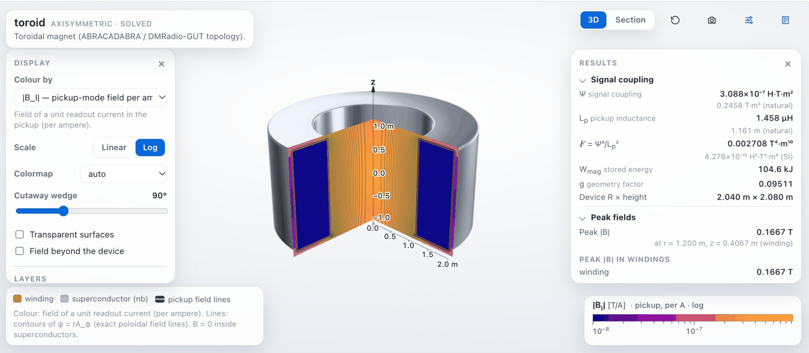
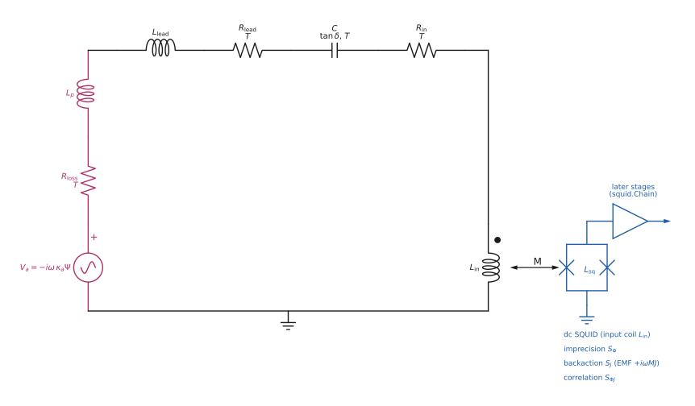
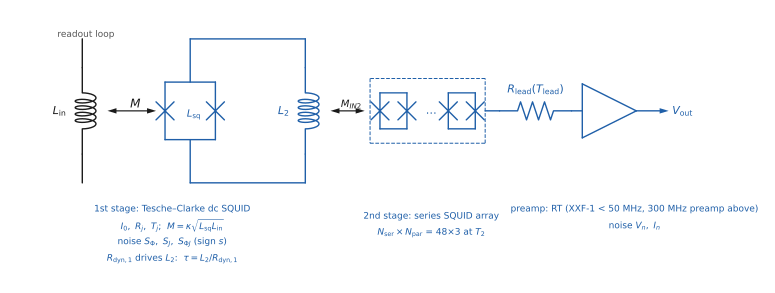

# axionFEM

axionFEM is a finite-element package for electromagnetics, structural
mechanics, heat conduction, fluid flow and electrochemistry. We built it to
design axion dark-matter detectors: lumped-element experiments (e.g.,
ABRACADABRA, DMRadio, CORE), resonant-cavity haloscopes (e.g., ADMX, HAYSTAC,
CAPP, QUAX, ORGAN) and superconducting radio-frequency heterodyne cavities.
The solvers themselves are general and apply to magnets, superconducting
devices, RF structures and resonators in other settings. It has a C++ core
built on MFEM, a Python interface, a 3D viewer, and an MCP server so that
designs can be built and evaluated through chat.

**What it solves:** magnetostatics and magnetoquasistatics (superconducting,
resistive and iron-core magnets and shields; fields, inductances, forces);
full-wave electromagnetics (impedances, S-parameters, radiation, eigenmodes);
superconductors (flux constraints, critical surfaces, the HTS critical state);
electrostatics; circuits with the noise of every element; mechanics and heat
conduction; adjoint shape sensitivities and optimization; and, in beta,
incompressible flow and electrochemistry. Geometries are axisymmetric profiles
or 3D solids, including imported CAD (STEP). Axisymmetric problems run on one
machine; 3D problems use MPI.

**Documentation:** [bsafdi.github.io/axionFEM](https://bsafdi.github.io/axionFEM/) (installation, tutorials, API reference)



*The interactive viewer (`res.show()` in a notebook, or `res.export_html(...)` for a standalone page)
on the quick-start ABRACADABRA-style toroid (R = 2 m, H = 2 m): a 90° cutaway colored by the
pickup-mode field per ampere $`|\mathbf B_I|`$ (log scale), with the pickup field lines and the results panel
(signal coupling $`\Psi`$, pickup inductance $`L_p`$, $`\mathcal F=\Psi^4/L_p^2`$, stored energy, peak fields).*

<details>
<summary>Static field $`\mathbf B_\mathrm{lab}`$ of the same toroid (3D cutaway)</summary>

<picture>
  <source media="(prefers-color-scheme: dark)" srcset="docs/images/home/hero_toroid_dark.png">
  
</picture>

*The toroidal lumped-element detector of the quick start (R = H = 2.0 m, NI = 1.0 × 10⁶ A turns), solved axisymmetrically and drawn by axionFEM's renderer as a 3D cutaway. Colour: the static field |B| on the cut planes (viridis, 0 to 0.167 T), which is confined to the toroid volume; where it vanishes the planes are left uncoloured. Pink: field lines of the pickup mode in the bore. Signal coupling Ψ = 3.088 × 10⁻⁷ H T m², pickup inductance L_p = 1.458 µH, with third-order elements; second-order elements agree to 4 × 10⁻⁶.*
The figure is generated by [docs/images/make_homepage_figures.py](docs/images/make_homepage_figures.py).

</details>

<picture>
  <source media="(prefers-color-scheme: dark)" srcset="docs/images/home/card_cavity_dark.png">
  
</picture>

*Transverse cross-section of a copper cavity with an off-centre tuning rod: $`E_z`$ of the three lowest TM modes from
the cross-section eigensolver (`"symmetry": "xsec"`, beta); dark lines are nodal lines
([validation](docs/validation/cavity_xsec.md)).*

<picture>
  <source media="(prefers-color-scheme: dark)" srcset="docs/images/home/card_srf_dark.png">
  
</picture>

*SRF heterodyne cavity (beta): the overlap density $`\mathbf E_1\cdot\mathbf B_0`$ of the pump and signal modes of a
closed cylinder at their degenerate length, on the meridional section, from the axisymmetric eigensolver; its volume
average is the overlap factor $`\eta_{10}`$ ([docs/srf/](docs/srf/README.md)).*




*Left: the readout loop of `circuit.series_readout` ([docs/physics/readout_circuit.md](docs/physics/readout_circuit.md)),
drawn by the package itself: `readout.draw(annotate=False)` (with values: `readout.draw()`; also `Chain.draw()`,
`MultiportReadout.draw()`; the `draw` extra). Right: the dc SQUID amplifier chain behind the input coil (beta),
`squid.chain("C1+low+RT").draw(annotate=False)` ([docs/physics/squid_chain.md](docs/physics/squid_chain.md)). Both
drawings come from [docs/images/make_circuit_figure.py](docs/images/make_circuit_figure.py).*

> Status: version 0.1.0 (alpha). Axisymmetric and MPI 3D solvers, full-wave analysis, circuits, HTS, mechanics and
> heat conduction, and the design tools are checked against closed-form solutions, manufactured solutions,
> independent solvers or published results ([validation](docs/validation/index.md)). Beta (working and tested, but
> with an interface or a validation that is not complete): cavity haloscopes, SRF heterodyne cavities, dc SQUID
> chains, multi-band and multipole scans, torsional dynamics, the COMSOL import, the fluids, scalar-transport and
> chemistry modules, the surface-resistance models, and in 3D full wave everything except current ports (prescribed
> sources, the imposed background field, perfectly matched layers, the error indicator, the Gauss-law guard, the
> adaptive sweep, the tree-cotree solve, eigenmodes, closed RF-only models and the energy-matrix, field-export and
> reactive-load diagnostics). The 3D engine and the fluids module need the MPI source build.

## What it computes for lumped-element detectors

For a lumped-element detector geometry (windings, superconductors, iron, normal conductors,
readout port) axionFEM solves the magnetoquasistatic problems that define a
lumped-element axion search:

- the static laboratory field $`\mathbf B_\mathrm{lab}`$ (nonlinear iron, superconductors with
  frozen fluxoid or prescribed current, exact open boundary);
- the pickup mode: the field of a unit readout current, giving $`L_p`$;
- the signal coupling $`\Psi=\frac{1}{I}\int \mathbf A_I\cdot\mathbf B_\mathrm{lab}\,d^3x`$ ($`\Phi_a=\kappa_a\Psi`$);
- the scan figure of merit $`\mathcal F=\Psi^4/L_p^2`$ against the requirement $`\mathcal F_\mathrm{req}`$ of
  the optimal resonant scan (Chaudhuri et al.), for any noise benchmark;
- stored energy, peak fields in windings and on superconducting surfaces,
  Lorentz forces and Maxwell pressure, cold-envelope area and a cost metric (a scaling metric for comparing
  designs, not a construction estimate);
- **shape sensitivities** of all of those with respect to the design parameters
  (adjoint on a morphed mesh) and gradient-based optimization
  ([docs/optimization.md](docs/optimization.md)).

## Quick start

axionFEM 0.1.0 is not yet on PyPI. We build it from a clone with meshing and notebook support; the sequential build
needs a C++17 compiler and CMake but no MPI ([installation](docs/guides/install.md#sequential-source-build)).

```bash
git clone https://github.com/bsafdi/axionFEM && cd axionFEM
python3 -m venv .venv && source .venv/bin/activate
pip install --upgrade pip
bash scripts/build_deps_wheel.sh
AXIONFEM_DEPS=$PWD/third_party/install-seq pip install ".[mesh,notebook]"
```

We solve the quick-start toroid to inspect its summary and fields, then export an HTML view.

```python
import axionfem as af
res = af.template("toroid", R=2.0, H=2.0, y=0.6).solve()
print(res.summary())
res.show()                      # the 3D viewer in a Jupyter cell
res.export_html("toroid.html")  # or a self-contained page
```

The sequential build has everything except the 3D engine and the fluids module, which need MPI and so the
[MPI source build](docs/guides/install.md#mpi-source-build). `af.build_info()` reports the available build features.

Step-by-step [example notebooks](examples/) (executed, and rendered on the documentation website) cover
lumped-element detectors, SQUID readout chains, cavity haloscopes, SRF heterodyne cavities, mechanics and heat,
fluids and chemistry.

With the MPI source build (on a cluster, in a compute allocation), we build the dependencies and axionFEM to solve an
example design.

```bash
bash scripts/fetch_deps.sh && bash scripts/build_deps.sh
cmake -S . -B build -G Ninja -DCMAKE_BUILD_TYPE=Release && cmake --build build
./build/axf solve examples/long_solenoid_coax.json -o runs/demo
```

`axf validate design.json` checks a design and prints actionable errors;
`axf schema` prints the JSON Schema of the design format;
`axf requirement` prints $`\mathcal F_\mathrm{req}`$ for the benchmarks.

## Layout

| Path | Contents |
|---|---|
| `cpp/` | C++ library `libaxionfem`, CLI `axf`, mesher `axf-mesher` (gmsh, separate process) |
| `python/axionfem` | Python package: builder API, templates, viewer server, MCP server |
| `viewer/` | three.js viewer shipped with the package |
| `docs/` | [installation](docs/guides/install.md), [build options](docs/install.md), [viewer](docs/viewer.md), [COMSOL export](docs/comsol_export.md), [COMSOL import](docs/comsol_import.md) (`axf import-comsol model.mph`, beta), physics notes, design-format reference, [validation](docs/validation/index.md) |
| `benchmarks/` | validation cases and their records (e.g. [SRF cell](benchmarks/srf/): 2D/3D convergence) |
| `examples/` | example designs and notebooks: [quick start](examples/notebook_quickstart.ipynb), [lumped-element detectors](examples/lumped_element_demo.ipynb) (toroid, solenoid, CORE: geometry → $`\Psi`$, $`L_p`$ → $`\mathcal F`$ vs $`\mathcal F_\mathrm{req}`$ → scan), [mechanics and thermal](examples/mechanics_thermal_demo.ipynb) (forces on the winding, support stresses, cooldown, heat load with $`k(T)`$), [dc SQUID amplifier chains](examples/squid_chain_demo.ipynb) (beta), [cavity haloscope walkthrough](examples/cavity_demo.ipynb) (beta; geometry → eigenmodes → $`C`$, $`Q_0`$ → reach), [SRF heterodyne cavities](examples/srf_demo.ipynb) (beta; mode pair → $`\eta_{10}`$, $`G`$, $`\xi`$ → required volume), [fluids](examples/fluids_demo.ipynb) (beta; Stokes flow), [chemistry](examples/chemistry_demo.ipynb) (beta; current distributions) |

## Building the docs

The documentation website (MkDocs Material; user guides from `docs/`, the
example notebooks, and an API reference generated from the docstrings) builds
without the compiled core.

We install the documentation dependencies and run the preview, strict build and offline build to generate the site.

```bash
pip install -r docs/requirements.txt -c docs/constraints.txt
mkdocs serve                        # live preview on http://127.0.0.1:8000
mkdocs build --strict               # what CI checks (.github/workflows/docs.yml)
bash scripts/docs/build_offline.sh  # a site/ that opens from disk (file://; MathJax still needs a network)
```

The API reference lists the public objects in `docs/api.md`; the validation pages, physics notes and other
reference pages are kept out of the site by `exclude_docs` in `mkdocs.yml` and linked on GitHub.

## Citing

We ask that work using axionFEM cite

> J. N. Benabou, J. W. Foster, B. R. Safdi, to appear (2026).

and the software itself, using the metadata in [CITATION.cff](CITATION.cff). Please also cite the methods and
benchmark papers your work relies on, and MFEM. [About](docs/about.md#citing-axionfem) has a BibTeX entry.

## Development

axionFEM was developed by its authors with Claude (Anthropic) as an AI coding agent in Claude Code, mostly Claude Opus
5.5; most commits in its development history carry a Claude Opus 5.5 co-author trailer. The correctness of axionFEM
rests on its checks, not on how the code was written: each validated capability is checked against closed-form
solutions, manufactured solutions, independent solvers or published results, most of those checks run in the test
suite, and modules with less validation evidence are labelled beta. Contributions are welcome; the
[developer guide](docs/developer/contributing.md) and [AGENTS.md](AGENTS.md) describe the conventions.

## Authors

Joshua N. Benabou, Joshua W. Foster, Benjamin R. Safdi

## License

BSD 3-Clause ([LICENSE](LICENSE)). The vendored three.js (`viewer/vendor/`, MIT) and stb_image_write
(`cpp/third_party/`, MIT or public domain) keep their own licences. gmsh (GPL) is used only as an external program, is
not redistributed in our wheels, and comes from its own PyPI package; licensing details are in
[docs/install.md](docs/install.md#licensing-of-each-wheel), "Licensing of each wheel".
