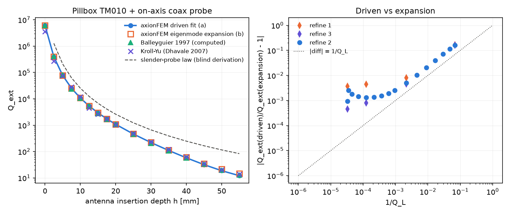

# Receiver coupling of a cavity mode: antenna port, Q_ext and beta

!!! warning "Beta"
    `axionfem.cavity_coupling` is beta: axisymmetric pillbox, on-axis electric probe, TM0np modes only.

Code: `python/axionfem/cavity_coupling.py`. Validation: `benchmarks/cavity_coupling_validation.py`
(record `benchmarks/records/cavity_coupling.json`), `tests/test_cavity_coupling.py`.

## 1. What is computed

A haloscope reads its cavity through an antenna: a coaxial line whose inner conductor protrudes into the
cavity (electric probe, insertion depth h). The receiver is a load Z0 on the line (normally matched,
Z0 = Z_c). The quantities the sensitivity layer needs are

- the external quality factor Q_ext = ω U / P_ext (U the stored energy, P_ext the power into the load);
- the coupling β = Q0 / Q_ext and the loaded Q_L = Q0 / (1 + β), with 1/Q_L = 1/Q0 + 1/Q_ext;
- the loaded resonance frequency (the probe pulls the mode).

These enter the signal power through β/(1+β)·Q_L and the scan rate through β/(1+β)·Q_L and the noise
([haloscope_sensitivity.md](../physics/haloscope_sensitivity.md) H3.2, H5).

Geometry implemented: the axisymmetric pillbox (radius R, length L) with a coax (radii a < b, fill ε_r, length
ℓ) on the axis through one end plate; the inner conductor protrudes to height h ≥ 0 (h = 0: flush). This is the
TM0np family (the probe couples to E_z). It is solved by the 2D imported-mesh full-wave engine (`Fw2DModel`,
[physics/fw2d.md](../physics/fw2d.md)) on a structured second-order triangle mesh written by
`cavity_coupling.probe_pillbox_mesh` (graded towards r = a, b and z = −ℓ, 0, h). Walls: Leontovich impedance
walls of conductivity σ on the cavity and the probe; the coax walls are PEC (lossless line); the far end of the
coax (z = −ℓ, a < r < b) is a lumped port (uniform current per circle; open circuit in the eigenproblem).

Off-axis probes and loops (m ≠ 0) need the 3D path; they are not implemented here (Sec. 7).

## 2. Two independent routes

Time dependence e^{−iωt}; Z = R − iωL for an inductor (axionFEM convention).

### (a) Driven: port impedance fit

The driven port impedance Z(ω) of the lossy structure (the wall loss is in the operator through the
Leontovich condition) is computed on a frequency grid of ±3 half-widths about the loaded resonance and ±3
unloaded half-widths about the open-port pole (both placed from the expansion (b); `sweep_grid`), and fitted by
one pole plus a quadratic background (if the fitted pole or loaded zero has no sample within one of its own
half-widths, the sweep is repeated once with both windows centred on the fitted roots),

  Z(ω) = c0 + c1 x + c2 x² + K/(x − s),  x = ω/ω_ref − 1

(linearized least squares, then damped Gauss–Newton; `fit_port_resonance`, which flags non-convergence,
non-positive decay rates, an ambiguous second zero and a pole or zero outside the sampled band). Then

- the pole p = ω_ref(1 + s) = Re p − iγ0 is the open-port (unloaded) resonance: Q0 = Re p/(2γ0);
- the zero p_L of Z + Z0 near it is the loaded resonance: Q_L = Re p_L/(2γ_L);
- γ_ext = γ_L − γ0, β = γ_ext/γ0 (no reference frequency), Q_ext = Re p/(2γ_ext).

Q_L and Q0/(1 + β) differ by Re p_L/Re p − 1, the relative loaded shift, O(1/Q_ext). The loaded resonance is a pole of
S11 = (Z − Z0)/(Z + Z0); the impedance pole is the open-circuit resonance.

Convention: Q0 is the open-port (port open-circuited at the line end) resonance of the whole structure, probe and
line included, and Q_ext follows from Q_L and Q0. The loaded state's wall loss can differ from the open-port one:
the receiver quantity is β/(1+β) Q_L, and `loaded_power.eta_c_from_power` gives
β/(1+β) directly from the full-wave power into the load at the loaded resonance, P_load/(Q_L O²/(2ω)).

### (b) Eigenmode expansion

Two lossless eigenmode solves on the same mesh: port open (H_φ = 0 on the port; ω_o) and port short-circuited
(PEC; ω_s). With the open-port mode e real and normalized ∫ε e² dV = 1 (U = 1/2 J), its port voltage is
v = −∫_a^b e_r dr at the port. The modal (Foster) expansion of the lossless port impedance gives, near ω_o,

  Z(ω) = −i v²/(2(ω_o − ω)) + i Y,   Y = v²/(2(ω_o − ω_s))

(the background Y from Z(ω_s) = 0; secant, error O(1/Q_ext)). Adding the wall loss
(ω_o → ω_o − (1+i)ω_o/(2Q0) for a good-conductor Leontovich wall, X_s = R_s: the reactive part shifts the pole
down by ω/(2Q0)) and a load Z0, the loaded resonance is the zero of Z + Z0:

  Q_ext = ω_o (Z0² + Y²)/(v² Z0),   δω_L = −v² Y/(2(Z0² + Y²))

(`one_port_coupling`). Q0 is the perturbative wall Q of the open-port mode, ω U/P with
P = ½∮Re Z_s|H_t|² dA. This is the Hartung–Haebel "current-voltage method" (Sec. 5): their P = ½R|V_open|²/(|V_open/I_short|² + R²) is the same
formula with Y = |V_open/I_short|. The code reports both: `Y_ohm` from the frequency pair and
`Y_from_fields_ohm`, `Q_ext_hartung_haebel` from the short-port mode's port current I_s = 2πr H_φ (same
normalization). The short-port partner of the open-port mode is not taken as the nearest frequency (Foster's
interlacing allows a partner on either side; at strong coupling the nearest one can be wrong): every short-port
mode is tried and the one whose |Y| from the frequency pair agrees best with its own |v/I_s| is used; all
candidates are recorded (`short_candidates`).

Two checks of v: the direct line integral of e_r (curl of the H_φ eigenvector, one-sided at the port) and the
TEM standing wave in the lower half of the coax (r H_φ = A sin k(z + ℓ), v = 2π Z_c A from nodal values).

### Expansion of the axion response

With the source B0 = B ẑ in the cavity (`fullwave.source`), the driven readout Ψ(ω) = (1/iωI)∫E_I·B0 dV
(reciprocity: V_oc = −iωΨ per unit effective current κ = 1 A m⁻² T⁻¹) is compared with the single-mode
expansion Ψ = −v O/(ω_c² − ω²), O = ∫_cavity e·B0 dV, ω_c = ω_o(1 − (1+i)/(2Q0)). The port power into Z0,
P = |V_oc|² Z0/(2|Z + Z0|²), is compared at the loaded resonance with the single-mode haloscope form
P = β/(1+β) Q_L O²/(2ω) (U = ½|a|², P_tot = ωU/Q_L). The form factor C = O² ε0/(B² V) uses the cavity volume
V (probe excluded).

## 3. Order of agreement

Both routes are exact descriptions of the same discretized physics up to (i) the single-pole / frozen-background
truncations, relative O(1/Q) (O(1/Q) in Q_ext and Q_L, O(ω/Q²) in the pole positions),
and (ii) the different discretizations (Nédélec E for the sweep, H1 dual H for the eigenmodes), which converge
under refinement; the probe tip and the coax mouth are 270° corners (field ∝ ρ^(−1/3)), so the convergence is
slow (observed local orders 1.2-1.8 in the element size; `refine` divides h_min and h_max but not the grading, so
it is not a uniform refinement).

Both routes describe the open-port mode of the structure *including the line up to the port*. That mode is the
cavity mode only while no resonance of the coax stub is near it: when one is (e.g. a 90 mm, ε_r = 2 line has its
half-wave resonance near 1.09 GHz (electrical length ℓ√ε_r + h), next to TM010 at 1.147 GHz), the open-port pole mixes cavity and line, and Q0,
β and C (whose mode energy then sits partly in the line) change with the line length by 10-20 %, while the
physical Q_L and loaded frequency change much less (Q_L by 1.2 % at 90 mm, mostly fit quality). `coupling_study` therefore warns on a half-wave stub resonance within 30 % of the mode
(`line_resonances`, electrical length ℓ√ε_r + h, the probe counted as line: an estimate), on Q_L of the two routes
or the loaded power vs β/(1+β) Q_L O²/(2ω) differing by more than 3/Q_L + 5×10⁻³, and on the two estimates of Y
differing by more than 10/Q_L + 5×10⁻³ (both carry O(1/Q) errors, ~5/Q_L on the record; this check is therefore
weak at strong coupling); a coax energy fraction above 1 % is a note. `to_haloscope_cavity` refuses a result with
warnings unless told otherwise. The independent checks back up the geometric guard: a 75 mm line at h = 30 mm is
caught by the loaded-power and Q_L checks. The form factor C is normalized with the whole-structure mode energy (the energy the Q's refer to, so
β/(1+β) Q_L C B² V reproduces the full-wave power); `C_cavity_energy` is the cavity-only value.
The axion source is applied in the cavity only (`source_regions`); the line's own overlap with B0 is left out
(its volume is 10⁻⁴ of the cavity's here).

## 4. Validation (record `benchmarks/records/cavity_coupling.json`)

Benchmark geometry: Balleyguier's pillbox (Part. Accel. 57 (1997), Figs. 7-8): TM010 at 1146 MHz, cavity
200 mm diameter × 150 mm, semi-rigid coax 1.65/5.35 mm with ε_r = 2.0 (Z_c = 49.9 Ω), antenna length 0-55 mm.
Our assumptions where the paper is silent: the dielectric ends flush with the plate, the hole radius equals the
outer conductor radius, copper σ = 5.8×10⁷ S/m (Q0 ≈ 3.08×10⁴; Q_ext does not depend on it), coax length 30 mm
to the port. Order-3 elements, refine 2 (4.7-6.4×10³ triangles); one core per case, 1-2.5 min per study.

### 4.1 Q_ext vs insertion depth

| h [mm] | Q_ext driven (a) | Q_ext expansion (b) | (a)/(b) − 1 | 1/Q_L | β (a) | Balleyguier 1997 (computed) | Kroll–Yu | (a)/Balleyguier − 1 |
|---|---|---|---|---|---|---|---|---|
| 0 | 6.148e+06 | 6.1537e+06 | -9.3e-04 | 3.27e-05 | 0.005002 | 6.06805e+06 | 3.55303e+06 | +0.013 |
| 2.5 | 3.9709e+05 | 3.9809e+05 | -2.5e-03 | 3.50e-05 | 0.07745 | 407113 | 269016 | -0.025 |
| 5 | 77135 | 77273 | -1.8e-03 | 4.55e-05 | 0.3987 | 81493 | 74439 | -0.053 |
| 7.5 | 25244 | 25281 | -1.5e-03 | 7.21e-05 | 1.218 | 23841 | 28111 | +0.059 |
| 10 | 10744 | 10758 | -1.3e-03 | 1.26e-04 | 2.86 | 10536 | 12086.1 | +0.020 |
| 12.5 | 5341.5 | 5348.8 | -1.4e-03 | 2.20e-04 | 5.746 | 5361 | 4449.1 | -0.004 |
| 15 | 2939.5 | 2944 | -1.6e-03 | 3.72e-04 | 10.42 | 2790 | 2660.16 | +0.054 |
| 17.5 | 1736.1 | 1739.4 | -1.9e-03 | 6.08e-04 | 17.59 | 1682 | 1709.18 | +0.032 |
| 20 | 1079.3 | 1082.1 | -2.6e-03 | 9.57e-04 | 28.16 | 1064 | 1061.46 | +0.014 |
| 25 | 463.94 | 466.28 | -5.0e-03 | 2.18e-03 | 64.31 | 455 | 482.99 | +0.020 |
| 30 | 219 | 221.26 | -1.0e-02 | 4.55e-03 | 131 | 207 | 232.46 | +0.058 |
| 35 | 109.87 | 112.19 | -2.1e-02 | 8.95e-03 | 241.9 | 106 | 118.52 | +0.037 |
| 40 | 57.772 | 60.182 | -4.0e-02 | 1.67e-02 | 402.9 | 56.5 | 61.87 | +0.023 |
| 45 | 31.876 | 34.34 | -7.2e-02 | 2.92e-02 | 596.7 | 33 | 34.15 | -0.034 |
| 50 | 18.765 | 21.222 | -1.2e-01 | 4.72e-02 | 782.7 | 19.9 | 20.36 | -0.057 |
| 55 | 12.153 | 14.492 | -1.6e-01 | 6.91e-02 | 917.8 | 13.1 | 13.87 | -0.072 |

Reference columns: Dhavale & Mittal, APAC 2007 WEPMA133, Table 3 (Balleyguier's method [their ref. 9] and
their Kroll–Yu computation of the same pillbox). Balleyguier quotes 5-10 % (always < 15 %) agreement of his
computation with measurement over six decades ("The error was less than 15% as Qext varies from 6 millions down
to 12 units"); the two computed columns differ from each other by up to 40 % (flush) and 10-20 % elsewhere.
axionFEM's driven Q_ext is within ±7.3 % of the Balleyguier column at every depth (1.3 % at h = 0, 2.0 % at
10 mm), i.e. inside the reference's own spread.

### 4.2 Driven vs expansion: the O(1/Q) criterion



*Left: Q_ext vs antenna depth, axionFEM (a) and (b) against the two published computed columns and the slender-probe
law. Right: |Q_ext(a)/Q_ext(b) − 1| vs 1/Q_L; dotted: 1/Q_L. The plateau at weak coupling is the mesh floor
(falls with refinement), the rise at strong coupling the O(1/Q) truncation of (b) (mesh-independent).*

- Weak to moderate coupling (Q_ext ≳ 10³, 1/Q_L ≲ 10⁻³): |Q_ext(a)/Q_ext(b) − 1| = 0.9-2.6×10⁻³ at refine 2.
  This is a mesh floor, not the O(1/Q) truncation; it falls under refinement (refine 1 / 2 / 3: h = 0 mm: 3.6e-03 / 9.3e-04 / 4.6e-04, h = 10 mm: 4.4e-03 / 1.3e-03 / 8.0e-04, h = 25 mm: 8.0e-03 / 5.0e-03 / 4.6e-03, h = 55 mm: 1.7e-01 / 1.6e-01 / 1.6e-01); both routes converge to the same value (the probe tip and coax mouth are 270° corners).
- Strong coupling: the difference is 2.3/Q_L (h = 25 mm: 5.0×10⁻³ at 1/Q_L = 2.2×10⁻³; 35 mm: 2.1×10⁻² at
  8.9×10⁻³; 55 mm: 0.16 at 6.9×10⁻²): the O(1/Q) truncation of the single-mode
  lemma (secant background, frequency-independent Y, energy normalization of the open-port mode), as expected. For Q_L and the loaded frequency the driven fit is the more accurate route
  there (no single-mode truncation; rms fit misfit ≤ 1.2×10⁻³ Z0 even at Q_L = 12, ≤ 1.4×10⁻⁷ Z0 for h ≤ 25 mm);
  the split of Q_L into Q0
  and Q_ext is the open-port convention of Sec. 2(a) in both routes.
- **The expansion is checked to O(1/Q).** The difference splits into a part ≈ 2.3/Q_L, the
  O(1/Q) truncation (|difference|·Q_L = 2.41 / 2.34 / 2.33 at refine 1 / 2 / 3 at h = 55 mm, where it dominates;
  at h = 25 mm 3.66 / 2.30 / 2.13, converging towards it as the mesh part shrinks), and a
  mesh part that falls under refinement (h = 0 and 10 mm: 3.6-4.4×10⁻³ at refine 1, 0.9-1.3×10⁻³ at refine 2,
  4.6-8.0×10⁻⁴ at refine 3). The coefficient 2.3 is measured, not assumed.
- Q0: the open-port pole of the driven fit equals the perturbative wall Q of the eigenmode to 7×10⁻⁶ (weak
  coupling) - 5×10⁻⁴ (h = 55 mm). Pole frequency (with the −ω/(2Q0) reactive shift): 7×10⁻⁹ (flush), 4×10⁻⁷
  (10 mm), 3×10⁻⁵ (55 mm).
- Loaded resonance frequency of (a) and (b): ≤ 1.2×10⁻⁶ apart for h ≤ 20 mm, 3×10⁻³ at 55 mm. There the probe
  lowers the open-port mode by 8.3 % from the empty TM010, the short-port mode lies 9.8 % below the open-port one,
  and the loaded resonance (driven fit) 1.1 % below the open-port mode.
- Hartung–Haebel current-voltage estimate (Y from |v/I_short|): within 3×10⁻⁵ (flush) to 4.5 % (55 mm) of (b); its
  difference also grows like 1/Q_L (it neglects the open/short frequency shift, "most appropriate in the case of
  weak coupling"). The fitted residue of (a) equals the eigenmode's i v²/2 to ≤ 2.5×10⁻³ at every depth (refine 2),
  a sign-sensitive check of v and of the impedance convention.
- Port voltage two ways (line integral vs coax TEM standing wave): 7×10⁻⁵.
- Loaded port power at the loaded resonance vs β/(1+β) Q_L O²/(2ω) with the driven β, Q_L and the eigenmode O:
  |ratio − 1| ≤ 1.1×10⁻⁴ for Q_L ≥ 200 (h ≤ 30 mm), ≤ 1.3 % down to Q_L = 12 (h = 55 mm). Equivalently
  `eta_c_from_power` = P_load/(Q_L O²/(2ω)) and β/(1+β) agree to the same level.
- Open-circuit Ψ(ω) vs the single-mode expansion −vO/(ω_c² − ω²) in the loaded window (±3 loaded half-widths,
  excluding the ±3 unloaded half-widths about the open-port pole, where a pole-frequency discretization error of
  a fraction of f/Q0 dominates; `Psi_check` keeps the full arrays): 0.06 % (flush), 0.8 % (10 mm), 2.3 % (20 mm),
  5.5 % (40 mm), 11 % (45 mm), 22 % (50 mm), 36 % (55 mm). At weak coupling it is a mesh effect (h = 10 mm:
  2.2 % / 0.83 % / 0.46 % at refine 1 / 2 / 3); at strong coupling it is mesh-independent (55 mm: 35 % at
  refine 1 and 3): the loaded resonance lies many unloaded widths from the open-port pole, where the open-circuit
  Ψ's non-resonant part (the other modes' v_m O_m) is no longer small against the resonant term. The receiver
  quantity, the loaded power, does not have this problem (ratio within 1.3 % at every depth, above). Including the
  pole window the maximum difference is 2.6 % at 10 mm and 54 % at 55 mm.

### 4.3 Invariances (h = 10 mm, refine 2)

| case | Q_ext driven | Q_ext expansion | β (driven) |
|---|---|---|---|
| reference (σ = 5.8e7, ℓ = 30 mm, Z0 = Z_c) | 10743.7 | 10758 | 2.86 |
| σ × 10⁻² (Q0 ÷ 10) | 10737.6 | 10758 | 0.2861 |
| σ × 10² (Q0 × 10) | 10744.3 | 10758 | 28.6 |
| line length 50 mm | 10743.4 | 10758.9 | 2.86 |
| line length 90 mm (stub half-wave resonance ~1.09 GHz; flagged) | 10204.2 | 9561.36 | 3.386 |
| receiver Z0 = 25 Ω | 8280.69 | 8292.26 | 3.71 |

Q_ext is a property of the lossless geometry: changing σ by 10⁴ (Q0 by 10²) moves it by ≤ 6×10⁻⁴ (driven;
0 for the expansion, whose Q_ext never sees σ) while β scales with Q0. A matched lossless line of a different
length gives the same Q_ext (3×10⁻⁵ driven, 50 mm) as long as no stub resonance is near the mode; at 90 mm the
open-port mode mixes with the line (10.6 % of its energy in the coax). Relative to the 30 mm line, Q0 moves by
+12.4 %, β by +18.4 %, C by −10.8 %, Q_ext by −5.0 % (driven) and −11.1 % (expansion), and the driven Q_L by
−1.2 % (the fit itself degrades: rms misfit 2.4×10⁻² Z0). The guards fire: stub resonance, fit quality, Q_L of
the two routes 5 % apart, loaded power vs β/(1+β) Q_L O²/(2ω) (+8.9 %), the two Y estimates. A mismatched receiver (Z0 = 25 Ω) changes Q_ext as the
lemma predicts and (a), (b) still agree to 1.4×10⁻³.

### 4.4 Small-probe law and flush probe (independent derivation; trend only)

An independent derivation, made without numbers or code from this package, gives for a slender monopole
(a, b ≪ h ≪ R, L) the small-probe law
β = Q0 ω Z_c C_p² ℓ_eff²/(ε0 V_m (1 + (ω C_p Z_c)²)) → Q0 π ε0 ω Z_c h⁴/(R² L J1(p01)² ln²(h/a)), with
C_p = 2πε0 h/ln(h/a), ℓ_eff = h/2, and for the flush coax (TEM aperture potential) the flush law
β = Q0 Z_c ω ε0 π (b² − a²)²/(4 R² L J1² ln²(b/a)). Comparison with the driven Q_ext:

| h [mm] | Q_ext driven | Q_ext small-probe law | ratio | local slope −d ln Q_ext/d ln h: FEM / law |
|---|---|---|---|---|
| 2.5 | 3.9709e+05 | 1.274e+06 | 3.21 | 2.36 / 2.60 (to 5 mm) |
| 5 | 77135 | 2.106e+05 | 2.73 | 2.75 / 3.00 (to 7.5 mm) |
| 7.5 | 25244 | 6.253e+04 | 2.48 | 2.97 / 3.14 (to 10 mm) |
| 10 | 10744 | 2.532e+04 | 2.36 | 3.13 / 3.22 (to 12.5 mm) |
| 12.5 | 5341.5 | 1.234e+04 | 2.31 | 3.28 / 3.28 (to 15 mm) |
| 15 | 2939.5 | 6789 | 2.31 | 3.42 / 3.31 (to 17.5 mm) |
| 17.5 | 1736.1 | 4074 | 2.35 | 3.56 / 3.34 (to 20 mm) |
| 20 | 1079.3 | 2608 | 2.42 | 3.78 / 3.37 (to 25 mm) |
| 25 | 463.94 | 1230 | 2.65 | 4.12 / 3.39 (to 30 mm) |
| 30 | 219 | 662.4 | 3.02 | 4.47 / 3.41 (to 35 mm) |
| 35 | 109.87 | 391.5 | 3.56 | 4.81 / 3.42 (to 40 mm) |
| 40 | 57.772 | 248 | 4.29 | 5.05 / 3.43 (to 45 mm) |
| 45 | 31.876 | 165.6 | 5.20 | 5.03 / 3.43 (to 50 mm) |
| 50 | 18.763 | 115.4 | 6.15 | 4.56 / 3.43 (to 55 mm) |
| 55 | 12.15 | 83.26 | 6.85 | - |

Flush (h = 0): driven Q_ext = 6.148e+06, flush law 5.336e+06 (ratio 0.87; the TEM aperture potential is an
approximation).

The leading-log law is a trend reference: its relative error is O(1/ln(h/a)) and ln(h/a) is only 1.1-4.2 here.
Where its assumptions hold best (h/a ≥ 12, k h ≤ 0.5, i.e. h = 10-20 mm) the local slope agrees with the FE one
to ≤ 11 % (3.1-3.6 vs 3.2-3.4, both below the asymptotic 4 because of the ln² factor) and the normalization is a
constant factor 2.3-2.4 (the O(1/ln) correction to C_p ℓ_eff); for h ≳ 25 mm (k h ≳ 0.6) the quasistatic law
fails and the FE slope rises to 4-5, as expected from dynamic corrections O((k h)²). None of the sources in Sec. 5
states the h⁴ law explicitly; the closest are Burt's induced-charge current source and Kamigaito's
Q_ext = C/(Z0 ω Cf²).

## 5. Literature

- Balleyguier, "A straightforward method for cavity external Q computation", Part. Accel. 57, 113-127 (1997):
  Fig. 7 "TM010 mode, 1146 MHz, Qint = 25000, antenna length z = 0 to 55 [mm], cavity drawn 200 × 150 [mm]";
  "The semi-rigid cable dielectric had a relative permittivity εr = 2.0, and its external/internal diameters
  were 5.35/1.65 mm, respectively."; "The relative difference is typically between 5 and 10% (in any case less
  than 15%)." Method: Qext = ωW/P with the line power from the field on a line cross-section (Eqs. (1)-(3), (8)).
- Dhavale & Mittal, APAC 2007 WEPMA133, Table 3: the Balleyguier and Kroll-Yu Q_ext columns used above
  ("pill box cavity operating at 1146 MHz having diameter ~200mm, length ~150mm with semi-rigid coaxial line
  (φ in/out=1.65/5.35 mm). The penetration depth was varied from 0 to 5.5 cm").
- Hartung & Haebel, PAC 1993 p. 898, "current-voltage method": "P = ½ R |Vopen|² / ( |Vopen/Ishort|² + R² )",
  Q_V ≡ 2ωU R/|Vopen|², Q_I ≡ 2ωU (1/R)/|Ishort|², "Q_ext = Q_V + Q_I" (Eqs. (1)-(2)); "the method is most
  appropriate in the case of weak coupling". This is route (b) with Y = |V_open/I_short| (implemented as
  `Q_ext_hartung_haebel`).
- Balleyguier, LINAC98 MO4037: two runs (magnetic and electric wall at the line end), "Qext = Q1 + Q2"; "The
  reference plane position has no influence on the external Q".
- Kroll & Yu, SLAC-PUB-5171 (1990): Q_ext from the phase of the reflection vs line length; the third column of
  the reference table.
- Kamigaito, arXiv:2005.05843, Eq. (37): "Qext = C / (Z0 ωr Cf²)" (capacitive coupling of a parallel LCR).
- Definitions: Brubaker, arXiv:1801.00835 Eqs. (4.27)-(4.29) "1/QL = 1/Q0 + 1/Qr", "β = Q0/Qr", "QL = Q0/(1 + β)";
  HAYSTAC arXiv:1611.07123 "the scan rate is maximized for an overcoupled cavity with β = 2".
- Haloscope depth data without a law: TASEH arXiv:2205.01477 Fig. 7 (κ vs insertion depth, HFSS and
  measurement); Brubaker: β at fixed depth depends on frequency.

## 6. Using it

```python
from axionfem import cavity_coupling as cc, haloscope as hs
geo = cc.ProbePillbox(R=0.1, L=0.15, a=0.825e-3, b=2.675e-3, coax_eps_r=2.0, h=0.01, sigma_S_m=5.8e7)
res = cc.coupling_study(geo, "run_dir")          # res["driven"], res["expansion"], res["comparison"]
cav = cc.to_haloscope_cavity(res, B_T=8.0)        # C, V from the mode; Q0, beta from the port (driven)
P = hs.signal_power(1e-15, res["driven"]["f_loaded_Hz"], cav.B_T, cav.V_m3, cav.C, Q0=cav.Q0, beta=cav.beta)
rate = hs.scan_rate(res["driven"]["f_loaded_Hz"], cav, hs.hemt(0.1, 1.0))
```

`tests/test_cavity_coupling.py::test_haloscope_hook` checks that this P equals the full-wave port power into the
receiver load times the axion's effective-current factor.

Cost: one study = two eigensolves (open and short port), a 26-point sweep and a one-point solve at the loaded
resonance; 1-3 min on one CPU core at refine 2.

## 7. Limits and open items

- Axisymmetric on-axis electric probe only (TM0np modes). Off-axis probes, loops (TE/TM11x coupling) and real
  connector geometry need the 3D path (`fullwave.ports` on a coax stub with `validation_loads`), not done here.
- The lumped port at the end of the line is a uniform-current TEM feed; it is exact for the TEM line used here
  (the line is long enough that higher coax modes have decayed: v from the line integral and from the TEM standing
  wave agree to 7×10⁻⁵).
- Wall loss: Leontovich walls (good conductor, X_s = R_s). Superconducting walls (X_s ≠ R_s) would need the
  reactive shift generalized; Q_ext itself is unaffected.
- Strong coupling (Q_ext ≲ 100): use the driven fit; the expansion is O(1/Q)-limited by construction.
