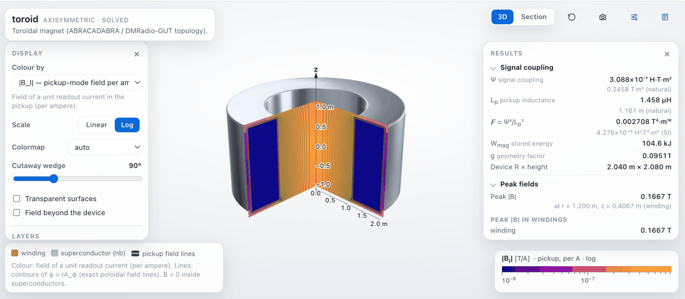

# axionFEM

Axion dark-matter experiments include lumped-element detectors, cavity haloscopes, and SRF heterodyne cavities. Here we introduce axionFEM, a finite-element package for these detectors, with a Python interface and an interactive field viewer.

- [Lumped-element detectors](../examples/lumped_element_demo.ipynb): magnets, pickup circuits, and scan sensitivity.
- [dc SQUID readout chains](../examples/squid_chain_demo.ipynb) (beta): amplifier noise and detector coupling.
- [Cavity haloscopes](../examples/cavity_demo.ipynb) (beta): resonant modes, form factors, and sensitivity.
- [SRF heterodyne cavities](../examples/srf_demo.ipynb) (beta): pump and signal modes in superconducting radio-frequency cavities.
- [COMSOL export and import](guides/comsol.md): exchange of designs, meshes, and model settings.
- [Fluids](guides/fluids.md) and [chemistry](guides/chemistry.md) (beta): incompressible flow and current distributions in electrolytes.

[Installation](guides/install.md) ·
[Quick start](../examples/notebook_quickstart.ipynb) ·
[API reference](api.md)

Citing axionFEM, contact and issues: [About](about.md)

*Pickup field in a toroidal detector.*

*Overlap of the pump and signal fields in an SRF heterodyne cavity.*

Contributors: Joshua N. Benabou, Joshua W. Foster, Benjamin R. Safdi.
