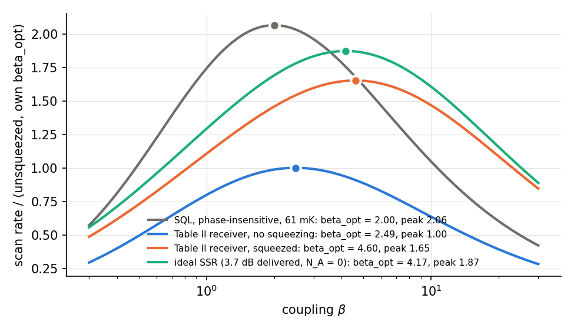
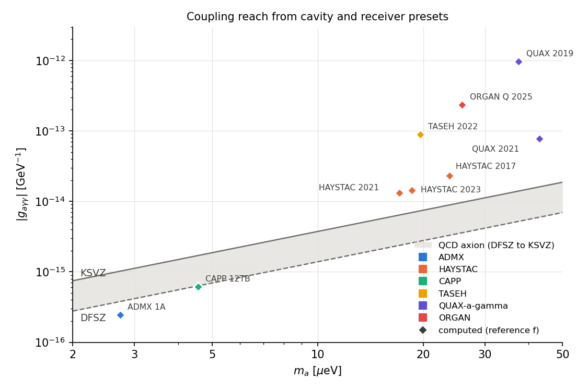
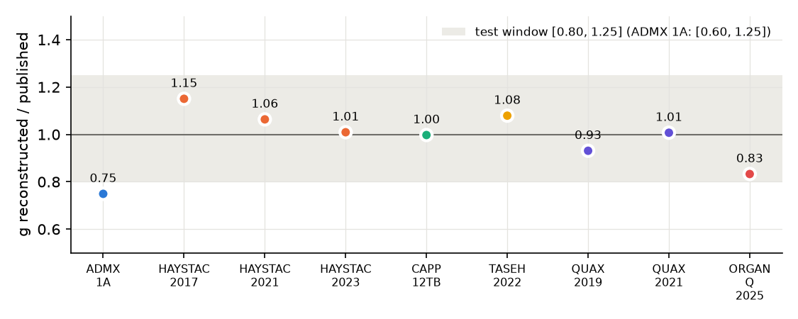

# Cavity-haloscope sensitivity: signal, noise, scan rate, limits

!!! warning "Beta"
    `axionfem.haloscope` and `axionfem.haloscope_presets` are beta.

**Code:** `python/axionfem/haloscope.py`, presets in `python/axionfem/haloscope_presets.py`.
**Tests:** `tests/test_haloscope.py`. **Notebook:** `examples/cavity_demo.ipynb`.
**Figures:** `docs/physics/figures/cavity_sensitivity_{limits,ratios}.png`, `cavity_scan_rate_beta.png` (embedded in Secs. 4 and 8; drawn with `axionfem.haloscope` and `axionfem.haloscope_presets`; the drawing script is not part of the repository).

This layer is pure Python and independent of the FEM solver. A cavity mode enters only through
numbers, or callables of frequency, `f, C, Q0, beta` (what the eigenmode solver returns per mode) and
`B, V`. Tags (H*n*) below match the code's docstrings.

Sources:

| tag | reference |
|---|---|
| [D1] | independent closed-form derivation of the signal power, line-shape factor and scan rate (made without the code; its reference values are in `tests/test_haloscope.py`) |
| [D2] | independent closed-form derivation of the squeezed-receiver scan rate (reference values in `tests/test_haloscope.py`) |
| [AK17] | Al Kenany et al., NIM A 854 (2017), arXiv:1611.07123 (HAYSTAC design) |
| [B17] | Brubaker et al., PRD 96, 123008 (2017), arXiv:1706.08388 (HAYSTAC analysis) |
| [K20] | Kim, Jeong, Youn, Kim, Semertzidis, JCAP 03 (2020) 066, arXiv:2001.05605 |
| [M19] | Malnou et al., PRX 9, 021023 (2019), arXiv:1809.06470 (squeezing) |
| [H23] | HAYSTAC, PRD 107, 072007 (2023), arXiv:2301.09721 (Phase II, corrected IIa) |
| [S] | `docs/physics/scan_and_signal.md` (package conventions, SHM, Q_a) |

---

## 1. Units and couplings

SI internally; inputs carry units in their names (`f_Hz`, `B_T`, `V_m3`, `g_GeV` = |g_aγγ| in GeV⁻¹,
`rho_GeV_cm3`). Mass and frequency: m_a = h f / e. Constants are those of `axionfem.circuit` (CODATA 2018).

**(H1.2) Benchmark couplings, "haloscope" convention** ([AK17] text after Eq. 1, [B17] Sec. II; ADMX, HAYSTAC,
TASEH, QUAX, CAPP):

$$|g_{a\gamma\gamma}|=\frac{|g_\gamma|\,\alpha}{\pi\Lambda^2}\,m_a,\qquad \Lambda=77.6\ \mathrm{MeV},\qquad g_\gamma^{\rm KSVZ}=-0.97,\ g_\gamma^{\rm DFSZ}=0.36 .$$

Papers differ in Λ: 78 MeV (HAYSTAC 2017 PRL, TASEH, QUAX), 77.6 MeV ([B17], [H23]), and CAPP-12TB's
power normalisation implies Λ² = m_a f_a = 5.70×10⁻³ GeV² (Λ = 75.5 MeV; test
`test_published_power_normalisations`). A published "× KSVZ" statement is converted with the paper's own Λ
(preset key `published.Lambda_MeV`). The spread is up to 11% in g.

`g_axion(m, model, convention="qcd")` reuses the package's E/N − C_γ form ([S] S2.1,
`axionfem.scan.g_qcd`, C_γ = 1.77, m_a f_a = 5.70×10⁻³ GeV²). There KSVZ is about 5% below the
haloscope convention.

## 2. Axion line

**(H2.1)** SHM lab-frame spectrum s(f), f = f_a(1 + v²/2), ∫s df = 1. These are the same equations as
the C++ core ([S] S2.4–S2.5, `signal.cpp`), re-implemented in Python because the core binds only Q_a. The
test checks Q_a against `scan.Q_axion_shm` to 1e-7.

**(H2.2)** The radiometer quantity is the noise-equivalent width Δf_eff = 1/∫s² df ≡ f_a/Q_a, where
Q_a = f_a∫s² df is the package's `Q_axion` ([S] S2.6): 6.779×10⁵ for v₀ = 220 and v_obs = 232 km/s.

**(H2.3)** Q_a conventions differ between papers, and the difference matters at first order in df/dt.
In the code a keyword named `Q_a` **always** means the radiometer Q_a = f/Δf_eff of H2.2 (`scan_rate`,
`g_limit_*`, `time_to_cover`, preset `analysis.Q_a`). The other conventions have their own names:
`Q_a_fwhm` (f/FWHM of a Lorentzian line, `signal_power`) and `Q_a_kim` (Kim's ~10⁶, `scan_rate_kim2020`,
`beta_opt_kim2020`).

- A Lorentzian of f/FWHM = Q_F has Δf_eff = π·FWHM, so Q_a,rad = Q_F/π [D1].
- [AK17] and [K20] use "Q_a ~ 10⁶" (≈ c²/⟨v²⟩) with a 4/5 or Lorentzian prefactor.
- Our optimal formula with the SHM is 1.5× slower than [AK17] Eq. 5 at Q_a = 10⁶. The factor is
  (4/5 × 10⁶)/(π/4 × 6.78×10⁵).

## 3. Signal power

**(H3.1)** Power coefficient, natural units g²(ρ/m_a)B²VC (Sikivie 1985). In SI ([D1]):

$$\mathcal P = g_J^2\,\frac{\hbar c^3}{\mu_0\,\omega_a}\,\rho\,B_0^2\,V\,C,\qquad g_J=g/(1.602\times10^{-10}\ \mathrm{J/GeV}).$$

**(H3.2)** Received power ([K20] Eq. 7 = Eq. 18; [B17] Eq. 5):

$$P=\eta\,\frac{\beta}{1+\beta}\,\mathcal P\,\frac{Q_LQ_a}{Q_L+Q_a}\,\frac{1}{1+(2Q_L\delta/f)^2}$$

- Q_L = Q₀/(1+β).
- η is any extra transmission efficiency, e.g. HAYSTAC η_L = 10^{-0.06}.
- Here Q_a is f/FWHM of a Lorentzian line (keyword `Q_a_fwhm`); `None` is the narrow-line limit, Q_eff = Q_L.
- β from the geometry (beta): `axionfem.cavity_coupling.coupling_study` computes Q_ext, β and Q_L
  of a coaxial antenna port (driven fit and eigenmode expansion), and `cavity_coupling.to_haloscope_cavity(result,
  B_T)` returns the `Cavity` (C, V from the mode, Q0 and β from the port) for `signal_power` / `scan_rate`.
  The full-wave port power into the receiver load reproduces this P with the computed β, Q_L and C
  ([cavity/coupling.md](../cavity/coupling.md)).

Checks:

- [D1]: 1.61723×10⁻²² W × β/(1+β), and 8.08613×10⁻²³ W at β = 1. Both reproduced to 2×10⁻⁶.
- Hand evaluation in natural HL units: agrees to 1e-8.
- Published normalisations:
  - ADMX 1A, 1B, 1C Eq. 1: within 4–6%. ADMX's Λ is unstated.
  - CAPP-12TB, 22.51 yW: within 1% with Λ = 75.5 MeV.
  - QUAX 2019, 1.85×10⁻²⁵ W: within 1%.
  - TASEH, 1.4×10⁻²⁴ W: within 2%.
  - HAYSTAC "~5×10⁻²⁴ W": we get 5.9×10⁻²⁴ W.
  - ADMX 1D's Eq. 1 normalisation (1.8×10⁻²³ W) is 0.61× our value. It is internally inconsistent with
    the other ADMX PRLs; we do not use it.

**(H3.3)** For an SHM line, Q_eff = Q_L ∫s(f) L(f − f_c) df ([D1]). Its limits Q_L (Q_L ≪ Q_a)
and (π f/2) s(f_c) (Q_L ≫ Q_a) are both tested. The integral (and the dwell SNR of H6.3) uses composite
Gauss–Legendre panels in v that break at f_c ± {0, 1, 3, 10, …} cavity half-widths, so a cavity much narrower
than the line is resolved: a single 400-node rule over the line is wrong by a factor ≈2 at Q_L = 10⁹.
`pytest.approx`'s default absolute tolerance (10⁻¹²) would make every test of a power (~10⁻²² W) or coupling
(~10⁻¹⁴ GeV⁻¹) vacuous, so the tests use `abs=0` throughout. Agreement with
`scipy.integrate.quad` is ≤ 3×10⁻⁹ for Q_L = 10³–10⁹.

## 4. Noise

**(H4.1)** k_B T_sys = h f N_sys, with N_sys = n̄(T) + ½ + N_A ([AK17] Eq. 4). N_A excludes the input
zero-point, so the SQL is N_A = ½ and N_sys ≥ 1. A classical HEMT noise temperature enters as
N_A = k T_A/(h f).

**(H4.2)** Detuning-resolved model, used when the noise is not flat (`Receiver.N_sys`). Noise is referred to
the amplifier input:

$$N_{\rm sys}(\delta)=k\Big[\eta_{\rm out}\big(|\chi|^2 S_{\rm cav}(\bar n_{\rm in}+\tfrac12)+(1-|\chi|^2)(\bar n_c+\tfrac12)\big)+(1-\eta_{\rm out})(\bar n_{\rm in}+\tfrac12)+N_A\Big],$$
$$|\chi|^2=\frac{(\beta-1)^2+x^2}{(\beta+1)^2+x^2},\quad x=\frac{2Q_0\delta}{f}.$$

- n̄_in = n̄(T_in) is the occupation of the termination incident on the port, and of every transmission-loss
  bath. These are all at the fridge temperature, as [H23] App. A 2 assumes.
- n̄_c is the cavity-bath occupation: n̄(T_cav), or the measured `n_cav`.
- k = 2 for a phase-sensitive readout (H4.3), else 1.
- S_cav is the squeezing delivered to the cavity (H4.3); it is 1 without squeezing.
- **η_out** (`eta_out`, HAYSTAC's α) is the power transmission between the cavity port and the amplifier.
  - It multiplies the axion signal: `scan_rate` and the limits use P·η_out.
  - It replaces a fraction 1 − η_out of the cavity output with fresh noise.
  - N_A is then the added noise referred to the **amplifier** input (HAYSTAC's N_a).
  - This is [H23] Eq. A4 term by term, with α = η_out, ρ = `squeeze_eff`, G_S = 1/G_s, S_c = (n̄_c + ½)/2 and
    S_mc = (n̄_in + ½)/2. The loss λ before the squeezer drops out for a load at T_mc. Test
    `test_haystac_eq_A4_noise_model`.
  - With all baths at one temperature, the noise is unchanged and the rate scales exactly as η_out² (tested).
- A quoted `T_sys_K` is referred to the cavity port. It cannot be combined with `eta_out`.
- **With an isolator at the cavity temperature** (the default): N_sys is flat and independent of β.
- **Hot cavity** (T_cav > T_in): gives a Lorentzian noise bump. HAYSTAC 2017's "≈ 3 hν on resonance,
  2.2 hν at 650 kHz" is reproduced with T_cav = 0.47 K behind a 127 mK isolator (INFERRED; tested).
- **No isolator** (T_in = 0): reproduces [K20]'s thermal term (n̄ + ½)·4β/(1+β)² on resonance
  (tested). ORGAN's Eq. 3 (2203.12152) has the same structure.

**(H4.3) Phase-sensitive readout and squeezing** (HAYSTAC Phase II):

- **Single-quadrature counting.** One quadrature is measured. The random-phase axion puts half its power
  there, so we report phase-insensitive-equivalent quanta N_sys = 2 N_quad, with vacuum counted as ½ per
  quadrature. This is the corrected convention of [H23] Sec. III; the original Nature analysis used ¼ and
  was off by √2 in g. With this counting, an ideal phase-sensitive amplifier without squeezing gives
  N_sys = 1, the same as the SQL. `N_A` is the single-quadrature added noise.
  - This equality holds only in the vacuum limit. At occupation n̄, an unsqueezed ideal PS receiver gives
    N_sys = 2n̄ + 1, against n̄ + 1 for the quantum-limited PI one.
  - Notation map to [H23]: its G_S < 1 (one-quadrature power gain) is our 1/G_s, i.e.
    `squeeze_dB` = −10 log₁₀ G_S. Their N_q (vacuum ½) is our N_sys/2. Their N0 and D (in PI-equivalent
    quanta) are N_sys at large detuning and the resonant bump divided by 4β/(1+β)².
- **Squeezing convention (one meaning).** `squeeze_dB` is the squeezer's own one-quadrature gain G_s (the
  noise reduction at the squeezer output, before any loss). `squeeze_eff` = η₁ is the squeezer → cavity
  transmission, so S_cav = η₁/G_s + 1 − η₁. The amplifier then sees
  s = η_out S_cav + 1 − η_out = 1 − η + η/G_s with η = η₁η_out ([H23] Eq. 6; [D2]).
  - **A squeezing measured at the receiver output** (σ²_on/σ²_off, [H23] Sec. II A) also contains N_A:
    S_meas = (s(n̄+½) + N_A)/((n̄+½) + N_A).
  - It must never be entered as `squeeze_dB` with N_A then added on top, because that counts N_A twice.
    `squeezer_gain_dB(S_meas, η, N_A=…)` inverts the relation. It raises when the inputs are inconsistent
    (s ≤ 1 − η).
  - HAYSTAC's 4.0 dB with η = 0.63 and N_a = 0.08 is such a case (tested): the measured 4.0 dB requires
    N_a ≲ 0.023 (at T → 0, infinite squeezing).
- **No ellipse rotation.** The squeezer and the local oscillator sit at the cavity frequency, and
  χ(−δ)* = χ(δ), so the cavity reflection multiplies both sideband quadratures by the same factor. It does
  not rotate the squeezed ellipse, and anti-squeezing never enters.
  - With this, `scan_rate` reproduces [M19] Eq. 2 exactly, both the enhancement and β_opt, at
    1, 3, 6, 10 and 20 dB (test).
  - Rotating the ellipse by arg χ would be wrong: it gives enhancements below 1.
- [D2] check: E_same = 1.82395 and E_direct = η₂²E_same = 1.16733 at 9 dB, η₁ = η₂ = 0.8, with
  β_opt = 4.03520 (tested to 10⁻⁵).
- **Presets.** The HAYSTAC II presets are [H23] Eq. A4 with the Table II averages:
  - Q_L, β, α (= `eta_out`), ρ = αρ/α, N_a, S_C (→ `n_cav` = 2S_C − ½ = 0.32/0.30, i.e. T ≈ 0.14 K);
  - G_S = 0.11/0.08 (9.6/11.0 dB), which is the value the analysis used ([H23] Eqs. A4, A8; ~50% uncertainty).
    The text's "13 dB SQ gain" gives g 1.6% lower for IIa.
  - Setting G_s from the output-measured 4.0/3.7 dB and then adding N_a on top would count N_a twice.

**Squeezing enhancement.** The published "expected" factors (2.0 for IIa, 1.9 for
IIb) are the ideal number for the delivered 4.0/3.7 dB with negligible added noise. With T = 0, N_A = 0 and η
split as Table II, we get 1.98/1.87 at β_opt = 4.47/4.17. These equal the closed-form E_same(β_opt, s) of [D2]; the test
requires agreement with 2.0/1.9 within 3%.

The full Table II receiver gives less, because N_a = 0.08 is not small against the squeezed vacuum:

| enhancement | IIa | IIb |
|---|---|---|
| each receiver at its own optimal β (β_opt 4.73/4.60 squeezed; 2.51/2.49 unsqueezed, hot cavity) | 1.68 | 1.65 |
| at the run β (6.9/6.5), against the same β unsqueezed | 2.09 | 2.02 |

Excess cavity noise and the AMP bandwidth are not the cause: S_C moves E by under 2%.

*Scan rate vs β at 4.49 GHz (HAYSTAC IIb cavity), normalised to the unsqueezed receiver at its own β_opt; dots mark each β_opt.*

## 5. SNR and scan rate

**(H5.1)** Dicke radiometer: SNR = P/(k T_sys) √(t/b) ([AK17] Eq. 3).

**(H5.3–H5.4) Optimal scan rate.** We assume:

- optimally weighted (matched-filter) combination;
- dense tuning steps;
- no dead time.

Summing SNR² over all tunings gives ([D1]):

$$\frac{df}{dt}=\frac{1}{{\rm SNR}^2\,\Delta f_{\rm eff}}\int d\delta\left[\frac{P(\delta)}{hf\,N_{\rm sys}(\delta)}\right]^2
\ \xrightarrow{\ \text{flat}\ }\ \frac{\pi}{4}\,\frac{(\eta_c\mathcal P)^2\,Q_L\,Q_a}{({\rm SNR}\,k_BT_{\rm sys})^2}
=\frac{\pi}{4}\,\frac{\mathcal P^2Q_aQ_0}{({\rm SNR}\,k_BT_{\rm sys})^2}\,\frac{\beta^2}{(1+\beta)^3}.$$

- **The line-shape/cavity split is exact.** In the dense-scan limit the double integral over tuning and
  axion frequency factorises: ∫df_c∫df [s(f)L(f−f_c)]² = ∫s² · ∫L². So Δf_eff = f/Q_a enters for any
  Q_L/Q_a. Test `test_scan_equals_sum_of_dwells_shm` sums 2401 SHM matched-filter dwells at Q_L = 10⁶ and
  agrees with the scan formula to 0.5%.
- [D1] reference: 38.3153 Hz/s at Q_a,rad = 10⁶, and 12.1961 Hz/s at Q_a,F = 10⁶. Reproduced to
  3×10⁻⁶.
- **Scaling** ∝ g⁴ B⁴ V² C² Q_L / T_sys² / SNR² · Q_a. Each factor is tested separately.
- `prefactor="haystac"` replaces π/4 by the 4/5 of [AK17] Eq. 5 (stepping ≲ Δν_c/2 with boxcar bins).

**(H5.5)** At fixed Q₀ and flat noise, β_opt = 2 ([D1]; [AK17]). `beta_opt` maximises numerically for
any receiver: squeezing and hot cavities move it.

**(H5.6) [K20] Eq. 19 vs the optimal rate.** [K20] gives

$$\frac{df}{dt}\propto\frac{Q_lQ_a^2}{Q_l+Q_a},\qquad \beta_{\rm opt}=\tfrac12\left(1+\sqrt{9+8Q_0/Q_a}\right)\quad\text{(the }\lambda\gg1\text{ root of Eq. 20, text after it)}.$$

`scan_rate_kim2020` takes either `T_sys_K` (flat system noise) or `T_eff_K` together with `T_add_K` (Kim's
no-isolator form k(T_eff·4β/(1+β)² + T_add)); both are keyword arguments, so T_add cannot be taken for T_sys.

Both are implemented (`scan_rate_kim2020`, `beta_opt_kim2020`), and the closed form is tested against a
numerical maximum.

- **Q_L ≪ Q_a:** K20 = optimal × Q_a,K20 / ((π/4) Q_a,rad).
- **Q_L ≫ Q_a:** K20 saturates at Q_a², because it integrates power over a bin Δν_a. The optimally weighted
  rate keeps growing ∝ Q_L, because the cavity resolves the axion line. This agrees with Chaudhuri et al.
  (arXiv:1803.01627): resonant searches still gain beyond Q ~ Q_a.
- Which formula applies depends on the analysis. For SRF-Q cavities, report both.

## 6. Limits and projections

**(H6.1)** The SNR a signal needs to be excluded is threshold + Φ⁻¹(CL). Examples:

- HAYSTAC: 3.455 + 1.645 = 5.1 at 95%.
- CAPP: 3.718 + 1.28 = 5.0 at 90%.
- Otherwise the paper's stated target: ORGAN-Q 8.33, TASEH 5 at 95%.
- **Likelihood limits:** we use the zero-excess one-sided z (1.28 at 90%; QUAX 2019: 1.64 at 95%).

**One convention per comparison.** The two families are not like-for-like. A threshold limit requires
SNR ≈ 5. A zero-excess likelihood limit requires SNR ≈ 1.3. That choice alone changes g by (5/1.28)^½ ≈ 2.

- **Presets reproduce each paper's own convention**, so that reconstructed and published limits are
  compared like-for-like. Each preset records it as `analysis.limit_type`:
  - `threshold`: HAYSTAC, CAPP, TASEH, ORGAN.
  - `likelihood`: QUAX. The paper's own limit formula is the zero-excess one, which we reproduce. QUAX 2021
    builds its limit with σ_max, which the preset models through T_sys.
  - `likelihood_approx`: ADMX. A likelihood on real data with measured excesses and rescans, which the
    zero-excess median only approximates. ADMX 1A's 0.75 implies an effective SNR ≈ 2.3. This family is
    excluded from the ensemble-bias statistic and has its own window (Sec. 8).
- **Projections and design comparisons** must use one threshold-style target for every configuration.
  `time_to_cover` and `scan_rate` default to SNR 5. A published likelihood limit must not be compared with
  a threshold projection without converting by (SNR_thr/SNR_lik)^½.

**(H6.2) Scan.** At fixed rate SNR ∝ g², so the excluded coupling is g = g_ref (r / r_ref)^¼. The rate is
r = Δf_step/τ, or for a preset the band divided by the live integration time.

**(H6.3) Single tuning (QUAX, ORGAN pathfinder).** Matched-filter SNR with the SHM and the full cavity
response:

$$\mathrm{SNR}^2 = t\int df\,\big[P_{pk}\,s(f)\,L(f-f_c)/(hf\,N)\big]^2.$$

With `Q_a` given, it uses the narrow-line Dicke form with Δf_eff = f/Q_a, which matches QUAX 2019's
single-bin analysis to 1e-10 (hand formula test). For Q_L ≪ Q_a the SHM form equals Dicke with Q_a,SHM
(7×10⁻⁵ at Q_L = 10⁴). At QUAX 2019's Q_L = 0.3 Q_a the cavity response across the line costs 2.6% in g.

**(H6.4)** Projection: t = ∫df/(df/dt) on a log grid, with any parameter allowed to be a callable of f
(FEM tuning-branch tables), and a duty-cycle factor.

**(H6.5)** `implied_rate` gives the rate and live time that a published limit implies, for runs that do
not publish their stepping (ADMX 1D).

## 7. Presets

`haloscope_presets.py` holds nine runs; ADMX 1D additionally has no published live time. Every number
carries its source (arXiv id and section/table/page). Numbers we derived are tagged INFERRED, choices among
stated ranges ASSUMED, values read off plots FIGURE-READ, and missing values NOT FOUND/UNVERIFIED.
Parameters were extracted from the arXiv text by reading the papers. Not covered:

- **ADMX 1B/1C:** no step size or live time, so they are not included.
- **ORGAN 1a/1b:** the HEMT noise temperature is not printed, so we use ORGAN-Q instead.
- **CAPP-9T and 18T:** V is not stated.

## 8. Reproduction of published limits

Reconstructed / published |g| at the reference frequency (`test_preset_reproduction`, also
`docs/physics/figures/cavity_sensitivity_ratios.png`). First, every correction that a paper documents is
modelled:

- HAYSTAC II: α and S_C ([H23] Table II, Eq. A4);
- QUAX 2021: σ_max;
- ORGAN-Q: grand-spectrum filter retention 0.9.

*Published limits (open circles) and our reconstructions from published parameters (diamonds) at each run's reference frequency.*

| preset | limit type | published | rec/pub | remaining known differences |
|---|---|---|---|---|
| ADMX_1A | likelihood_approx | FIGURE-READ 3.25e-16 (Fig. 4) | 0.75 | likelihood on real excesses (effective SNR ≈ 2.3, not 1.28); SG loss not published; Q_L = Eq.-1 normalisation; figure read ±10% |
| HAYSTAC_2017 | threshold | 2.3×KSVZ (text) | 1.15 | rod temperature modelled as one T_cav; "≥90%" after rescans in the PRL vs the 95% target |
| HAYSTAC_2021 (IIa, corrected) | threshold | 1.95×KSVZ | 1.06 | Bayesian aggregate vs 5.1σ target; IIa SG efficiency ASSUMED = IIb; G_S ±50% |
| HAYSTAC_2023 (IIb) | threshold | 2.06×KSVZ | 1.01 | Bayesian aggregate; G_S ±50% |
| CAPP_12TB | threshold | ~0.92×DFSZ (Fig. 4) | 1.00 | T_n quoted as 215 mK and 140 mK (24% in g) |
| TASEH_2022 | threshold | 8.2e-14 (text) | 1.08 | central vs average B; SG efficiency not found (1 used) |
| QUAX_2019 | likelihood | 1.03e-12 (text) | 0.93 | the measured σ_P is 6% above Dicke (the paper uses the measured value) |
| QUAX_2021 | likelihood | 0.766e-13 (text) | 1.01 | generic C = 0.69 |
| ORGAN_Q_2025 | threshold | 2.8e-13 (text) | 0.83 | τ is 30–60 min (45 ASSUMED; ≤ 50 min from 489 steps in ~17 d, so ~10% dead time is implied; g ∝ τ^-¼); Q_L, β, C spreads of 5–25% |

**HAYSTAC II variants:**

- Without the measured excess cavity noise (S_C → mixing-chamber temperature), the ratios are 0.99/0.94.
- With the text's 13 dB SQ gain instead of Table II G_S, IIa gives 1.05.

The presets keep S_C, because it is a Table II value that the paper's own analysis uses.

**Geometric-mean ratio:** 1.005 over the eight like-for-like presets (0.97 including ADMX 1A).

*Reconstructed / published |g| per preset; the band is the `test_preset_reproduction` window.*

**Windows (`test_preset_reproduction`):**

- ±20% in g ([0.80, 1.25]) for threshold and likelihood limits;
- [0.60, 1.25] for `likelihood_approx` (ADMX). Measured excesses move the effective SNR target from 1.28
  to about 1.3–3.3, i.e. g down to about 0.62×;
- no global bias above 10% (ADMX excluded).

The windows cover:

- the papers' own systematic error on g (5–13%);
- FIGURE-READ values (±10%);
- unmodelled analysis details (Bayesian aggregation, rescans, SG attenuation, Λ conventions). Each of these is
  5–15% in g.

**These windows are not the validation.** A factor 2 in rate is only 19% in g (rate ∝ g⁴).

### 8.1 Independent hand reconstruction (the validation)

`test_preset_limit_equals_hand_computation` recomputes every reproducible limit to 10⁻⁴ from:

- the papers' numbers, **re-typed in the test** (not read from the presets);
- CODATA constants;
- closed forms only.

The hand computation:

- **Signal.** P_pk/g² = η_sig·β/(1+β)·Q_L·K, with K = ħc³ρB²VC/(μ₀·2πf)/(GeV in J)².
- **Noise.** N(δ) = N₀ + D·A(δ), with A = 4β/(1+β)²·L(δ).
- **Detuning integral.** ∫L²/N² dδ = π(f/Q_L)/(4N₀²)·[1 + 4βD/(N₀(1+β)²)]^(−3/2). This closed form comes
  from [D2], not from the package's quadrature.
- **Coupling.** g⁴ = r·SNR²·f·(hf)² / ((P_pk/g²)²·I·η_snr²·Q_a), with Q_a = 6.7795×10⁵.
- **HAYSTAC II.** N₀ = 2[N_a + αS_cav·v + (1−α)·v] and D = 2α[2S_C − S_cav·v], with v = n̄(61 mK) + ½,
  S_cav = ρG_S + 1 − ρ, and the signal multiplied by α.
- **HAYSTAC 2017.** N₀ = n̄(127 mK) + ½ + 1.35, D = n̄(0.47 K) − n̄(127 mK).
- **QUAX 2019.** Single-bin Dicke: g² = SNR·kT·√(b/t)/(P_pk/g²).
- **QUAX 2021.** SHM matched filter by `scipy.integrate.quad`.

`test_ak17_eq5_absolute_anchor` is an end-to-end anchor that does not depend on our signal code:

- [AK17] Eq. 5, written out literally, equals `prefactor="haystac"` at Q_a = 10⁶.
- With HAYSTAC 2017's own numbers (N_sys between 2.2 and 3 quanta, η = 0.76), it brackets the published
  108.8 MHz in 1692 h.

**Snapshots.** The 1% `SNAPSHOT_RATIO` pins in the tests are labelled regression snapshots: they carry no
physics; the checks above are the validation.

We did **not** tune any parameter to the published limits.

ADMX 1D: the published ≈ 0.55×KSVZ limit implies only about 8 days of optimal live time over 210 MHz,
against about 11 months of calendar time. The likely reasons are fast KSVZ-target scanning, rescans,
calibration and dead time; it is not a contradiction, but it is unexplained. The T_sys spread of ±53%
(rate ∝ T⁻²) leaves this weakly constrained.

## 9. Open issues

- No discrete-step model (finite step vs linewidth); the 4/5 option only rescales.
- Non-uniform B: C must come from the FEM with the field map, as ADMX and CAPP do. B²VC conventions
  (central vs rms B) are recorded per preset.
- Wiring to the FEM per-mode outputs (f, C, Q0 tables along a tuning branch) is via callables. A helper
  that builds them from the eigenmode results is not provided yet.

## Tutorials

Executed notebook: [eigenmodes, form factor, tuning, scan rate and reach](../../examples/cavity_demo.ipynb).
