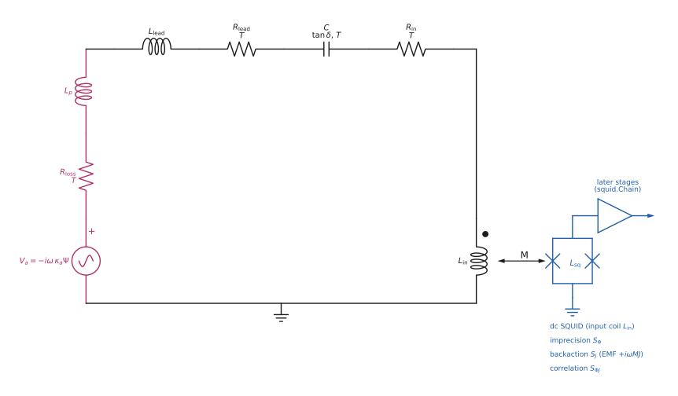

# Readout circuit network

Here *the spec* is [scan_and_signal.md](scan_and_signal.md), the specification of the signal and scan model; "spec
Sec. n" and the tags "(S*)" refer to it.

**Scope:** the linear
circuit between the FEM pickup and the SQUID — tuning capacitor, SQUID input coil,
leads, flux/matching transformers — its signal transfer, its Johnson and amplifier
noise, and its exact reduction to the inputs the optimal scan already uses.
**Implementation:** `python/axionfem/circuit.py`; `Results.readout(...)`.
**Tests:** `tests/test_circuit.py`.
**Depends on:** `docs/physics/scan_and_signal.md` (equation tags `(S*)` below refer to
it; `[C]` = Chaudhuri et al. arXiv:1803.01627, `[BF]` = arXiv:1904.05806,
`[MQS]` = arXiv:2211.00008).




*The plain series topology of `series_readout` (Secs. 2–4): the pickup branch (EMF
$\mathcal E_{\rm pickup}=-i\omega\kappa_a\Psi_{\rm SI}$, $Z_p=R_{\rm loss}-i\omega L_p$), leads,
tuning capacitor and SQUID input coil, coupled by $M$ to the SQUID loop. Every dissipative element
carries its own Johnson EMF (C4.1); the SQUID adds imprecision $S_\Phi$, backaction $S_J$ and their
correlation $S_{\Phi J}$ (C4.5). Drawn by `Readout.draw(annotate=False)` from the object itself
(Sec. 7.1); generated by `docs/images/make_circuit_figure.py`.*

---

## 1. Conventions

### 1.1 Time convention and element impedances

The package's full-wave engine uses $e^{-i\omega t}$ and reports the readout impedance as
$Z = R - i\omega L$ (`cpp/src/model.cpp` writes `Z_im_ohm` $= -\omega L$). The circuit module uses the same convention
throughout, so $\partial_t \to -i\omega$ and

$$Z_R=R,\qquad Z_L=-i\omega L,\qquad Z_C=\frac{i}{\omega C},\qquad
Z_{jk}=-i\omega M_{jk}\ (j\neq k). \tag{C1.1}$$

A series $R$–$L$–$C$ loop therefore has
$Z(\omega)=R-i\left(\omega L-\tfrac1{\omega C}\right)$, which is **capacitive**
($\operatorname{Im}Z>0$) below resonance and inductive above it — the opposite sign to the
$e^{+i\omega t}$ textbook convention, with identical $|Z|$.

### 1.2 Modified nodal analysis

Every two-terminal element is a *branch* with an unknown current $I_b$ flowing from its
$p$ to its $m$ terminal, and a constitutive law

$$V_p-V_m=\sum_{b'}Z_{bb'}I_{b'}-\mathcal E_b \tag{C1.2}$$

(a positive EMF $\mathcal E_b$ drives positive current in the $p\to m$ direction, so a
branch closed by $Z_{\rm ext}$ carries $I=\mathcal E/(Z+Z_{\rm ext})$). With the incidence
matrix $A_{nb}$ ($+1$ at $p$, $-1$ at $m$) and Kirchhoff's current law, the system is

$$\begin{pmatrix}0&A\\A^{\mathsf T}&-Z\end{pmatrix}
\begin{pmatrix}V\\I\end{pmatrix}=\begin{pmatrix}J\\-\mathcal E\end{pmatrix}. \tag{C1.3}$$

Making *every* element a current unknown costs a few extra rows (these networks have
$O(10)$ branches) and buys three things: mutual inductance, ideal voltage sources and
zero-impedance shorts all use the same stamp; the matrix is **symmetric** for every
reciprocal network, which is checked at run time (`Circuit.check_reciprocity`); and any
branch can be given a series noise EMF without rebuilding the network.

An ideal transformer of turns ratio $n=N_2/N_1$ is the one four-terminal element. Its
unknown is the secondary current $I_2$ (into $p_2$), with incidence entries
$A_{p_1}=+n$, $A_{m_1}=-n$, $A_{p_2}=-1$, $A_{m_2}=+1$ and $Z=\mathcal E=0$. Then
$A^{\mathsf T}V=0$ gives $V_2=nV_1$, the incidence column gives $I_1=-nI_2$, and hence
$V_1I_1+V_2I_2=0$ identically: the element is lossless by construction.

### 1.3 PSD normalisation

PSDs follow Foster, Rodd & Safdi, as everywhere else in the package
(`scan_and_signal.md` Sec. 3.2): $\langle X^2\rangle=\frac1\pi\int_0^\infty d\omega\,S_X$,
i.e. **half** the one-sided-in-$\nu$ PSD. Voltage PSDs are in V²s, current PSDs in A²s,
flux PSDs in Wb²s.

---

## 2. The pickup as a source branch

The pickup is a single branch with a series EMF and the pickup impedance:

$$\mathcal E_{\rm pickup}(\omega)=-i\omega\,\kappa_a\Psi_{\rm SI},\qquad
\kappa_a=g_{a\gamma\gamma}\sqrt{2\rho_{\rm DM}},\qquad \Phi_a=\kappa_a\Psi_{\rm SI}
\tag{C2.1}$$

with $\Psi_{\rm SI}=\mu_0\Psi$ [T H m²] and $\kappa_a$ in H⁻¹ (S2.2–S2.3; the sign
follows [design_format.md](../design_format.md), and only fixes an overall phase).
`circuit.kappa_a_SI` reproduces the spec's check value
$\kappa_a=8.65882567\times10^{-19}$ H⁻¹ at $g=10^{-19}$ GeV⁻¹, $\rho=0.3$ GeV/cm³.

Two pickup impedances are supported (`circuit.pickup_impedance`):

* **MQS:** $Z_p(\omega)=R_{\rm loss}(\omega)-i\omega L_p$, with $L_p$ from
  `results["coupling"]["L_p_H"]` and $R_{\rm loss}$ from an explicit value, from a quality
  factor ($R=\omega L_p/Q$), or from the RF surface losses the solver already computes,
  `results["pickup"]["losses"]["surfaces"][*]["R_eff_ohm"]` with
  $R_{\rm eff}=R_s(f)\,\Gamma$, $\Gamma=\frac1{I^2}\int|H_t|^2dA$.
  Those are stored (summed over surfaces) at the two edges of the design's scan band and
  interpolated as a power law $R\propto f^{\,p}$ whose exponent is read off the data
  ($p=2$ for a superconductor, $1/2$ for a normal metal) rather than assumed. The band
  edges are not echoed in the results document, so they are recovered from the stored
  $Q=2\pi fL_p/R_{\rm eff}$ as $f=Q\,R_{\rm eff}/(2\pi L_p)$.
* **Full wave:** $Z_p(\omega)$ interpolated from `results["fullwave"]["sweep"]`
  (`Z_re_ohm` $+$ `R_loss_ohm`, and `L_H`), which already carries the radiation resistance
  and the frequency dependence of the inductance. The interpolation is done on $R(f)$ and
  $L(f)=-\operatorname{Im}Z/\omega$ — both smooth and nearly constant in the MQS limit — so
  that $Z\to-i\omega L$ stays exact between the samples and as $\omega\to0$; interpolating
  $\operatorname{Im}Z$ directly would not. This is the Thévenin reduction of [MQS]
  (its supplement: drive the lumped port to get $Z_S$, restore the axion current to get the
  source EMF).

---

## 3. Signal transfer

Let $\Phi_{\rm SQ}=M\,I_{\rm in}$ be the flux coupled into the SQUID loop by the input coil
and define the transfer functions (one network solve each)

$$H_s(\omega)\equiv\frac{\Phi_{\rm SQ}}{\mathcal E_{\rm pickup}}\ \ [\mathrm{Wb/V}],\qquad
Z_{\rm eff}(\omega)\equiv\frac{\mathcal E_{\rm pickup}}{I_{\rm pickup}}\ \ [\Omega],\qquad
M_{\rm eff}(\omega)\equiv H_sZ_{\rm eff}=\frac{\Phi_{\rm SQ}}{I_{\rm pickup}}. \tag{C3.1}$$

$Z_{\rm eff}$ is the driving-point impedance *including* the pickup's own $Z_p$ — the series
impedance of the loop closed through the pickup — and $M_{\rm eff}$ is the mutual
inductance an equivalent single loop would need. For the plain series topology
$H_s=M/Z$ and $M_{\rm eff}=M$.

The SQUID's input impedance is neglected, as in [C] Eq. (E33): $M$ does not load the
circuit, so the loaded $Q$ is set by the circuit's own losses and the internal and loaded
$Q$ coincide ([C] Sec. F 3). Consequently $Z_{\rm eff}$, $Q$ and $T_{\rm eff}$ are
independent of $M$, and $M$ only scales $H_s$.

**Flux conservation check.** For a lossless superconducting loop $L_p+L_{\rm in}$ driven by
an applied flux $\Phi$ ($\mathcal E=-i\omega\Phi$), (C1.2) gives
$I=\Phi/(L_p+L_{\rm in})$ at *every* frequency, so

$$\frac{\Phi_{\rm SQ}}{\Phi}=\frac{M}{L_p+L_{\rm in}}
=\frac{k\sqrt{L_{\rm in}L_{\rm SQ}}}{L_p+L_{\rm in}}, \tag{C3.2}$$

maximised at $L_{\rm in}=L_p$ — the textbook inductance match, $\Phi_{\rm SQ}/\Phi=
\tfrac{k}2\sqrt{L_{\rm SQ}/L_p}$. **This is *not* the optimum for a scan** (Sec. 6).
For a flux transformer ($L_1$ coupled by $k$ to $L_2+L_{\rm load}$), fluxoid conservation
in both loops gives

$$I_1=\frac{\Phi(L_2+L_{\rm load})}{D},\quad I_2=-\frac{\Phi M}{D},\quad
D=L_1\big[L_2(1-k^2)+L_{\rm load}\big],\quad M=k\sqrt{L_1L_2}, \tag{C3.3}$$

which is singular for $k=1$, $L_{\rm load}=0$ (a perfectly coupled, shorted secondary is a
short across the primary).

On resonance the flux *gain* $|\Phi_{\rm SQ}|/\Phi_a\sim QM/L$ is routinely $\gg1$; it is a
resonant gain, not an efficiency, and should not be confused with (C3.2).

---

## 4. Noise

### 4.1 Johnson noise of every dissipative element

Each branch with $\operatorname{Re}Z_b>0$ at temperature $T_b$ carries an independent
series EMF with (fluctuation–dissipation, spec S3.3)

$$S_{V,b}(\omega)=\operatorname{Re}Z_b(\omega)\,\hbar\omega\big[2n(\omega,T_b)+1\big]
\ \xrightarrow{\ \hbar\omega\ll k_BT\ }\ 2k_BT_bR_b,\qquad
n=\frac1{e^{\hbar\omega/k_BT}-1}. \tag{C4.1}$$

They are mutually independent because the mutual terms $-i\omega M$ are purely reactive, so
the branch noise matrix $\propto\operatorname{Re}Z$ stays diagonal (Sec. 8, limitation 3).
Summing over branches,

$$S_\Phi^{\rm th}(\omega)=\sum_b|H_b(\omega)|^2S_{V,b}(\omega),\qquad
H_b\equiv\frac{\Phi_{\rm SQ}}{\mathcal E_b}. \tag{C4.2}$$

**Nyquist self-test.** At a *uniform* temperature, a passive reciprocal network must satisfy

$$\sum_b\left|\frac{T_{b,p}}{T_{pp}}\right|^2\operatorname{Re}Z_b
=\operatorname{Re}Z_{\rm eff}(\omega)\quad\text{for all }\omega,\qquad
T_{bc}\equiv\frac{I_c}{\mathcal E_b} \tag{C4.3}$$

— Nyquist's theorem for the Thévenin source seen in series with the pickup branch (the
network outside the cut contributes $\operatorname{Re}[Z_{\rm eff}-Z_p]$, the pickup's own
resistance $\operatorname{Re}Z_p$). The temperatures cancel, so (C4.3) is an identity that
holds whatever the branch temperatures are: `Circuit.nyquist_check` returns its relative
error and `Readout.equivalent` reports it as `R_noise_over_R_eff`. It holds to
$\lesssim2\times10^{-16}$ on every network in the test suite, including one with mutual
inductance, a lossy capacitor and a transformer.

**The referral matters, and must be the pickup current.** (C4.3) is a statement about the
noise referred to a series EMF *in the pickup branch*, so the transfer that appears in it is
$T_{b,p}/T_{pp}$ — the pickup current per unit branch EMF. Referring it instead with the flux
transfer $H_b/H_s$ coincides only when every branch carries the same current, i.e. in a plain
series chain. With a parallel path the flux referral fails: with a parasitic capacitance across
the pickup and three lossy branches the "identity" would read $0.628$ at $\omega/\omega_0=0.01$,
and with a flux transformer ($k=0.2$) $5.6\times10^{7}$ — while the current referral that
`equivalent` uses is $1$ to $10^{-15}$ at the same points (regression test in
`tests/test_finite_band.py`). This concerns only the diagnostic: the noise itself, (C4.2) and
(C4.5), is referred to the SQUID flux and then divided by $|H_s|^2$, which is correct by
construction.

### 4.2 Amplifier noise ($\eta_A$, $\xi$)

The SQUID is parametrised exactly as in spec S3.5: imprecision flux PSD $S_\Phi$ and
backaction circulating-current PSD $S_J$, with

$$\eta_A=\frac{2\sqrt{S_\Phi S_J}}\hbar\ (=1\ \text{at the SQL}),\qquad
\xi=\frac{2R_{\rm eff}S_\Phi}{\hbar\omega_0|M_{\rm eff}|^2}. \tag{C4.4}$$

Imprecision adds $S_\Phi$ directly to the flux PSD; backaction is a series EMF
$\mathcal E_{\rm ba}=+i\omega MJ$ in the input-coil branch, i.e. a flux PSD
$|H_{\rm in}|^2\omega^2M^2S_J$.

**Sign of the backaction EMF.** $J$ is the SQUID's circulating current, oriented so that the
input coil couples to the SQUID loop with the same $M$ that gives $\Phi_{\rm SQ}=+MI_{\rm in}$.
In the constitutive law (C1.2) the mutual stamp $Z_{\rm in,sq}=-i\omega M$ (C1.1) puts
$-i\omega MJ$ on the *impedance* side, $V_p-V_m=\dots-i\omega MJ-\mathcal E_{\rm in}$; as an
EMF that is $\mathcal E_{\rm ba}=+i\omega MJ$, i.e. Faraday's $-d(MJ)/dt$ with
$\partial_t\to-i\omega$. This is what the code uses (`Squid.correlation_term`, shared by
`Readout.noise_psd` and `MultiportReadout.noise_psd`; `squid_chain.md` Sec. 4), and
`tests/test_squid.py::test_backaction_emf_sign_is_the_mutual_stamp` checks it by adding the SQUID
loop to the network as an inductor with a pinned current $J$, coupled by `Circuit.mutual`
(series loop, multiport, real flux transformer; both signs of $M$). The sign is invisible in
the backaction PSD $\propto|{\pm}i\omega MJ|^2$ and matters only for the correlated term
$2\operatorname{Re}[(i\omega MH_{\rm in})^*S_{\Phi J}]$: writing the EMF as $-i\omega MJ$
is the same as replacing $S_{\Phi J}\to-S_{\Phi J}$, i.e. flipping the (open) correlation
sign $s$. A statement of $s$ is therefore a statement in *these* orientations ($J$ as above,
$S_{\Phi J}=\langle\Phi_nJ^*\rangle$). (The flux-conservation check of Sec. 3 drives
$\mathcal E=-i\omega\Phi$: there $\Phi$ is the applied flux counted in the opposite orientation,
which only fixes an overall sign of the currents.) In total, referred to the SQUID flux and then to a series
EMF in the pickup branch,

$$N_V(\omega)\equiv\frac{S_\Phi^{\rm tot}(\omega)}{|H_s(\omega)|^2}
=\underbrace{\sum_b\Big|\frac{H_b}{H_s}\Big|^2S_{V,b}}_{\text{thermal}}
+\underbrace{\Big|\frac{H_{\rm in}}{H_s}\Big|^2\omega^2M^2S_J}_{\text{backaction}}
+\underbrace{\frac{S_\Phi}{|H_s|^2}}_{\text{imprecision}},\qquad
s(\omega)=\frac{S_{V,a}(\omega)}{N_V(\omega)}. \tag{C4.5}$$

Referring both signal and noise to the same place makes $s(\omega)$ identical to spec
(S3.6), so **the exact per-bin signal-to-noise ratio of any network is $S_{V,a}/N_V$ with
$N_V$ from (C4.5)**, and every statistic downstream (S4.1–S5.10, S6.1–S6.4) applies
unchanged.

For the plain series loop $H_b=H_{\rm in}=H_s$ and $H_s=M/Z$, so (C4.5) collapses to
$N_V=\sum_bR_b\hbar\omega(2n_b+1)+\omega^2M^2S_J+|Z|^2S_\Phi/M^2$ — spec (S3.6) term by
term. `tests/test_circuit.py` checks this against the C++ `psd_at_tuning` on 69
frequencies spanning $\pm30$ noise-doubling widths plus the axion line: agreement to
$5\times10^{-14}$ in $N_V$ and to round-off in each of the three parts.

---

## 5. Reduction to a single pole: the scan inputs

The optimal scan (spec Sec. 5) takes a detector $(\Psi,L,Q,T,\eta_A)$. The network is
reduced to one at its resonance as follows (`Readout.equivalent`):

| quantity | definition | series loop |
|---|---|---|
| $\omega_0$ | $\operatorname{Im}Z_{\rm eff}(\omega_0)=0$ (bisection in $\log\omega$) | $1/\sqrt{L_{\rm tot}C}$ |
| $R_{\rm eff}$ | $\operatorname{Re}Z_{\rm eff}(\omega_0)$ | $\sum_bR_b$ |
| $L_{\rm eff}$ | $\tfrac12\left\lvert d\operatorname{Im}Z_{\rm eff}/d\omega\right\rvert _{\omega_0}$ | $L_p+L_{\rm in}+L_{\rm lead}$ |
| $Q$ | $\omega_0L_{\rm eff}/R_{\rm eff}$ | $\left(\sum_bQ_b^{-1}\right)^{-1}$ |
| $n_{\rm eff}$ | $\sum_b\big\lvert \tfrac{H_b}{H_s}\big\rvert ^2R_b(2n_b+1)=R_{\rm eff}(2n_{\rm eff}+1)$ | $T_{\rm eff}/Q=\sum_bT_b/Q_b$ |
| $\xi$ | (C4.4) | $2R_0S_\Phi/\hbar\omega_0M^2$ |
| $\eta_A^{\rm eff}$ | $N_V^{\rm ba}=\tfrac{\hbar\omega_0R_{\rm eff}}{2\xi}(\eta_A^{\rm eff})^2$ | $=\eta_A$ |

$L_{\rm eff}$ is the standard reactance-slope inductance of a resonance,
$Q=\frac{\omega_0}{2R}\left|dX/d\omega\right|$; for a series RLC
$dX/d\omega=-(L+1/\omega^2C)=-2L$ at $\omega_0$, so $L_{\rm eff}=L$ exactly, and a
transformer-coupled or dispersive ($dL/d\omega\neq0$) network gets its correct reflected
and dispersive contributions automatically.

$n_{\rm eff}$ is defined so that the referred thermal noise is reproduced exactly; it is the
multi-channel rule $2n+1\to\sum_b(Q/Q_b)(2n_b+1)$ of [scan_and_signal.md](scan_and_signal.md) Sec. 3.4,
i.e. $T_{\rm eff}/Q=\sum_bT_b/Q_b$ classically — the only place that rule is actually
*derived* rather than asserted.

$\eta_A^{\rm eff}$ absorbs whatever sits between the pickup and the input coil. Write $T_{bc}$
for the current in branch $c$ produced by a unit EMF in branch $b$ (so $T_{bc}=T_{cb}$, the
network being reciprocal, and $T_{pp}=1/Z_{\rm eff}$). Then
$\xi\propto|T_{p,{\rm in}}/T_{pp}|^{-2}$ and
$N_V^{\rm ba}\propto|T_{{\rm in},{\rm in}}/T_{p,{\rm in}}|^2$, so

$$\eta_A^{\rm eff}=\eta_A\,\frac{|T_{pp}|\,|T_{{\rm in},{\rm in}}|}{|T_{p,{\rm in}}|^2}
\equiv\frac{\eta_A}{\text{\tt port\_coupling}},\qquad
\text{\tt port\_coupling}\equiv\frac{|T_{p,{\rm in}}|^2}{|T_{pp}||T_{{\rm in},{\rm in}}|}.
\tag{C5.1a}$$

**If all the dissipation sits in the pickup branch**, with resistance $R$, then a unit EMF at
either port delivers a power that is entirely dissipated in that one resistor, which gives
$|T_{pp}|^2R=\operatorname{Re}T_{pp}$ (hence $T_{pp}=1/R$ at resonance) and
$|T_{p,{\rm in}}|^2R=\operatorname{Re}T_{{\rm in},{\rm in}}$, so (C5.1a) collapses to

$$\text{\tt port\_coupling}=\frac{\operatorname{Re}T_{{\rm in},{\rm in}}}
{|T_{{\rm in},{\rm in}}|}=\cos\big(\arg T_{{\rm in},{\rm in}}\big). \tag{C5.1b}$$

and the phase of $T_{\rm in,in}$ is set by the quality factor of the loop seen *through the
coupling* with the pickup port open. Writing that $Q_1$ (for a flux transformer with primary
$L_1$, secondary $L_2$ and coupling $M=k\sqrt{L_1L_2}$ feeding $L_{\rm in}$,
$Q_1=\omega_0M^2/[(L_2+L_{\rm in})R]$),

$$\boxed{\ \text{\tt port\_coupling}=\frac{Q_1}{\sqrt{1+Q_1^2}},\qquad
\eta_A^{\rm eff}=\eta_A\sqrt{1+Q_1^{-2}}\ }\tag{C5.1c}$$

verified against the code to 7 digits at 25 points spanning $Q_p=10^2$–$2\times10^7$ and
$k=0.01$–$1$ (`tests/test_finite_band.py`). So

> **$\eta_A$ is invariant under a lossless reciprocal coupling network only when
> $Q_1\gg1$** — a strongly coupled, high-$Q$ loop. Then the network is a pure impedance
> transformation: it moves $L_{\rm eff}$ and $\xi$, never $\eta_A$. When $Q_1\lesssim1$ —
> weak coupling, a low-$Q$ pickup, or both — the amplifier really is degraded, by
> $\sqrt{1+Q_1^{-2}}$, *even though nothing in the coupling path dissipates*.

`port_coupling` is close to 1 for a lossless coupling network only when $Q_1\gg1$ (e.g. at
$Q_p=10^6$–$2\times10^7$). Counter-examples: $Q_p=100$, $k=0.02$, $L_1=L_2=L_p$,
$L_{\rm in}=0.1L_p$ gives $Q_1=0.0364$, `port_coupling` $=0.0363$ and
$\eta_A^{\rm eff}=27.5\,\eta_A$; $Q_p=10^4$, $k=0.01$ gives $Q_1=0.909$ and
`port_coupling` $=0.673$. `equivalent` reports $Q_1$ back as `coupling_Q1`, so the regime is
visible without re-deriving it.

Two cases that genuinely do not degrade the amplifier (both have $Q_1=\infty$: the pickup and
the input coil carry the same current):

* an **ideal transformer** of ratio $n$ raises $|H_{\rm in}/H_s|^2$ to $1/n^2$ but lowers
  $|M_{\rm eff}|^2$ to $n^2M^2$, and the two cancel exactly. It changes only $L_{\rm eff}$
  (by the reflected $L_{\rm in}/n^2$), hence $Q$ and the participation.
* a **parasitic capacitance** $C_{\rm par}$ across the pickup. With the loop retuned,
  $C_{\rm tune}=1/(\omega_0^2L_p)-C_{\rm par}$, and the pair is a *capacitive tap* of ratio
  $t=C_{\rm tune}/(C_{\rm par}+C_{\rm tune})=1-\omega_0^2L_pC_{\rm par}$: $L_{\rm eff}$, $Q$,
  $T_{\rm eff}$ and $\eta_A^{\rm eff}$ are all unchanged, while $M_{\rm eff}\to tM$ and
  therefore $\xi\to\xi/t^2$. A parasitic capacitance is a **coupling knob, not a loss** — it
  trades against $M$, and only hurts as $t\to0$ at the self-resonance
  $C_{\rm par}\to1/(\omega_0^2L_p)$, where the loop cannot be tuned at all.

Besides the finite-$Q_1$ effect of (C5.1c), `port_coupling` also moves when the *coupling path
itself* dissipates: a parasitic capacitor with $\tan\delta=10^{-2}$ gives
$1-1.8\times10^{-5}$. With loss in more than one branch the derivation of (C5.1b) no longer
applies and `port_coupling` can exceed 1 (1.02 with $R_2=0.1\,\Omega$ in a two-loss network),
so it is a diagnostic, not a bound. The exact $N_V$ of (C4.5) never relies on any of this; only
the *reduced* detector does, through $\eta_A^{\rm eff}$ — which is why `analyze(reach=True)` and
`scan_inputs` both pass $\eta_A^{\rm eff}$ and not $\eta_A$ (with the $Q_p=100$, $k=0.02$
transformer above, using $\eta_A$ would give $g_{95}=9.66\times10^{-19}$ instead of
$2.21\times10^{-18}$, a reach overstated by $2.3\times$).

A note on the numerics of $\omega_0$. `tune` finds the tuning capacitance from the closed form
$C=-1/(\omega X_{\rm rest})$ and then refines it by bisection on
$\operatorname{Im}Z_{\rm eff}=0$. For a plain series loop the closed form is already exact, so
the residual sits at round-off, and *one ulp of $C$ moves $\operatorname{Im}Z_{\rm eff}$ by more
than the residual* ($\partial X/\partial C=1/\omega C^2$). The closed form is therefore accepted
whenever $|\operatorname{Im}Z_{\rm eff}|\le10^{-12}/(\omega C)$, and the bracket handed to the
bisection keeps the two endpoints that were actually evaluated rather than recomputing one of
them. (Before that, a round-off sign flip at the endpoint could make the bisection return the
bracket end — a 15 % error in $C$ with $\operatorname{Im}Z_{\rm eff}\ne0$, at isolated
frequencies; `tests/test_finite_band.py::test_tune_is_exact_over_a_decade_of_frequencies` now
checks $C\omega^2L=1$ to $10^{-14}$ over 200 tunings.)

With these definitions,

$$N_V(\omega_0)=\frac{\hbar\omega_0R_{\rm eff}}{2\xi}
\left[\xi^2+2(2n_{\rm eff}+1)\xi+(\eta_A^{\rm eff})^2\right]
=\frac{\hbar\omega_0R_{\rm eff}}{2\xi}A \tag{C5.1}$$

**exactly, by construction** (reported as `N_V_reduction_resid`, $\le2\times10^{-16}$ in the
tests), and spec (S3.7)–(S3.12) then give $A$, $\bar G=\xi/A^{3/2}$, $\xi_{\rm opt}$, the
three sensitivity bandwidths and the ring-up time.

### 5.1 The hand-off, and why $L_{\rm eff}$ carries the penalty

The scan rate (S5.2) is
$\dot\omega_0=\frac{\pi^2}8\frac{Q_a}{\Theta}\frac{\Phi_a^4}{\hbar^2L^2}Q\bar G$,
derived with $R_0=\omega_0L/Q$ and $\Phi_a$ the flux of the pickup. In a network, $R_0$ and
$Q$ belong to the whole loop while $\Phi_a$ still belongs to the pickup alone, so

$$\boxed{\ \text{scan inputs}=\big(\Psi_{\rm SI},\ L_{\rm eff},\ Q,\ T_{\rm eff},\
\eta_A^{\rm eff}\big)\ }\qquad
\dot\omega_0\Big|_{\rm network}=\dot\omega_0\Big|_{L_p}\times\left(\frac{L_p}{L_{\rm eff}}\right)^{2} \tag{C5.2}$$

— which is precisely the $(L_{\rm PU}/L)^2$ factor of [C] Eq. (F37) (amplitude
$L_{\rm PU}/L$ in its Eq. F26, and $R/(L_{\rm PU}+L_{\rm IN})$ in its F34/F35). Passing
$L_{\rm eff}$ instead of $L_p$ to the existing `scan.reach` therefore reproduces the
degradation with no change to the scan code at all; equivalently the figure of merit becomes
$\mathcal F=\Psi^4/L_{\rm eff}^2$ and the reach degrades by $(L_{\rm eff}/L_p)^{1/2}$. The
participation ratio $L_p/L_{\rm eff}$ is reported as `participation`.

Note what does *not* degrade: the on-resonance kernel

$$K=\frac{\pi}8\,Q_a\,\frac{\omega_0^3\Phi_a^4}{N_V(\omega_0)^2}\quad[\mathrm{s^{-1}}]
\tag{C5.3}$$

(spec S6.3; no $\hbar$ appears in SI because
$\mathrm{Wb^4s^{-3}/(V^2s)^2=s^{-1}}$) is independent of $L$ at fixed $R$: a larger total
inductance narrows the band without changing the on-resonance SNR. The scan rate is
$K\,\Delta\omega_{\rm eq}/\Theta$, and `tests/test_circuit.py` checks that this reproduces
all five of the spec's reference scan rates (toy A at 0.5/1/4.1 neV, toy B at 1 neV) to
$5\times10^{-10}$ — the precision of the quoted reference digits.

### 5.2 Diagnostics

`equivalent()` reports, besides the numbers above:

| key | meaning | ideal |
|---|---|---|
| `react_resid` | $\lvert\operatorname{Im}Z_{\rm eff}\rvert/\lvert Z_{\rm eff}\rvert$ at $\omega_0$ | 0 |
| `R_noise_over_R_eff` | the Nyquist identity (C4.3) | 1 |
| `backaction_transfer_ratio` | $\lvert H_{\rm in}/H_s\rvert^2$ | 1 (series) |
| `port_coupling` | (C5.1a), $=\eta_A/\eta_A^{\rm eff}$ | $Q_1/\sqrt{1+Q_1^2}$ (C5.1c) |
| `coupling_Q1` | $Q_1$ recovered from `port_coupling` | $\gg1$ for an undegraded $\eta_A$ |
| `reciprocity_resid` | $\lvert T-T^{\mathsf T}\rvert/\max\lvert T\rvert$ of the branch transfer matrix, from solves | 0 |
| `matrix_symmetry_resid` | $\lvert K-K^{\mathsf T}\rvert/\max\lvert K\rvert$ of the assembled matrix | 0 (tautological) |
| `N_V_reduction_resid` | (C5.1) vs the exact $N_V$ | 0 |

`react_resid`, `R_noise_over_R_eff`, `reciprocity_resid` and `N_V_reduction_resid` are
*correctness* checks and should always hold (they do, to $\lesssim10^{-9}$, on every network
in the test suite). `matrix_symmetry_resid` is a *tautology* for the present element set — the
stamp $\begin{pmatrix}0&A\\A^{\mathsf T}&-Z\end{pmatrix}$ is symmetric by construction whenever
$Z$ is, and a complex $M$ is rejected — so it returns exactly 0 and is kept only as a guard for
a future non-reciprocal element; `reciprocity_resid` is the statement with content, because it
goes through the incidence matrix, the transformer stamp, the solve and the extraction.
`backaction_transfer_ratio` and `port_coupling` are *physics*:
the first says the backaction EMF is not referred like the signal EMF, the second says how much
of that actually costs anything.

---

## 6. Matching: three different optima

The three "optimal couplings" that appear in this problem are genuinely different, and the
module reports all of them.

1. **Maximum power transfer / conjugate match.** A source $(\mathcal E,Z_s)$ delivers
   maximum power to $Z_L=Z_s^*$, namely $P_{\max}=|\mathcal E|^2/(8\operatorname{Re}Z_s)$.
   This is the right optimum for a single measurement of power and nothing else.
2. **Flux/energy transfer match, $L_{\rm in}=L_p$** (C3.2). The right optimum when the
   amplifier is characterised by an energy resolution alone and backaction is negligible.
3. **Scan match, $\xi=\xi_{\rm opt}$** (spec S3.9, [C] F54), with
   $L_{\rm PU}\gg L_{\rm IN}$ so that $L_{\rm eff}\to L_p$. This is the right optimum here,
   and [C] is explicit that it is *not* (2): *"to maximize SNR, we should choose the pickup
   inductance to be much larger than the input inductance… integrated sensitivity, rather
   than energy transfer, is the figure of merit"* ([C] App. F 3). Sitting at a single
   frequency instead maximises $\xi/A$, i.e. $\xi=\eta_A$, the noise match ([C] F36) — a
   fourth optimum, appropriate for following up a candidate.

---

## 5.3 Beyond the single pole: the exact $N_V(\omega)$ in the finite band

The reduction above is a resonance expansion (limitation 5). When it is not good enough, the
*exact* $N_V(\omega)$ of (C4.5) goes straight into the finite-band machinery of spec Sec. 6
instead — no single pole anywhere in the chain. Everything Sec. 6 needs from the readout is
$N_V(\omega)$ per setting plus the pickup's $\Psi$, because

$$K_j(m)=\frac1{2\pi}\int d\omega\,h\!\big(s_j(\omega)\big),\qquad
s_j=\frac{S_{V,a}(\omega;\Phi_a)}{N_{V,j}(\omega)}\tag{S6.1}$$

and $S_{V,a}$ depends only on $\Phi_a=\kappa_a\Psi_{\rm SI}$ and the line shape (S3.2). The C++
side therefore takes the noise as *data*:

| C++ (`axf::scan`) | what it does |
|---|---|
| `NoiseCurve {omega_rad_s, N_V_V2_s}`, `.at(omega)` | a tabulated $N_V(\omega)$ for one setting; log-log interpolation (every term of (C4.5) is a power law in $\omega$ or in the detuning, so log-log is exact in each limit and smooth through the resonance) |
| `kernel_row_noise(Psi_SI, m_a, g, noise[], stat, params, n_v)` | (S6.1)–(S6.2) with the exact $N_V$ of each setting |
| `kernel_narrow_line_noise(Psi_SI, m_a, g, N_V(omega_a), params)` | (S6.3) |
| `g95_band` / `reach_band` | $\sum_jt_jK_j(m)=\Theta$ at one target / over a list of targets |
| `lp_schedule(K, Theta)` | unchanged (S6.4) |

and the Python side drives it (`axionfem.scan.finite_band`, `axionfem.circuit.Readout.noise_curve`):

```python
r = ck.series_readout(L_p_H=..., Psi_SI=..., f_Hz=1.209e5, Q=1e4, T_K=0.030, eta_A=10.0)
out = scan.finite_band(r, 120.9e3, 400e3, n_settings=200, n_targets=120,
                       xi_factors=(0.3, 1.0, 3.0))     # tune, tabulate N_V, build K, LP, reach
out["schedule"]["t_total_s"], out["reach"]["g95_GeV"], out["comparison"], out["band"]
```

`finite_band` also takes a *factory* `f0 -> Readout`, for a network that itself depends on the
tuning (a surface resistance quoted at the operating point, a full-wave $Z_p(\omega)$ and
$\Psi(\omega)$). `Readout.noise_curve` lays the $N_V$ grid out in the detuning, in units of the
noise-doubling half width, and `finite_band` merges a band-wide grid into it (`band_points`) so
that structure sitting at a *fixed* frequency — a self-resonance of $Z_p$ — is resolved too.

**What this buys, measured** (`docs/validation/finite_band.md`, `benchmarks/finite_band.py`):

| case | $\Delta\omega_{2\times}/\omega_0$ | on-resonance $K$ | max $K$ | LP time | coverage of the pole's plan | reach the pole claims |
|---|---|---|---|---|---|---|
| high-$Q$ network ($L_{\rm in}$, leads, lossy $C$) | 0.10 | $5\times10^{-7}$ | +1.9 % | $\times1.0010$ | 0.9944 | +0.17 % |
| normal metal, $Q=300$ | 5.97 | $3\times10^{-7}$ | +30 % | $\times1.184$ | 1.076 | +6.0 % |
| normal metal, $Q=10^3$ | 1.79 | $4\times10^{-7}$ | +22 % | $\times1.053$ | 1.036 | +4.4 % |
| radiation limited, $R\propto\omega^4$ | 0.022 | $3\times10^{-6}$ | +28 % | $\times1.003$ | 0.839 | +2.8 % |

So a high-$Q$ network reproduces the reduced-detector scan rate and reach (the point of
limitation 5's "across a wide band"), while a low-$Q$ or radiation-limited pickup does not. In
both failing cases the single pole recovers the exact answer once it is told the resistance
exponent, `Detector::R_exp` ($R=R_0(\omega/\omega_0)^{R_{\rm exp}}$): $1/2$ for the skin effect,
$4$ for magnetic-dipole radiation, which brings the kernel error down to the $10^{-3}$
interpolation floor. That is the cheap fix; the exact $N_V$ is the general one.

The same machinery reproduces the spec's Sec. 6 reference demonstration from the circuit: local
schedule time to $7\times10^{-5}$, LP total time to $6\times10^{-4}$, LP/local $1.1727$ versus
$1.1735$, interior coverage $1.054$–$1.125$ versus $1.051$–$1.125$, and (S6.3) against (S6.1) to
$8\times10^{-5}$ (reference $7\times10^{-5}$).

---

At $\xi_{\rm opt}$ the readout is backaction-dominated and the sensitivity bandwidth is
$\sqrt A/\xi\simeq\sqrt3(2n+1)/\eta_A$ linewidths, versus $\simeq2\sqrt n$ at the noise
match: at $n=50$, $\eta_A=1$ the module gives 14.3 and 175.0, reproducing [BF] Fig. 3's
"$\approx14$" and "$\approx173$" (note [BF]'s stated formula $2n/\sqrt3$ is a typo for
$2\sqrt3\,n$; its *number* is right). `Readout.match_xi()` rescales $M$ to $\xi_{\rm opt}$,
and `M_for_xi_opt_H` reports the required mutual inductance.

---

## 7. Usage

```python
from axionfem import circuit as ck

# DMRadio-style: pickup + tuning C + SQUID input coil + leads, tuned to 120.9 kHz
r = ck.series_readout(L_p_H=1.26e-6, Psi_SI=1.26e-5, f_Hz=1.209e5,
                      Q=1e6, T_K=0.030, eta_A=10.0,          # pickup loss, temperature, SQUID
                      L_in_H=1.3e-7, R_in_ohm=1e-8,           # input coil
                      lead_length_m=2.0, L_per_m=1e-7, R_per_m=1e-9, T_lead_K=4.0,
                      tan_delta=1e-6)                         # capacitor loss
print(r.summary())                 # resonance, Q, T_eff, xi, G-bar, signal, noise budget
a = r.analyze(1.209e5, reach=True) # + axionfem.scan.reach with the reduced inputs
sw = r.sweep(np.linspace(1.2e5, 1.22e5, 201))   # N_V and Phi_SQ versus frequency
nc = r.noise_curve()                            # the exact N_V(omega) for the Sec. 6 kernel
```

From a solved design:

```python
res = af.template("toroid", R=1.0, H=1.0).solve()
out = res.readout(f_Hz=1.209e5, benchmark="conservative", L_in_H=0.1 * res.L_p)
print(out["readout"].summary(out["f0_Hz"]))
print(out["scan_inputs"])          # (Psi, L_eff, Q, T_eff, eta_A) for the optimal scan
out_fw = res.readout(model="fullwave")   # Z_p(omega) from the full-wave sweep
```

Planning a scan with the exact network instead of the reduced pole (Sec. 5.3), and with a
frequency-dependent coupling (limitation 7):

```python
from axionfem import scan

# Psi(omega) and Z_p(omega) both from the design's full-wave sweep
Psi_of = ck.pickup_coupling(res.data)            # |Psi|(omega), interpolated log-log
Z_of = ck.pickup_impedance(res.data, model="fullwave")
make = lambda f0: ck.series_readout(Z_p=Z_of, Psi_SI=Psi_of, L_p_H=res.L_p, f_Hz=f0,
                                    T_K=0.030, eta_A=10.0)
plan = scan.finite_band(make, 5e6, 40e6, n_settings=60, n_targets=80)
print(plan["band"])                 # the scan band, settings, allocation, live time, benchmark
print(plan["schedule"]["t_total_s"], plan["comparison"])

# the beyond-MQS reach curve of the design, against the MQS one
rf = scan.reach_fullwave(res.data, "conservative", live_time_yr=3.0)
rf["g95_GeV"], rf["mqs"]["g95_GeV"], rf["ratio_g95_fullwave_over_mqs"], rf["band"]
```

Custom networks are built element by element; `examples/readout_circuit.py` walks through
all of this.

### 7.1 Drawing the effective circuit: `.draw()`

Every readout object draws itself (optional dependency `schemdraw`: `pip install schemdraw matplotlib`, the `draw` extra;
without it `draw()` raises an `ImportError` saying so, and nothing else changes). The drawing
is generated from the object's element list, so it shows the network exactly as built:

```python
r = circuit.series_readout(L_p_H=1.4e-6, Q=1e6, f_Hz=1e6, T_K=0.03, L_lead_H=50e-9,
                           R_lead_ohm=1e-4, T_lead_K=4.0, tan_delta=1e-6, L_in_H=2e-9)
d = r.draw()                     # values: R and T per element, C and tan(delta), L_in, M, SQUID noise,
d.save("readout.svg")            #   xi against xi_opt at the resonance (f_Hz= to choose another f)
r.draw(annotate=False)           # symbols only: the figure at the top of this page
res.draw_readout(benchmark="conservative")        # the readout of a solved design (Results)
squid.chain("C1+low+RT").draw(f_Hz=1e6)          # the amplifier chain, eta(f) and stage noise
mr.draw(omega=w0, compact=True)  # a MultiportReadout: Z(omega) box, one row per port
```

* `Circuit.draw()` / `Readout.draw()`: nodes of degree 2 are merged into series chains; a chain
  that returns to its branch point is a closed loop, chains between the same two branch points
  form a ladder (a parallel `C_par` across the pickup is a shunt column). Ground is drawn as a
  ground symbol in every block, other shared nodes carry their name. Mutual inductances
  (`M`, `k`) and ideal transformers (`1 : n`) are dashed couplings; the SQUID sits on
  `squid.input_coil`. Orientation is drawn: a dot marks the `p` end of every coupled winding
  and of the input coil (positive `M` adds flux for currents entering the dots; $\Phi_{\rm SQ}=+MI_{\rm in}$
  with $I_{\rm in}$ entering the dot), and `+` the terminal a voltage source's EMF raises (`m`).
  Each dissipative element shows its noise temperature as `noisy_branches` uses it: `0 K`
  (vacuum noise) when `T_K` is None, `noiseless` for `noise=False`. The pickup branch is drawn as its EMF $V_a=-i\omega\kappa_a\Psi$ with
  $R_{\rm loss}$ and $L_p$ when $Z_p$ has the MQS form, else as a $Z_p(\omega)$ box.
* `MultiportCircuit.draw()` / `MultiportReadout.draw()`: each multiport is a box
  ($Z(\omega)$, $N\times N$, its bath temperatures) with one row per port, the port's external
  load drawn as a loop from its two terminals; ports carrying an axion EMF are marked.
  `compact=True` (default above 12 ports) folds consecutive rows into one row labelled
  `module0 … module7 (8 ports)` when their elements are interchangeable (same kind, value, noise,
  $Z$ at two frequencies, orientation) and sit on the same shared nodes -- equal labels are not
  enough; this keeps the $N=25$ closure (8 modules + pickup) on one screen.
* `Chain.draw()`: TC first stage, second-stage array, preamplifier, each with its parameters,
  gains and (with `f_Hz`) its flux noise referred to the first stage.

`axionfem.draw.check_drawing(d, obj)` (`obj` a circuit or a readout) recovers the netlist from
the drawing's *geometry* (wires, T-junctions, ground symbols) and compares it with the object:
every element present once, drawn with the symbol its kind needs (read from the placed
schemdraw elements), each terminal on the right node, every node label on the node it names,
the couplings exactly, the SQUID on its input coil, in annotated drawings each R, L, C value
and noise temperature, and every folded row interchangeable with the drawn one. The tests run it on every topology
`series_readout` can build and on multiport closures, and `docs/images/make_circuit_figure.py`
runs it before writing the figure above.

---

## 8. Limitations

1. **Linear, single-frequency, time-invariant.** No mixers, no parametric or tunable-SQUID
   dynamics, no transients. Ring-up is reported (`ringup_time_s` $=2Q/\omega_0$) but not
   simulated, and the dwell-time validity conditions of spec Sec. 5.5 are the user's to check.
2. **SQUID input impedance neglected** ([C] E33): $\operatorname{Re}Z_{\rm in}$ does not
   damp the resonator and $\operatorname{Im}Z_{\rm in}$ must be folded into $L_{\rm in}$ by
   hand ([C] footnote 10). Valid when the power gain is large,
   $G_P\gg\xi_{\rm opt}^2/4$. A SQUID that loads the circuit appreciably would need an
   explicit $Z_{\rm in}(\omega)$ branch — which the generic `impedance` element supports,
   but then $\xi$ and $\eta_A$ as defined here no longer describe the amplifier alone.
3. **Imprecision–backaction correlations: off by default** ($S_{\Phi J}=0$).
   `Squid.S_PhiJ` (real $\langle\Phi_nJ^*\rangle$, Foster) adds the cross term
   $2\operatorname{Re}[(i\omega MH_{\rm in})^*S_{\Phi J}]$ to `Readout.noise_psd` and
   `MultiportReadout.noise_psd`, and `Readout.equivalent` reports the correlated
   $\eta_A^{\rm eff}$ and the band shift. Physical values come from `axionfem.squid`
   (Tesche–Clarke chains of arXiv:2504.20398); the sign of the correlation is open.
   See `squid_chain.md`. A correlation that is real in the current–voltage variables of
   [C] (a noise-temperature shift) is not modelled.
4. **Lossy mutual coupling not supported.** $M$ is real, so $\operatorname{Re}Z$ is diagonal
   and the branch noise sources are independent (Sec. 4.1). A complex $M$ (eddy-current
   coupling) would need a correlated noise matrix $\propto\operatorname{Re}Z$ with
   off-diagonal entries; it is rejected rather than silently mishandled.
5. **The reduction is a resonance expansion** — *and the exact alternative is available*
   (Sec. 5.3). $(\omega_0,R_{\rm eff},L_{\rm eff},Q,n_{\rm eff},\xi,\eta_A^{\rm eff})$
   reproduce $N_V(\omega_0)$ and the reactance slope exactly, so the single pole is correct to
   second order in the detuning: for a high-$Q$ network it reproduces the finite-band scan rate
   and reach (LP time to $10^{-3}$, claimed reach to 0.2 %). Across a *wide* band it does not —
   a normal-metal pickup with $Q=300$ ($\Delta\omega_{2\times}/\omega_0\simeq6$) gives kernel
   errors of 30 %, asks for 18 % more live time and claims a 6 % better reach than it has.
   `Readout.noise_curve` tabulates the exact $N_V(\omega)$ of (C4.5) and
   `axionfem.scan.finite_band` feeds it to the C++ `kernel_row_noise` / `lp_schedule` /
   `reach_band`; numbers in `docs/validation/finite_band.md`. Residual caveats: the exact
   $N_V$ is *tabulated* (log-log interpolation; the quoted numerical floor is a few times
   $10^{-4}$ in $K$ at the default grid, and `finite_band(convergence=True)` measures it), and
   a self-resonance of $Z_p$ needs enough `band_points` to be resolved.
6. **No circuit elements in the FEM.** Every capacitance is a lumped number. The solver's
   readout-port gap capacitance (`results["pickup"]["port_capacitance"]["C_gap_F"]`, itself a
   lower bound because fringing outside the port region is not included) can be put across
   the pickup with `C_par_F=` or `Results.readout(parasitic=True)`, but it is *not* included
   by default, and no parasitic capacitance of the leads or the input coil is modelled.
   Above the pickup's self-resonance $-\operatorname{Im}Z_p/\omega<0$ and a series tuning
   capacitor cannot resonate the loop at all ([MQS] Sec. I); `series_readout` detects this
   and says so rather than returning a wrong answer.
7. **$\Psi(\omega)$ is supported.** `Readout.Psi_SI` may be a callable $\Psi(\omega)$ —
   `circuit.pickup_coupling(results)` builds one from `results["fullwave"]["sweep"]` by log-log
   interpolation of $|\Psi|$ — and `Readout.Psi_at(omega)` is what `signal`, `kernel`,
   `equivalent`'s `scan_inputs` and `scan.finite_band` all use. Only $|\Psi|$ is kept: the
   pickup is the only source, so the phase of $\Psi(\omega)$ is an overall phase and cancels in
   every PSD (it would matter for two coherently summed pickups, limitation 8). $\Psi$ is
   evaluated once per *tuning*, which is exact to $O(1/Q_a)\sim10^{-6}$ across the axion line.
   A full beyond-MQS reach curve — $\Psi(\omega)$, $L(\omega)$ and
   $R(\omega)=R_{\rm rad}+R_{\rm loss}$ all from the sweep — is `axionfem.scan.reach_fullwave`
   (`docs/validation/finite_band.md` Sec. 3). Still missing: the solver reports $Z_p(\omega)$
   and $\Psi(\omega)$ only for the frequencies in the design's `fullwave` block, so the
   interpolation is only as good as that sweep, and 3D $\Psi(\omega)$ has no exterior
   reciprocity term yet (`docs/design_format.md`).
8. **One SQUID, one output.** `Readout.flux` reads one input-coil branch. Several SQUIDs or
   a differential input need a custom readout functional (the machinery is general; the
   convenience class is not).
