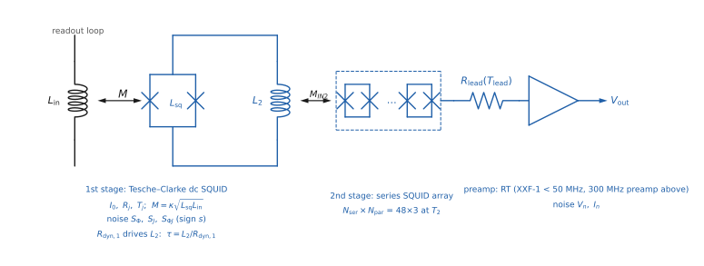
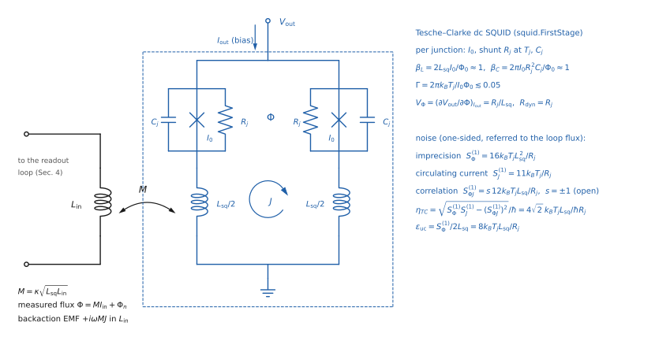
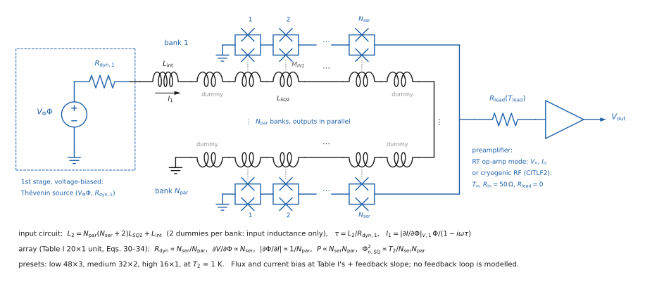
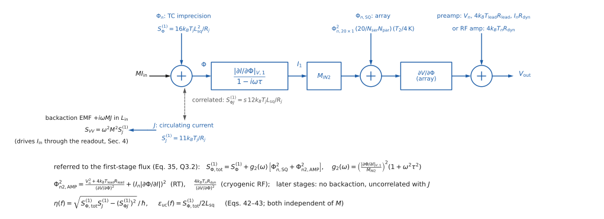
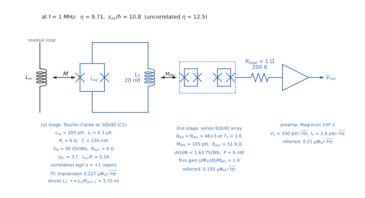
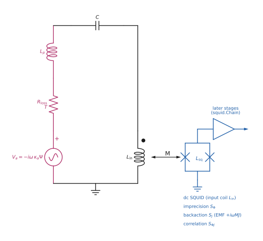
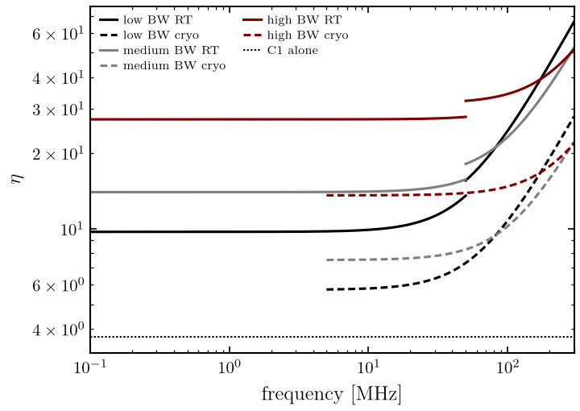
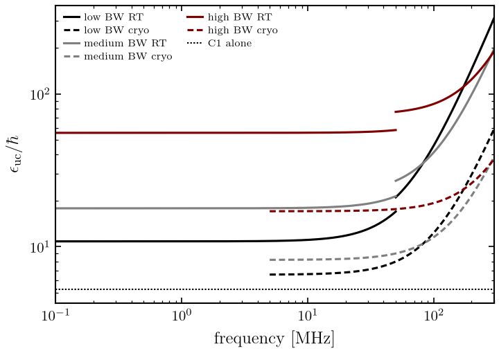

# dc SQUID amplifier chains (`axionfem.squid`)

!!! warning "Beta"
    `axionfem.squid` is beta: Tesche–Clarke (TC) theory with the rounded response functions of [DMR-SQUID]
    ("the paper" below); the second stage is scaled from one measured 20×1 prototype; the correlation sign is open.

**Source.** [DMR-SQUID] V. Ankel et al., "Noise limits for dc SQUID readout of high-Q resonators below
300 MHz", J. Appl. Phys. 138, 094505 (2025), arXiv:2504.20398. Equation numbers are those of arXiv v1
(the journal typesetting was not checked). Other references: [C] Chaudhuri et al. arXiv:1803.01627
(App. F), [Clerk] Clerk et al. RMP 82, 1155 (2010), and `scan_and_signal.md` (S-numbers).

The module replaces a typed-in `eta_A` by a chain specified by device and circuit parameters, and returns
the two numbers that fix a scanning readout ([DMR-SQUID] Sec. VII): the noise parameter `eta(f)` and the
uncoupled energy sensitivity `eps_uc(f)`; plus the scan-optimal coupling and a correlated
`circuit.Squid` for the readout and multiport closures.



*The chain of Secs. 2–3: Tesche–Clarke first stage coupled to the readout loop by
$M=\kappa\sqrt{L_{\rm sq}L_{\rm in}}$, its output current through $L_2$ into the second-stage
$N_{\rm ser}\times N_{\rm par}$ array ($M_{IN2}$, $\tau=L_2/R_{\rm dyn,1}$), then leads and the
preamplifier. Drawn by `squid.chain("C1+low+RT").draw(annotate=False)` (`Chain.draw(f_Hz=...)` adds
every stage's parameters, gains and referred noise); generated by `docs/images/make_circuit_figure.py`.*

## 1. Conventions

**PSD normalisation.** The module computes with **one-sided per-Hz PSDs** $S^{(1)}$, those of the paper:
Johnson noise is $S_V^{(1)}=4k_BTR$ (Eq. 17 reduces to it), the TC noise is $S_V^{(1)}=16k_BT_jR_j$ (Eq. 5),
and $\epsilon_{\rm uc}=S_\Phi^{(1)}/2L_{\rm sq}$ (Eq. 13). The package's Foster PSDs are half of these,

$$S=\tfrac12S^{(1)},\qquad \langle X^2\rangle=\frac1\pi\int_0^\infty S\,d\omega=\int_0^\infty S^{(1)}d\nu \tag{Q1.1}$$

(S3.2). Foster's $S$ equals the symmetrised two-sided $\bar S(\omega)$ of [Clerk]. The paper writes
under Eq. 17 "the extra factor of 2 from our two-sided PSD": its PSDs are $2\bar S$, i.e. one-sided
per Hz; the word "two-sided" there does not mean $\bar S$. The conversion $S=S^{(1)}/2$ happens in one place,
`Chain.squid()`. The scan parameters do not depend on the convention:

$$\eta=\frac{\sqrt{S^{(1)}_\Phi S^{(1)}_J-(S^{(1)}_{\Phi J})^2}}{\hbar}=\frac{2\sqrt{S_\Phi S_J-S_{\Phi J}^2}}{\hbar}\quad(\text{S3.5 with the correlation}),\qquad
\xi=\frac{R\,S^{(1)}_{II}}{\hbar\omega}=\frac{2RS_\Phi}{\hbar\omega M^2}. \tag{Q1.2}$$

**Time dependence** $e^{-i\omega t}$ as in `circuit.py`: inductor $Z=-i\omega L$, and the EMF in a branch
obeys $V_p-V_m=ZI-\text{emf}$. The paper's Eq. 14, $Z=R+i(\omega L-1/\omega C)$, is the $e^{+i\omega t}$
convention; its reactances are the complex conjugates of ours. Only the (open) correlation sign is affected.

**Variables.** $\Phi_n$: imprecision flux referred to the first-stage SQUID loop ($V_{\rm out}/V_\Phi$);
$J$: circulating current; $M=\kappa\sqrt{L_{\rm sq}L_{\rm in}}$ (Eq. 8). Input-referred:
$I_n=\Phi_n/M$, backaction EMF $V_{\rm ba}=i\omega MJ$ (Sec. 4).

## 2. First stage (Sec. II–III)



*The `FirstStage` device: two junctions ($I_0$, shunt $R_j$ at $T_j$, $C_j$) in a loop $L_{\rm sq}$ (drawn as $2\times L_{\rm sq}/2$, as in [DMR-SQUID] Fig. 1), bias $I_{\rm out}$, output $V_{\rm out}$, input coil $L_{\rm in}$ coupled by $M$; the noise is $S_\Phi,S_J,S_{\Phi J}$ of (Q2.1). Drawn by `docs/images/make_circuit_figure.py`, which recomputes every printed formula from `axionfem.squid`.*

**Regime (Eq. 1).** $\beta_L\approx1$, $\beta_C\approx1$, $\Gamma=2\pi k_BT_j/I_0\Phi_0\lesssim0.05$, with the
Tesche–Clarke definitions $\beta_L=2L_{\rm sq}I_0/\Phi_0$ and $\beta_C=2\pi I_0R_j^2C_j/\Phi_0$ ($I_0$ per junction).
Eq. 1 *prints* half of each ($L_{\rm sq}I_0/\Phi_0$, $\pi I_0R_j^2C_j/\Phi_0$), but its own App. A needs the factor 2:
$1.6I_0R_j/\Phi_0=0.8R_j/L_{\rm sq}$ (A1→A2) holds only for $2L_{\rm sq}I_0/\Phi_0=1$.
`FirstStage.validity()` reports the TC values (and the printed ones as `*_eq1_printed`) and warns when
$\beta_{L,C}\notin[0.5,2]$ (our window; the paper does not quantify "≈ 1"), when $\Gamma>0.05$, and when
$0.025<\Gamma\le0.05$ with $V_\Phi=R_j/L_{\rm sq}$ (Eq. 2 assumes $\Gamma<0.025$, footnote 2). $\beta_C$ needs
$C_j$, which the paper does not give for C1. The App. A mean voltage $0.38I_0R_j$ sets
$f_J=0.38I_0R_j/\Phi_0$ (6.9 GHz for C1); `Chain` warns above $0.1f_J$ (our threshold for $f\ll f_J$).

**Responses (Eqs. 2–4).** $V_\Phi=c_VR_j/L_{\rm sq}$, $R_{\rm dyn}=c_RR_j$ with $c_V=c_R=1$ (paper; App. A:
$c_V=0.8$–$0.9$, $c_R=0.97$). Euler's chain rule (B1) gives $(\partial I/\partial\Phi)_V=-V_\Phi/R_{\rm dyn}$, so
$|\partial\Phi/\partial I|_V=R_{\rm dyn}/V_\Phi=L_{\rm sq}$ (Eq. 4); its sign never enters a PSD.

**TC noise, referred to the loop flux** (Eqs. 5–7 divided by $V_\Phi$; derived):

$$S^{(1)}_\Phi=\frac{16k_BT_jR_j}{V_\Phi^2}=\frac{16k_BT_jL_{\rm sq}^2}{R_j},\quad S^{(1)}_J=\frac{11k_BT_j}{R_j},\quad
S^{(1)}_{\Phi J}=s\,\frac{12k_BT_j}{V_\Phi}=s\,\frac{12k_BT_jL_{\rm sq}}{R_j}. \tag{Q2.1}$$

Correlation coefficient $12/\sqrt{176}=0.905$; noise inductance $\sqrt{S_\Phi/S_J}=4L_{\rm sq}/\sqrt{11}$.

**Input-referred (Eqs. 9–12).**

$$S^{(1)}_{II}=\frac{S^{(1)}_\Phi}{M^2}=\frac{16k_BT_jL_{\rm sq}}{\kappa^2R_jL_{\rm in}},\quad
S^{(1)}_{VV}=\omega^2M^2S^{(1)}_J=\frac{11k_BT_j\kappa^2L_{\rm in}L_{\rm sq}\omega^2}{R_j},\quad
S^{(1)}_{IV}\equiv\langle I_nV_{\rm ba}^*\rangle=-i\omega S^{(1)}_{\Phi J}\quad(S^{(1)}_{\Phi J}\ \text{signed, Q2.1}). \tag{Q2.2}$$

$|{\rm Im}\,S_{IV}|=12k_BT_jL_{\rm sq}\omega/R_j$ is Eq. 12; ${\rm Re}\,S_{IV}=0$ (the paper's "real TC
correlation becomes imaginary", Sec. II).

**Energy sensitivity (Eq. 13).** $\epsilon_{\rm uc}=S^{(1)}_\Phi/2L_{\rm sq}=8k_BT_jL_{\rm sq}/R_j$ (some
sources quote 9 for $\Gamma=0.05$).

**Noise temperature of a source** $Z$ (the loop impedance seen by the coil; derived, Sec. 4): the noise
referred to a series EMF is

$$S^{(1)}_e=S^{(1)}_{VV}+|Z|^2S^{(1)}_{II}+2\omega S^{(1)}_{\Phi J}\,{\rm Im}Z,\qquad 4k_BT_n{\rm Re}Z=S^{(1)}_e \tag{Q2.3}$$

(Eq. 17 for real $Z$). Minimising over ${\rm Re}Z$ at ${\rm Im}Z=0$ gives Eqs. 18–19, $R=\sqrt{S_{VV}/S_{II}}$ and
$k_BT_{\min}=\tfrac12\sqrt{S_{VV}S_{II}}$; for TC, $R=(\sqrt{11}/4)\kappa^2\omega L_{\rm in}$ (Eq. 20),
$\kappa_g^2\equiv\kappa^2L_{\rm in}/L_{\rm tot}=(4/\sqrt{11})/Q$ (Eqs. 21–22), $k_BT_{\min}=2\sqrt{11}k_BT_jL_{\rm sq}\omega/R_j$
(Eq. 23), $T_{\min}/{\rm SQL}=4\sqrt{11}k_BT_jL_{\rm sq}/\hbar R_j$ (Eq. 24; 8.68 for C1, "≈ 9"). Minimising over
complex $Z$: ${\rm Im}Z_{\rm opt}=-\omega S_{\Phi J}/S_{II}$ and

$$k_BT_{\min}=\tfrac12\sqrt{S_{VV}S_{II}-({\rm Im}S_{IV})^2}\ (\text{Eq. 25}),\qquad \eta=\frac{k_BT_{\min}}{\hbar\omega/2}=\frac{\sqrt{S_\Phi^{(1)}S_J^{(1)}-(S^{(1)}_{\Phi J})^2}}{\hbar}\ (\text{Eqs. 26, 28}). \tag{Q2.4}$$

TC: $\eta_{TC}=\sqrt{176-144}\,k_BT_jL_{\rm sq}/\hbar R_j=4\sqrt2\,k_BT_jL_{\rm sq}/\hbar R_j$ (Eq. 29; 3.703 for C1,
"≈ 3.7"), and $\epsilon_{\rm uc}/\hbar=\sqrt2\,\eta_{TC}$. Clarke's detuned-LCR optimum $2.8$ (Eq. 27) vs
$2\sqrt2=2.83$.

**C1** (Sec. III B): $L_{\rm sq}=200$ pH, $I_0=6.3$ µA, $R_j=6\,\Omega$, $T_j=150$ mK (self-heating):
$\beta_L=1.219$ (Eq. 1 as printed: 0.609), $\Gamma=1.0\times10^{-3}$, $\eta_{TC}=3.703$, $\epsilon_{\rm uc}/\hbar=5.237$.
`FirstStage.at_eta(eta)` rescales $T_j$ to reach a benchmark $\eta$ (10 → 405.08 mK), keeping the TC ratios.

## 3. Later stages (Sec. IV–V)

**Second-stage array (Sec. IV C–D, Eqs. 30–34).** Unit cell = Table I "+ feedback slope" (20×1 at 4 K):
$\Phi_{n,20\times1}=0.297$ µΦ₀/√Hz, $|\partial\Phi/\partial I|=95.5$ pH, $\partial V/\partial I=64.9\,\Omega$,
$\partial V/\partial\Phi=6.80\times10^{11}$ Hz, $M_{IN2}=105$ pH, $P=0.834$ nW. For $N_{\rm ser}\times N_{\rm par}$:
$P\propto N_{\rm ser}N_{\rm par}$, $|\partial\Phi/\partial I|\propto1/N_{\rm par}$, $R_{\rm dyn}\propto N_{\rm ser}/N_{\rm par}$,
$\partial V/\partial\Phi\propto N_{\rm ser}$, $\Phi^2_{n,\rm SQ}\propto T_2/(N_{\rm ser}N_{\rm par})$.

$$L_2=N_{\rm par}(N_{\rm ser}+2)L_{SQ2}+L_{\rm int},\qquad \tau=L_2/R_{{\rm dyn},1} \tag{Q3.1}$$

with $L_{SQ2}=120$ pH, $L_{\rm int}=2$ nH, two dummy SQUIDs per bank (Sec. IV D items 1–3: $18,68,150\,L_{SQ2}$),
$R_{{\rm dyn},1}=R_j=6\,\Omega$, $T_2=1$ K (Sec. V A). Presets (Table II): low 48×3, medium 32×2, high 16×1.



*The `SecondStage`: the voltage-biased first stage (Thévenin $V_\Phi\Phi$, $R_{\rm dyn,1}$) drives $L_2$ = $L_{\rm int}$ + $N_{\rm par}(N_{\rm ser}+2)$ input coils $L_{SQ2}$ (coupled by $M_{IN2}$; two dummies per bank), the banks' outputs in parallel feed $R_{\rm lead}(T_{\rm lead})$ and the preamplifier; no flux-bias feedback loop is modelled. Drawn by `make_circuit_figure.py`.*

**Referral to the first stage (Eq. 35).** The voltage-biased first stage is a Thévenin source
($V_\Phi\Phi$, $R_{{\rm dyn},1}$) driving $L_2$, so its output current per flux is
$|\partial I/\partial\Phi|_V/(1-i\omega\tau)$; the second-stage input flux noise $\Phi_{n2}$ referred to the first-stage loop is

$$S^{(1)}_{\Phi,\rm ref}(\omega)=\Big(\frac{|\partial\Phi/\partial I|_{V,1}\,}{M_{IN2}}\Big)^2\Phi_{n2}^2\,(1+\omega^2\tau^2)
=M^2S^{(1)}_{II,\rm ref}. \tag{Q3.2}$$

**Second-stage input noise (Eqs. 36–40, C1–C2).**
$\Phi_{n2}^2=\Phi^2_{n,20\times1}\frac{20}{N_{\rm ser}N_{\rm par}}\frac{T_2}{4\,{\rm K}}+\Phi^2_{n2,\rm AMP}$ with

* op-amp-mode RT preamp: $\Phi^2_{n2,\rm AMP}=\frac{V_n^2+4k_BT_{\rm lead}R_{\rm lead}}{(\partial V/\partial\Phi)^2}+(I_n|\partial\Phi/\partial I|)^2$
  of the scaled array (Eqs. 37–39), $R_{\rm lead}=1\,\Omega$, $T_{\rm lead}=200$ K (Sec. V B);
* cryogenic RF amplifier (matched 50 Ω, $R_{\rm lead}=0$): $\Phi^2_{n2,\rm RF}=4k_BT_n|\partial\Phi/\partial I||\partial\Phi/\partial V|
  =4k_BT_nR_{\rm dyn}/(\partial V/\partial\Phi)^2>0$ (Eq. C1; the source's open-circuit EMF noise $4k_BT_nR$).

Amplifiers (Sec. IV E–F): Magnicon XXF-1 0.33 nV/√Hz, 2.6 pA/√Hz, < 50 MHz; 300 MHz RT preamp 0.3 nV/√Hz,
6 pA/√Hz; CITLF2 $T_n=2$ K, 5–500 MHz. Preset "RT" = XXF-1 below 50 MHz and the 300 MHz preamp above
(Fig. 3 solid); "cryo" = CITLF2 (Fig. 3 dashed). Later-stage backaction on the first stage is neglected
(Sec. V), so they add uncorrelated imprecision only.

**Full system (Eqs. 41–43).** $S_{II,\rm sys}=S_{II}+S_{II,\rm ref}$, i.e. $S^{(1)}_{\Phi,\rm tot}=S^{(1)}_\Phi+S^{(1)}_{\Phi,\rm ref}$, and

$$\eta(\omega)=\frac{\sqrt{S_{VV}S_{II,\rm sys}-({\rm Im}S_{IV})^2}}{\hbar\omega}=\frac{\sqrt{S^{(1)}_{\Phi,\rm tot}S^{(1)}_J-(S^{(1)}_{\Phi J})^2}}{\hbar},\qquad
\epsilon_{\rm uc}(\omega)=\frac{M^2S_{II,\rm sys}}{2L_{\rm sq}}=\frac{S^{(1)}_{\Phi,\rm tot}}{2L_{\rm sq}}, \tag{Q3.3}$$

both independent of $M$ (tested).



*Where each noise of `Chain.one_sided` enters: TC imprecision $\Phi_n$ and circulating current $J$ (correlated, $S_{\Phi J}$, sign $s$; backaction EMF $+i\omega MJ$), then the array and preamplifier noise referred back through $g_2(\omega)$ (Q3.2) to give $\eta(f)$ and $\epsilon_{\rm uc}(f)$ (Q3.3). Drawn by `make_circuit_figure.py`.*



*`squid.chain("C1+low+RT").draw(f_Hz=1e6)`: every stage's parameters and its flux noise referred to the first stage at 1 MHz ($\eta=9.71$, $\epsilon_{\rm uc}/\hbar=10.8$, as in the Sec. 6 table).*

**Table I check** (`table_I_check`, a test): Eqs. 38–39 at 20×1 with Table I's measurement preamp
(0.32 nV, 2.7 pA, no lead term) give 0.2595 µΦ₀/√Hz (table 0.259) on the + slope and 0.3807 (0.380) on
the − slope; quadrature subtraction from the totals gives 0.2965 (0.297) and 0.2454 (0.247);
$\partial V/\partial\Phi\cdot|\partial\Phi/\partial I|=64.94$ (64.9) and 153.8 (154) Ω, i.e. $|{\rm B1}|=1$.

## 4. Correlation and the circuit closures



*The closure: `series_readout` (pickup EMF $-i\omega\kappa_a\Psi$, $L_p$, $R_{\rm loss}$ at $T$, tuning $C$, input coil $L_{\rm in}$) with the correlated `Squid` of `Chain.squid_for_resonator` (C1+low+RT, Eq. 48 coupling at 1 MHz) on $L_{\rm in}$; its backaction EMF is $+i\omega MJ$. Drawn by `Readout.draw(annotate=False)` and checked against the circuit by `check_drawing`.*

The circulating current $J$ threads $M$, so the input coil sees the flux $MJ$ and the series EMF
$-d(MJ)/dt\to+i\omega MJ$. The SQUID output is $\Phi=\Phi_n+H_{\rm in}\,i\omega MJ+\Phi_{\rm sig}$, with
$H_{\rm in}$ the flux per volt of EMF in the input-coil branch. The sign is the circuit's own mutual
stamp $Z=-i\omega M$ (the same $M$ that gives $\Phi_{\rm SQ}=+MI_{\rm in}$), checked by
`test_backaction_emf_sign_is_the_mutual_stamp` with the SQUID loop added to the network as an inductor
carrying a pinned $J$ (`readout_circuit.md` Sec. 4.2). Writing $-i\omega MJ$ instead is equivalent to $s\to-s$. Hence (Foster, $S_{\Phi J}=\langle\Phi_nJ^*\rangle$ real)

$$S_{\Phi,\rm out}=S_{\Phi,\rm th}+S_\Phi+|H_{\rm in}\omega M|^2S_J+2\,{\rm Re}\big[(i\omega MH_{\rm in})^*S_{\Phi J}\big]. \tag{Q4.1}$$

`Squid.S_PhiJ` (default 0) and `Squid.correlation_term` carry the last term into `Readout.noise_psd`
and `MultiportReadout.noise_psd` (key `S_Phi_correlation_Wb2_s`). Referred to $S_{II}/S_{VV}$:
$S_{IV}=\langle(\Phi_n/M)(i\omega MJ)^*\rangle=-i\omega S_{\Phi J}$, Eq. 12 with the sign. For a series loop
$H_{\rm in}=H_s=M/Z$ and the referred cross term is exactly $2\omega S_{\Phi J}{\rm Im}Z$ (tested to 1e-9),
which is (Q2.3). Reversing $M$ reverses both the imprecision referral and the backaction EMF, so the cross
term is even in $M$: the coil orientation does not set $s$.

$|S_{\Phi J}|\le\sqrt{S_\Phi S_J}$ is enforced. The later stages are uncorrelated with $J$, so the
chain's $S_{\Phi J}$ is the TC value at every frequency.

## 5. Scan: band shift, Eq. 48, and the open sign

Near a pole ($x=2Q(\omega-\omega_0)/\omega_0$), with ${\rm Im}Z\simeq-R_0x$ and $c\equiv2S_{\Phi J}/\hbar$:

$$\frac{N_V(x)}{\hbar\omega_0R_0}=\frac{\xi}{2}(1+x^2)+(2n+1)+\frac{\eta_0^2}{2\xi}-cx
=\frac{\xi}{2}\Big(x-\frac c\xi\Big)^2+\frac{\xi^2+2(2n+1)\xi+\eta^2}{2\xi},\qquad \eta^2=\eta_0^2-c^2, \tag{Q5.1}$$

$\eta_0=2\sqrt{S_\Phi S_J}/\hbar$. The correlation shifts the sensitivity band by $x_0=c/\xi$ (in units of $x$, i.e. half-linewidths $\omega_0/2Q$) and
replaces $\eta_0$ by the correlated $\eta$ (S3.5 and [C] F44–F57). The scan integral is shift-invariant, so
$\bar G(\xi,n,\eta)$ and $\xi_{\rm opt}$ keep their form; tested by integrating $N_V^{-2}$ over the exact
circuit for $s=\pm1$ (agreement 1e-4 / 2e-6 for C1+low+RT at 1 MHz; using the uncorrelated $\eta_0$ instead
misstates that integral by 34 %; for TC alone $\eta_0/\eta=\sqrt{176/32}=2.35$). `Readout.equivalent` does
this completion of the square numerically (`eta_A_eff`, `eta_A_eff_uncorrelated`, `correlation_c`,
`band_shift_x0`). **This reduction holds for the series loop (and an ideal transformer), not for a general
network**: a reactive background between pickup and coil (a real flux transformer) adds quadratic correlation
and backaction terms, so the curvature is no longer $\xi/2$ (the completed square can give $\eta^2<0$, or an
8.7 % error at $x=10$). `equivalent()` therefore compares the completed-square pole with the exact $N_V$ at the
noise-doubling points (`correlated_reduction_resid`) and raises above `corr_tol = 1e-2`; such networks must
integrate the exact output noise (`Readout.noise_psd`, `MultiportReadout.output_snr_rate`). The statements
below about $s$ dropping out are made for the series form.

**Scan-optimal coupling (Eqs. 46–48, re-derived).** $\xi_{\rm opt}=2\eta^2/(2n+1+\sqrt{(2n+1)^2+8\eta^2})$
(Eq. 46 = S3.9, [C] F55), $n$ the Bose occupation at the resonator temperature (Eq. 47). With
$S^{(1)}_{II,\rm sys}=2L_{\rm sq}\epsilon_{\rm uc}/M^2$, $M^2=\kappa_g^2L_{\rm sq}L_{\rm tot}$ (Eq. 21) and $R=\omega L_{\rm tot}/Q$:

$$\kappa_g^2=\frac{2\epsilon_{\rm uc}}{\hbar Q\,\xi_{\rm opt}}=\frac1Q\frac{\epsilon_{\rm uc}}{\hbar}\,\frac{2n+1+\sqrt{(2n+1)^2+8\eta^2}}{\eta^2}\quad(\text{Eq. 48}). \tag{Q5.2}$$

`Chain.kappa_g2_scan`, `Chain.M_scan_H` and `Chain.squid_for_resonator` implement it. Eq. 48 is an
unconstrained optimum: `kappa_g2_scan` may return $\kappa_g^2>1$ (e.g. C1 at 100 kHz with $Q=10^3$ gives 9.6),
which no transformer reaches (Eq. 21: $\kappa_g^2=\kappa^2L_{\rm in}/L_{\rm tot}\le1$); `M_scan_H` and
`squid_for_resonator` raise there. In a multiport,
$\kappa_g^2=2\kappa^2U_{\rm in}/U_{\rm tot}$ with $U_{\rm in}=L_{\rm in}|I|^2/4$ and $U_{\rm tot}$ the total tuned-mode energy.

**The sign $s$ is OPEN.** [DMR-SQUID] Eq. 12 gives only $|{\rm Im}S_{IV}|$; a signed TC referral with
explicit orientations has not been done. Flipping $S_{\Phi J}$ at fixed conventions is a different physical
covariance, not a convention change. For the series form (Q5.1), in the high-Q limit
$s$ drops out of the scan rate; at finite $Q$ it enters at order $x_0/Q$ and through which frequency a tuning's
information is booked at. `Chain(sign=±1)` and `squid.chain(..., sign=±1)` expose it; use
both to bracket.

**Freezing.** `Chain.squid(f0, M)` freezes the PSDs at the tuning frequency. Across a noise band of width
$\Delta\omega$ the chain's $(1+\omega^2\tau^2)$ changes by at most $2\Delta\omega/\omega$ (relative), e.g. < 1e-6 for
C1+low+RT at 1 MHz with Q = 1e6, so the closures may hold the PSDs fixed per tuning, as
`MultiportReadout.output_snr_rate` requires.

## 6. Use in the scan

`scan.reach(Psi, L, benchmark)` accepts `benchmark["eta_A"]` as a callable `eta(f)`; a `Chain` is one
(`Chain.__call__ = eta`). It then runs `reach_dispersive` with constant `Psi`, `L`, `Q`, `T` and the
frequency-dependent `eta`, which in the constant limit reproduces the C++ `reach_local` to 1e-10
(tests). `squid.benchmark(chain_or_preset, Q, T_K)` builds the dict. `reach_dispersive` and
`reach_fullwave(eta_A=...)` already accepted callables. The callable route also applies
`reach_dispersive`'s local-validity guards (noise bandwidth < 0.1 f), which the scalar route does not, and
reports band quantities as $[f_{\min},f_{\max}]$ endpoint values; for `allocation="log_uniform"` its
`band["t_req_s"]` is set to the live time, as in the scalar route. With target allocation every search reaches
$g_{\rm target}(t_{\rm req}/t_{\rm live})^{1/4}$, so a dispersive $\eta(f)$ changes $t_{\rm req}$, not the shape of $g_{95}/g_{\rm target}$. The optimal-scan formulas assume the coupling
is retuned to $\xi_{\rm opt}$ at every tuning (Eq. 48), so `eta(f)` is all they need (Sec. VII).

```python
from axionfem import squid, scan
ch = squid.chain("C1+low+RT")                 # or "C1", "C1+medium+cryo", ...; sign=-1 for the bracket
ch.eta(f), ch.eps_uc_over_hbar(f)             # Eqs. 42-43, arrays in, arrays out
ch.kappa_g2_scan(f, Q=1e6, T_K=0.03)          # Eq. 48
sq = ch.squid_for_resonator(f0, Q, L_tot, T_K)   # correlated Squid for Readout / MultiportReadout
scan.reach(Psi, L, squid.benchmark(ch, Q=1e6, T_K=0.03))
```

Numbers (one-sided device data as above, Q = 1e6, T = 30 mK for $\kappa_g^2$):

| chain | $\eta$ (1 MHz) | $\epsilon_{\rm uc}/\hbar$ (1 MHz) | $\eta$ (100 MHz) | $\kappa_g^2$ (1 MHz) |
|---|---|---|---|---|
| C1 alone | 3.703 | 5.237 | 3.703 | 9.55e-4 |
| C1 + low (48×3) + RT | 9.707 | 10.828 | 24.45 | 2.87e-4 |
| C1 + medium (32×2) + RT | 13.96 | 17.81 | 23.10 | 2.29e-4 |
| C1 + high (16×1) + RT | 27.17 | 55.54 | 34.27 | 1.88e-4 |
| C1 + low + cryo | — (5–500 MHz only) | — | 10.75 | — |

`examples/squid_chain.py` prints the table and draws `docs/physics/figures/squid_chain_eta.{pdf,png}` and
`squid_chain_eps_uc.{pdf,png}` (analogues of Figs. 3–4 on a log axis).



*Noise factor η(f) of each SQUID-chain preset (solid: RT, dashed: cryo second stage); dotted: C1 alone.*



*Uncoupled energy resolution ε_uc/ħ(f) for the same presets.*

## 7. Inconsistencies in [DMR-SQUID] and the choices made here

1. **High-BW $L_2$**: Sec. IV D item 1 says "$L_2=18L_{SQ2}+L_{\rm int}\approx3$ nH", but $18\times120$ pH + 2 nH = 4.16 nH,
   which is Table II's 4 nH. We use the formula (Q3.1): $L_2$ = 20.0 / 10.16 / 4.16 nH (Table II: 20 / 10 / 4).
   Using the rounded table values instead moves $\tau^2$ by 3–8 % (medium/high), < 1e-4 in $\eta$ below 1 MHz.
2. **$\tau$ range**: Sec. V A quotes "0.5 ns to 3 ns"; Table II gives 3.3 / 1.7 / 0.7 ns (we get 3.33 / 1.69 / 0.69).
3. **Eq. 40 minus sign**: $(\partial\Phi/\partial I)_V$ is negative by Euler's chain rule (B1) while Table I lists
   magnitudes; Eq. C1 (same quantity) has no minus sign. We use magnitudes, giving the positive
   $4k_BT_nR_{\rm dyn}/(\partial V/\partial\Phi)^2$ (tested).
4. **"Two-sided PSD"** under Eq. 17: the normalisation is one-sided per Hz (Sec. 1).
5. **Inductance bookkeeping**: Sec. II adds a ~1 nH microwave-isolation inductance in series with the first stage,
   while $L_{\rm int}\approx2$ nH covers "wirebonds and interconnect" (Sec. IV D). Whether the 1 nH is inside
   $L_{\rm int}$ is not stated; we follow Table II.
6. **48×3 wiring**: "the outputs of the two banks wired in parallel" — three banks.
7. **Cryogenic-amplifier band**: Fig. 3 draws it above 10 MHz, App. C motivates it above 50 MHz, the
   CITLF2 is specified for 5–500 MHz. We allow 5–300 MHz and raise outside (no extrapolation).
8. **Response-function rounding**: Eq. 2 uses $V_\Phi=R_j/L_{\rm sq}$ (App. A: 0.8–0.9) and Eq. 3 $R_{\rm dyn}=R_j$
   (0.97); exposed as `V_Phi_coeff`, `R_dyn_coeff` (defaults 1, the paper's). $\eta\propto1/c_V$ for TC alone.
9. **Fig. 4 caption** "$\epsilon_{\rm uc}$ for the low-bandwidth SQUID with the cryogenic RF preamp has values less than
   7.6 ħ below 50 MHz": we get 6.56 at 5 MHz rising to 7.99 at 50 MHz (7.6 at 42.8 MHz). The 5 % difference is
   unexplained; similarly our low-BW RT values (η 9.71, ε 10.83 at 1 MHz) are 3–4 % above an eye read-off of
   Figs. 3–4 (9.4, 10.4). With Table I's preamp (0.32 nV, 2.7 pA) instead of Sec. IV E's
   they become 9.59 / 10.66. No digitized curves exist, so no test uses the figures' values.
10. **$\beta$ definitions** (Eq. 1 vs App. A): see Sec. 2; the noise formulas are unaffected.

## 8. Assumptions and limits

* TC white noise of a weakly coupled, optimally biased SQUID; no 1/f noise, no quantum noise (valid while $\eta\gg1$).
* SQUID input impedance (damping, reactive loading) neglected, as in `readout_circuit.md` limitation 2.
* Later stages: backaction on the first stage neglected; Table I unit cell scaled by Eqs. 30–34 (projection, not a
  measured chain); $T_2$ scaling linear down to 1 K (Sec. IV D).
* $f\le300$ MHz (paper scope) and amplifier bands are enforced (raise). Warnings, not errors: $f>0.1f_J$,
  $T_2<1$ K (Eq. 34 extrapolated below its supported range), TC regime (Sec. 2). The CITLF2 formula requires a
  matched array ($|R_{\rm dyn}/50\,\Omega-1|\le0.2$, our tolerance; presets 51.9 Ω) and raises otherwise.
* The correlation sign $s$ (Sec. 5).
