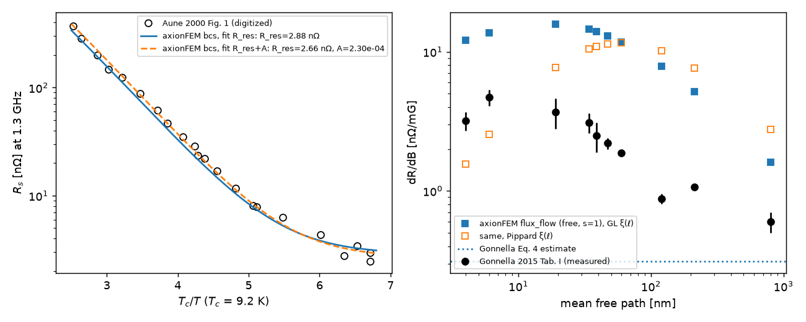

# SRF heterodyne cavities: modes and figures of merit

!!! warning "Beta"
    `axionfem.srf` and `axionfem.heterodyne` are beta.

This page covers the geometry and eigenmode side of an SRF heterodyne axion search: a pump mode (TM020, frequency
ω0) and a signal mode (TE011) of an elliptical cell, made degenerate by tuning the cell's axial length, and the figures
of merit that set the sensitivity. The cell is the published Project X 650 MHz β = 0.9 regular cell
(`srf.PROJECTX_650_B09`). The sensitivity and scan model is `axionfem.heterodyne` ([sensitivity.md](sensitivity.md)); it
takes the figures of merit computed here through `SRFGeometry.from_modes` (preset `PROJECTX_086` = `PROJECTX_086_WALL`,
B_pk = the wall maximum; the labelled diagnostic `PROJECTX_086_EQUATOR_DIAGNOSTIC`; cached, with an input fingerprint,
in `python/axionfem/data/srf_projectx086_geometry.json` by `benchmarks/srf/srf_geometry_record.py
--update-package-data`). Wall-vibration mode mixing: [vibrations.md](vibrations.md). Tests: `tests/test_srf.py`,
`tests/test_srf_external.py`.

## Definitions

The pump mode TM020 has frequency ω0 and field B̃0. The signal mode TE011 has field Ẽ1.

| quantity | definition |
|---|---|
| ξ | ω0 V^(1/3)/c (so ω0 = ξ V^(-1/3) with c = 1). V is the cavity volume, beam-tube stubs included |
| η10 | \|∫Ẽ1*·B̃0 dV\| / (∫\|Ẽ1\|² ∫\|B̃0\|²)^(1/2) |
| B0 | the spatial rms of the pump \|B̃0\| over V |
| B_pk/B0 | the largest pump \|B\| on the wall (the peak wall magnetic field). `B_equator_over_B0`, the \|B\| at the equator, is reported as a diagnostic only |
| E_pk/(cB0) | the largest pump \|E\| on the wall, in units of B0 with c = 1; field `SRFGeometry.Epk_over_cB0`, so E_pk = Epk_over_cB0 · c · B0 |
| A/V^(2/3) | wall area including the tube walls and their end caps |
| G | ω μ0 ∫\|H\|² dV / ∮\|H_t\|² dA over all walls; equal to Z0 × (ω/c)∫\|B\|² / ∮\|B\|² dA in natural units |

Two properties are checked:

- **Scale invariance.** ξ, η10, the field ratios, A/V^(2/3) and G do not depend on the size; checked under a ×10
  scaling, they agree to 1e-9.
- **Reciprocity.** At degeneracy, η10 equals η01 (E of the pump against B of the signal). In general,
  η10 = (ω1/ω0) η01.

## API (`axionfem.srf`)

- **`elliptical_cell_contour(cell, axial_factor, scale, tube_radius, tube_length, ds, angle_tol)`** builds the wall:
  the exact contour as a `contour` shape (`["shape"]`: lines and elliptical arcs, which the mesher builds exactly) and
  a polyline (`["points"]`, `["wall"]`). V and A are those of the exact wall (`V_polygon_m3`, `A_polygon_m2`: the
  polyline's). `contour_points(shape)` samples a contour.
  - The iris ellipse is centred at (0, R_i + b) and the equator ellipse at (L, R_eq − B). They are joined by their
    internal common tangent; for this cell the wall angle is 4.5°.
  - `axial_factor` scales L and both axial semi-axes.
  - Beam-tube stubs end in flat caps.
  - Polyline: the vertex spacing follows the curvature; the wall turns by at most `angle_tol` per chord.
  - The Project X 650 MHz β = 0.9 regular cell is `PROJECTX_650_B09`.
- **`elliptical_cell_design(...)`** builds the 2D axisymmetric design (fullwave TE and TM eigenmodes and the cavity
  section). **`elliptical_cell_design_3d(...)`** builds the same cell revolved into a full 3D model with no mirror
  planes, because the pump and the signal sit in different mirror sectors. Both take `wall="smooth"` (default: the
  exact contour, curved second-order elements on it) or `wall="polygon"` (a faceted wall; the figures and the
  vibration records use it). The smooth 3D design grades the volume mesh from the
  curvature-refined wall (`mesh.extend_from_boundary`, `mesh.optimize_netgen`, `curvature_points` = max(16,
  1.5 R_eq/h)) and writes the wall samples (`cavity.wall_samples`).
- **`classify_modes`** and **`find_mode`** label m = 0 modes ("TM020", ...) from their nodal lines.
- **`tune_degeneracy(pump, signal, bracket)`** finds the axial factor at which the two modes are degenerate (Brent's
  method, one 2D solve per evaluation).
- **`figures_of_merit(res, "TM020", "TE011")`** works on 2D results. Integrals are exact products of linear
  interpolants on a sub-lattice (`subdiv`). Wall peaks: the solver's `peak_wall_fields` (see "Wall peaks"). It also
  returns the equator \|B\|, the signal's own peaks and normalization checks, and the fields with `with_fields=True`.
- **`figures_of_merit_3d(res, f_pump, f_signal)`** picks the 3D pump (E_φ fraction < 0.01) and signal (> 0.99) and
  reads η from `overlaps.eta[signal][pump]`, G from `losses`, and the wall peaks from `azimuthal_wall_peaks` (smooth
  wall; see "Wall peaks") or, without wall samples, the single-point maxima of `peak_wall_fields`
  (`peak_definition` says which).
- **Closed cylinders:** `cylinder_pair("TM020/TE011" | "TM030/TE021" | "TE012/TM013")`, `eta_cylinder`,
  `cylinder_mode_fields` and `cylinder_pair_design` (the 2D model at the degenerate L/R).

The cavity result keys these use are documented in [design_format.md](../design_format.md):

- `E_azimuthal_fraction`
- `peak_wall_fields`, pointwise and face-rms, with their locations; with `cavity.wall_samples`, the consistent-flux
  wall E_n and a file of all wall quadrature points per mode
- 2D cavity modes: `peak_wall_fields` at the wall Gauss points
- eigenmode `probes` at `fullwave.field_probes`

## Convergence: the Project X cell at degeneracy (axial factor 0.86, tubes 50 mm × 100 mm)

| quantity | 2D (converged) | 3D (smooth wall, order 4, h = R_eq/8) | note |
|---|---|---|---|
| f_TM020 / f_TE011 [GHz] | 1.416510 / 1.416531 | 1.416535 / 1.416524 | smooth wall in both |
| axial factor for degeneracy | **0.86003** (tuner, faceted wall, h = R_eq/40 and /80, order 3) | – | 1.41651 GHz; smooth wall at 0.86: splitting 20 kHz (1.4e-5 f0) |
| V [L] | 17.063 | 17.06 | tubes included; the cell alone is 15.49 L |
| ξ | **7.643** | 7.6431 | the cell alone, without tubes, would give 7.42 |
| η10 | **0.4492** | 0.4492 | η10² = 0.202 |
| B_pk/B0 | **1.4640** (iris-side wall); 1.404 at the equator | 1.4641 (order 3, R_eq/12: 1.4634) | see the notes below |
| E_pk/(cB0) | **1.8430 ± 0.0005** (iris nose) | 1.8438 (order 3, R_eq/12: 1.8380); order ≥ 3 spread −0.8 … +0.04 % | see the notes below |
| A/V^(2/3) | 6.182 | 6.182 (contour) | |
| G pump [Ω] | **524.47** | 524.50 | |
| G signal [Ω] | **604.48** | 604.48 | |

How the 2D column was obtained (record: `benchmarks/srf/records/srf_2d_smooth.json`, `srf_2d_smooth_wall.py`;
smooth wall, wall peaks at the wall Gauss points):

- **Mesh and order.** h = R_eq/10 … R_eq/160 at order 2, and up to R_eq/80 at order 3. E_pk/(cB0): 1.8504, 1.8520,
  1.8468, 1.8435, 1.8429 (order 2) and 1.8462, 1.8483, 1.8452, 1.8431 (order 3); the two finest agree to 2e-4.
  B_pk/B0 = 1.46401 from R_eq/20 on (both orders).
- The faceted-wall record `srf_2d.json` (polygon refined with the mesh, angle_tol = 0.4·h/R_eq, lattice peaks incl.
  the polygon vertices) gave the same integrals and B_pk, and E_pk = 1.846 ± 0.003 (1.843 at order 2 / 1.848 at
  order 3 for angle_tol ≤ 0.005).
- **Converged quantities.** Between h = R_eq/80 and R_eq/160:
  - f changes by < 1e-6 relative;
  - η10 changes by 2e-6;
  - G changes by < 1e-5;
  - B_pk/B0 changes by 2e-5.
- **Integration lattice.** Refining it (`subdiv` 2 → 8) changes η10 by 3e-6.

How the 3D column was obtained (records `srf_3d_smooth_o2.json`, `_o3.json`, `_o4.json`, `srf_3d_validation.py`,
smooth wall; the faceted-wall records `srf_3d_o2.json` / `srf_3d_o3.json` are kept for reference):

- **Mode identification.** The E_φ fraction is < 1e-3 for the pump and > 0.999 for the signal.
- **Convergence in h and order** (2D: ξ 7.64298, η10 0.449212, B_pk/B0 1.46401, E_pk/(cB0) 1.8430, G signal
  604.4785 Ω; percentages vs 2D):

  | h | order | elements / DOFs | ξ | η10 | B_pk/B0 | E_pk/(cB0) | E_pk flux | G signal [Ω] | single-point max B / E |
  |---|---|---|---|---|---|---|---|---|---|
  | R_eq/6 | 2 | 34378 / 227202 | 7.6438 | 0.4447 | 1.5055 (+2.84 %) | 1.7591 (-4.55 %) | 1.8605 | 602.75 | 1.588 / 2.490 |
  | R_eq/8 | 2 | 53405 / 350846 | 7.6434 | 0.4489 | 1.4873 (+1.59 %) | 1.7836 (-3.22 %) | 1.8527 | 603.90 | 1.530 / 2.202 |
  | R_eq/12 | 2 | 112265 / 732672 | 7.6431 | 0.4492 | 1.4709 (+0.47 %) | 1.7983 (-2.43 %) | 1.8629 | 604.33 | 1.502 / 2.092 |
  | R_eq/16 | 2 | 253342 / 1641544 | 7.6430 | 0.4492 | 1.4645 (+0.03 %) | 1.8142 (-1.56 %) | 1.8558 | 604.42 | 1.479 / 1.992 |
  | R_eq/6 | 3 | 34378 / 656052 | 7.6432 | 0.4492 | 1.4652 (+0.08 %) | 1.8279 (-0.82 %) | 1.8366 | 604.44 | 1.530 / 2.328 |
  | R_eq/8 | 3 | 53405 / 1014774 | 7.6431 | 0.4492 | 1.4638 (-0.01 %) | 1.8359 (-0.39 %) | 1.8469 | 604.46 | 1.504 / 1.983 |
  | R_eq/12 | 3 | 112265 / 2123091 | 7.6430 | 0.4492 | 1.4634 (-0.04 %) | 1.8380 (-0.27 %) | 1.8483 | 604.47 | 1.473 / 1.925 |
  | R_eq/6 | 4 | 34378 / 1432580 | 7.6432 | 0.4492 | 1.4651 (+0.07 %) | 1.8355 (-0.41 %) | 1.8348 | 604.48 | 1.538 / 2.012 |
  | R_eq/8 | 4 | 53405 / 2217992 | 7.6431 | 0.4492 | 1.4641 (+0.00 %) | 1.8438 (+0.04 %) | 1.8467 | 604.48 | 1.510 / 1.949 |

  - At order ≥ 3, on every mesh, E_pk is within −0.82 … +0.04 % (−0.27 % at order 3, R_eq/12; +0.04 % at order 4, R_eq/8) and B_pk within −0.04 … +0.08 % of 2D; ξ, η10 and G agree to
    ≤ 1e-4. E approaches 2D from below at order 3 (−0.82, −0.39, −0.27 %; the rate flattens, ≈ h^0.8 between
    R_eq/8 and /12) and at order 4 (−0.41 %, +0.04 %). The mesh geometry is second order at every field order
    (sub-parametric for order ≥ 3) and the curvature sizing at the nose refines only ×1.5 from R_eq/6 to /12, so
    this is agreement to < 1 % approaching 2D, not a demonstrated asymptotic rate. At order 2 the peaks move
    monotonically towards 2D, E from below and B from above (−1.6 % / +0.03 % at R_eq/16).
  - "E_pk flux" is the same fit applied to the consistent-flux (charge) recovery of E_n, a diagnostic only: it
    scatters more than the pointwise field, sits 0–1 % above 2D at order ≥ 3 without a clear trend and is not
    monotone at order 2.
  - "Single-point max" is the largest value at any one wall quadrature point: 4–35 % above 2D, decreasing with h
    (order 3: 2.33, 1.98, 1.93). It is not the wall peak of the solution but the extreme of the solution's
    point-to-point scatter (next section).
- **Fields on the z = 0 plane.** (faceted wall, h = R_eq/16, order 3) The 3D probes agree with the revolved 2D
  fields to 0.18 % (B̃0φ) and 0.09 % (Ẽ1φ) of the peak (`make_srf_figures.py`, figure `srf_xsec`, panel (d)).

**Notes on the figures of merit.**

- **B_pk.** The pump's largest wall \|B\| sits on the iris-side wall: the inner lobe of TM020, at r ≈ 78 mm,
  z ≈ ±74 mm (`make_srf_figures.py`, figure `srf_wall_profile`). It is 1.464 B0, converged to 1e-4 in 2D and 3D (2D n = 40 vs 80: 4e-5). The
  equator value, 1.404 B0, is a diagnostic only: a cavity designed to the equator value would run its iris-side
  wall 4.3 % above the intended field limit.
- **E_pk.** The maximum is on the iris nose: r ≈ 52–53 mm, 5–6 mm from the iris plane. On the smooth wall it is
  1.8430 ± 0.0005 in 2D, and 3D at order ≥ 3 is within 1 %. On a faceted wall it converges only as the polygon is
  refined (vertices are weak convex-corner singularities): a coarse polygon (wall turning ~0.35 rad per chord at the
  iris) gives 1.93–1.95 at order 3, and angle_tol ≤ 0.005 gives 1.843 / 1.848 (orders 2 / 3).
- **G** is defined as ω μ0 ∫\|H\|²/∮\|H_t\|², i.e. the natural-unit geometry factor times Z0.

## Wall representation and wall peaks

Three things make 3D wall peaks unreliable on a naive model (3D E_pk of 5.7–6.3 at one iris face at h = R_eq/12,
1.85–2.17 elsewhere, and a B_pk overshoot at order 2):

1. **A faceted wall.** The polyline (angle_tol 0.1) revolved makes every chord its own conical CAD face, so near the
   iris nose the mesher must fit narrow strips (0.6 mm at the tip) inside 8 mm surface elements. Such meshes have
   hundreds of elements with gamma < 0.1 (minimum 0.002, inverted curved elements straightened), and the polygon's
   corners are weak E singularities.
2. **Ungraded meshes.** With the exact wall alone, the curvature-refined iris nose (2.5 mm) still meets the coarse
   interior (8 mm) in one layer of flat elements (gamma 0.05) unless the volume size field follows the boundary
   sizes. Flat elements resolve the wall-normal E (the whole E on a PEC wall) poorly.
3. **Peak definitions, and an extreme-value bias in 3D.** A 3D solution of an m = 0 mode is not exactly
   axisymmetric: at order 3 its wall E scatters by ~1 % rms from point to point around the azimuthal mean, with
   single points 4–8 % high, so the largest of ~10^5 points sits several % above the field. 2D samples one meridian
   and has no such bias.

What the code does:

- **Smooth wall.** The shape `contour` ([design_format.md](../design_format.md)): the wall is built from exact elliptical arcs (rational
  quadratic B-splines) and lines, in 2D and as the 3D revolve profile; second-order nodes lie on the true surface
  (meshed volume vs the exact one: 2D ≤ 2e-8, 3D −6e-6 … −4e-7). 3D meshes are graded from the wall
  (`extend_from_boundary`) and Netgen-optimized; gamma_min 0.18–0.27, no element below 0.1, no curved element
  straightened.
- **One wall-peak definition.** The wall peak is the maximum along the meridian of the wall field (normal \|E\| or
  tangential \|B\| at the wall) of the m = 0 mode.
  - 2D: the largest value over the Gauss points of the wall faces (never mesh vertices), evaluated in the cavity
    element (`peak_wall_fields`, model.cpp).
  - 3D: `srf.azimuthal_wall_peaks`. All wall quadrature points (`cavity.wall_samples`) are placed on the meridian
    by their arclength s along the exact contour; in each mirror half, a dA-weighted least-squares quadratic in s
    through all points within ±1.5 mm of the binned maximum (re-centred once) gives the peak; the reported value is
    the mean of the halves (their difference, ≤ 0.2 % for E at order ≥ 3, and the fit's scatter-only standard error
    are recorded; where a half has no concave peak in the window the binned maximum is used, `*_fit_ok` False).
    This is the 3D estimate of the same meridional function 2D samples. It is insensitive to its parameters (bin
    width 0.25–1 mm, fit half-width 0.5–5 mm: E ±0.1 %, B ±0.05 % at order 3) and to the scatter (synthetic test:
    4 % independent noise, peak recovered to < 0.3 %; a committed subsample of real samples is a regression test).
  - The single-point maxima remain in the records (`*_pointwise_max`) and are not used for the comparison. The
    estimator checks the m = 0 projection of the 3D field, not single-point extrema; it applies to axisymmetric
    cells only (it refuses samples > 1e-2 R_eq off the contour).
- **Consistent-flux wall E_n** (3D, with `wall_samples`): eps_r E_n = M_bdr^{-1} G^T M u on the whole boundary
  (H1 of the field's order; G the discrete gradient). A diagnostic only (see the table); near boundary corners and
  symmetry planes it mixes the E_n of the faces around a node.

## Validation: closed cylinders

The analytic values come from the closed forms in `srf.cylinder_pair` (below). The 2D column is the solver at h = R/40, order 2 (`srf_2d.json`); its ξ, B_pk, E_pk and G agree with the closed forms to ≤ 2e-4.

| pair (pump/signal) | analytic L/R, ξ, η10 | 2D η10 | B_pk/B0, E_pk/(cB0) of pump | G pump / signal [Ω] |
|---|---|---|---|---|
| TM020/TE011 | 0.79062, 7.4757, 0.43697 | 0.43698 | 1.7100, 2.9389 | 459.10 / 580.04 |
| TM030/TE021 | 0.62008, 10.8078, 0.49214 | 0.49216 | 2.1435, 3.6839 | 623.90 / 924.71 |
| TE012/TM013 | 2.35488, 9.0980, 0.43859 | 0.43860 | 1.1675 (caps), 0 | 925.03 / 475.59 |

Closed forms, with a_n the zeros of J0 and b_n the zeros of J1:

- η(TM020/TE011) = 4√2 b1 / (π(a2² − b1²))
- η(TM030/TE021) = 4√2 b2 / (π(a3² − b2²))
- η(TE012/TM013) = 16 b1 / (5π(b1² − a1²))

## Faceted wall (`wall="polygon"`)

The polyline's corners are convex for the cavity at the iris nose (interior angle π + θ), so E is weakly singular
there, ∝ ρ^(−θ/π). Integrals (f, η, G) are insensitive to this; the pointwise E_pk is not (`polygon_convergence` in
`srf_2d.json`). The figures (`make_srf_figures.py`) and the vibration records (`srf_vibration_mixing.py`) still use
it, with their wall sampling along the polyline; their quoted peaks come from the wall Gauss points.

## Figures (`benchmarks/srf/make_srf_figures.py`)

The script draws four figures of the cell into `runs/srf_figures/` (PDF and PNG; they are not committed):

- `srf_xsec`: the equator-plane section.
  - (a) the pump B̃0φ, with arrows and its sign-reversal circle at r = 13.0 cm;
  - (b) the signal Ẽ1φ;
  - (c) the overlap density Ẽ1·B̃0/(E1,rms B0), whose volume average is η10;
  - (d) radial profiles, 2D vs 3D probes.
- `srf_overlap_meridional`: the signed overlap density on the (z, r) plane, cell vs the TM020/TE011 cylinder scaled
  to the same frequency, with the pump's node line.
- `srf_tuning`: TM020/TE011 frequencies vs the axial factor (crossing at 0.86003, 1.4165 GHz). The splitting changes
  by −57 % of f0 per unit axial factor at the crossing; TM011 crosses TM020 near s = 0.81, outside the operating point.
- `srf_wall_profile`: the pump and signal \|B_t\| and the pump \|E\| along the wall. It marks B_pk, the equator, the
  pump's wall node (a natural pickup location) and the arcs carrying 80 % of the pump loss (the equator band and two
  iris-side bands).

Steps:

1. `python benchmarks/srf/make_srf_figures.py data` (2D, minutes).
2. `... data3d --ranks 16` (an MPI build; about 6 min on 16 ranks).
3. `... plot` (optionally `--style FILE` with a matplotlib style module).

## Reproduce

- `examples/srf_heterodyne.ipynb`: walkthrough of this page, of [sensitivity.md](sensitivity.md) and of the
  wall-vibration estimate ([vibrations.md](vibrations.md)); a few minutes on one node.
- `pytest tests/test_srf.py`: fast in about 1 min (incl. the 2D wall-peak robustness on three meshes, the synthetic
  azimuthal-peak test and the 3D records regression). With AXF_SLOW=1 it adds the tuner, the 3D cell and the 3D
  pillbox checks of the new keys (consistent-flux E_n, wall samples).
- `python benchmarks/srf/srf_2d_smooth_wall.py` (about 2 min): the 2D column.
- `python benchmarks/srf/srf_3d_validation.py --n 6 8 12 16 --order 2 --ranks 16` (and `--order 3 --n 6 8 12`,
  `--order 4 --n 6 8`; an MPI build, about 30 min / 1 h / 1 h on 16 ranks; the wall-sample files are ~5 MB per mode).
- `python benchmarks/srf/srf_2d_validation.py` (about 1 h): cylinders and the faceted-wall record.

## External benchmarks

These checks compare axionFEM with published numbers. The references are on arXiv; their PDFs are not distributed. Locations are quoted, and figures were digitized
from the PDF's vector data. Nothing was tuned: every input is either a published dimension or a stated assumption.
Scripts are in `benchmarks/srf/external/`, results in `benchmarks/srf/results/external_*.json`, and the fast
regressions in `tests/test_srf_external.py`. Verdicts: *agrees (predicted)*, *agrees after fitting X*, *consistent*,
*not decidable*, *disagrees (cause)*.

### 1. TESLA and LL 1.3 GHz cells (`tesla.py`)

**Mid cell, pi mode.** The domain is centred on an iris and closed by flat PEC planes at the two equators. These are
cell-centre planes, where E_t = 0 for both the 0 mode and the pi mode, so the two lowest TM0 modes of this domain
are the 0 and pi modes of the infinite chain. The wall integrals exclude the artificial planes.

- E_acc = |∫E_z e^{iωz/c}dz| over one cell length. The window matters at the 1e-3 level for TESLA: the integrand is
  periodic over the cell only if 2kl = π, and here 2kl − π = 5e-3 rad. V over the iris-centred domain and over the
  iris-to-iris cell (from the π-mode continuation E(z + 2l) = −E(z)) differ by 0.17 %, so both are quoted. For LL the
  difference is 1.5e-4. The axis is sampled strictly inside the domain (zeroing the two samples that fall on the PEC
  planes would make the LL R/Q 4.6e-4 low).
- R/Q = V²/(ωU), the linac convention (Aune uses half of it).
- k_c = 2(f_π − f_0)/(f_π + f_0).
- Geometry: Aune et al. 2000 Table 3 (midcup), and Juntong & Jones 0910.1305 Table 1 for LL. The LL half-length is
  57.652 mm. This is the cell length λ/2 = 115.304 mm stated in 0906.3592 p. 1 for their optimisation, and equals
  a + A = 7.6 + 50.052 mm for the LL shape, whose wall is vertical between the arcs.
- 2D, order 3, h = R_eq/20, /40, /80. Between /40 and /80, f changes by < 5e-6, E_pk by 1e-3 and the other figures
  by < 1e-4.
- JJ caveat: 0910.1305 p. 2 reports that Superfish and HFSS differ by 1.7 %, 8.2 % and 1.3 % in k_c, E_s/E_a and
  B_s/E_a. It does not say which code reads lower. 0906.3592 prints an identical table and attributes its
  simulations to HFSS. Its surface-field profiles (Fig. 5a) peak near 2.0 for TESLA and 2.3 for LL, below the
  tabulated 2.18 and 2.42. So the tabulated E_s/E_a is not consistent with the same paper's own field profiles.

| cell | quantity | reference | axionFEM (h = R_eq/80) | verdict |
|---|---|---|---|---|
| TESLA | f_π [GHz] | 1.30116 (JJ, Superfish) | 1.300960 (−1.5e-4) | agrees |
| TESLA | f_π − f_0 [MHz], k_c | 24.32, 1.89 % (JJ); 1.87 % (Aune Tab. 2) | 24.29, 1.885 % | agrees |
| TESLA | B_pk/E_acc [mT/(MV/m)] | 4.18 (JJ); 4.26 (Aune, 9-cell) | 4.159 (iris-to-iris: 4.166) | agrees (JJ), consistent (Aune) |
| TESLA | E_pk/E_acc | 2.0 (Aune, 9-cell); 2.18 (JJ Table 1) | 1.981 (iris-to-iris: 1.984) | agrees with Aune and with JJ's own profile (≈ 2.0); disagrees with JJ's table value (cause: the table/profile inconsistency above, within their stated 8.2 % code spread) |
| TESLA | G [Ω] | 270 (Aune, 9-cell) | 271.2 | agrees |
| TESLA | R/Q per cell [Ω] | — (Aune quotes the 9-cell value only) | 113.85 (iris-to-iris: 113.47) | — |
| LL | f_π [GHz], f_π − f_0 [MHz], k_c | 1.30008, 19.74, 1.53 % (JJ) | 1.299830 (−1.9e-4), 19.72, 1.529 % | agrees (the same offset from JJ as TESLA) |
| LL | B_pk/E_acc, E_pk/E_acc | 3.64, 2.42 (JJ Table 1) | 3.611 (−0.8 %), 2.314 (−4.4 %) | B agrees; E agrees with JJ's own profile (≈ 2.3), table caveat as for TESLA |

**9-cell TESLA cavity.** Aune Table 3 gives the midcups and the two endcups. The beam tubes are assumed to be
r = 39 mm (the endcup iris radius; Aune does not give the tube radius) and 0.2 m long. With 0.1 m tubes, f changes
by 3e-8, R/Q by 2.4e-4 and the other figures by ≤ 1.4e-4. V_acc integrates E_z over the whole axis, beam-tube
fringe fields included, and E_acc = V/(9 × 115.4 mm). Over the active length alone (end iris to end iris), V is
1.5 % higher: the tube fringe fields decelerate. Aune does not state his window, so both values are quoted.

| quantity | Aune Table 2 | axionFEM (2D, order 3, h = R_eq/40) | verdict |
|---|---|---|---|
| f_π [MHz] | 1300 | 1301.05 (+8e-4) | agrees (the published shape is the design before tuning) |
| R/Q [Ω], R = V²/(2P) | 518 | 501.4 (−3.2 %) over the whole axis; 517.0 (−0.2 %) over the active length | consistent within the window ambiguity (the field tilt below accounts for < 1 %) |
| G [Ω] | 270 | 271.65 | agrees (+0.6 %) |
| cell coupling | 1.87 % | 1.894 % (2(f_π − f_0)/(f_π + f_0) from the fitted passband) | agrees, see note |
| E_pk/E_acc, B_pk/E_acc [mT/(MV/m)] | 2.0, 4.26 | 2.344, 4.966 (whole-axis E_acc); 2.309, 4.891 (active length) | not decidable: field flatness. Dividing by the largest cell's share gives 1.91–2.04 for E_pk/E_acc, depending on how the share is defined (on-axis peak 1.194, or voltage 1.225) and on which cell the iris peak is assigned to; the decidable comparison is the mid cell |

Notes on the 9-cell table:

- **Field flatness.** The nominal Table 3 geometry gives a tilted π mode. The on-axis cell peaks run from 1.19
  (cell 1, endcup 1) to 0.92 (cells 7–8) of the mean: 91 % by 1 − std/mean, or 77 % by min/max. This does not depend
  on the mesh or the tube length. A plausible cause is a small detuning of the end cells in the nominal geometry
  (not checked here). Aune's 2.0 and 4.26 are for a tuned, flat cavity; the end cells are not tuned here.
- **Cell coupling.** Aune's footnote 6, f_n = f0/√(1 + 2k cos(nπ/9)), fitted to our nine passband frequencies, gives
  k = 0.947 %, half of the 1.87 % of Table 2. The footnote's 0 and π endpoints give 2(f_π − f_0)/(f_π + f_0) = 1.894 %.
  So the footnote's k is half the usual k_cc, an inconsistency inside the reference. Our number is the k_cc.

**3D cross-check** (`tesla.py cell3d`). The mid-cell domain is revolved into a full 3D model using a faceted wall
(polygon angle_tol 0.1) and compared with a 2D solve of the same polygon. Both G values include the
artificial equator planes and only check internal consistency; the physical G is the 2D wall integral above.

- At h = R_eq/12, order 3: f_0 = 1277.2529 MHz vs 1277.2578 (−3.8e-6), f_π = 1301.6099 vs 1301.6159 (−4.6e-6),
  G = 148.091 / 148.232 Ω vs 148.092 / 148.233 Ω (1e-5).
- The 0 and π modes are identified by the parity of the on-axis E_z (+1 / −1) and an E_φ fraction of 6e-7.
- The coarse wall polygon itself raises f_π by 5e-4 (1301.62 vs 1300.96 MHz with angle_tol 0.4/n), the same
  faceting effect as for the Project X cell.
- Verdict: **agrees**. The 3D runs took 0.6 + 1.9 min on 16 ranks.

### 2. Lasenby TE012/TM013 and the cylinder pairs (`lasenby.py`)

| quantity | Lasenby 1912.11056 (or Berlin 1912.11048) | axionFEM | verdict |
|---|---|---|---|
| TE012/TM013 degenerate d/R | ≈ 2.35 | 2.354884 closed form; 2.354884 from 2D solves alone (Brent on the FE frequencies, h = R/40, order 3; root tolerance 1e-7) | agrees |
| C01 = η10² | 0.19 | 0.19236 (closed form) / 0.19237 (2D) | agrees |
| TM020/TE011 degenerate d/R | ≈ 0.79 | 0.790621 (closed form = 2D) | agrees |
| η10 for TM0,n+1,0/TE0n1 | ≈ 0.5 (Berlin) | 0.437 (n = 1), 0.492 (n = 2) | consistent |
| TE012 wall E | zero | E_pk/(cB0) = 4e-17 (2D) | agrees |
| Table IV, 60 L cylinder (R = 20 cm, B_wall = 0.2 T, R_s = 5 nΩ): V, f, U, C01·U, P, Q0, Q1, B_rms | 60 L, 1.1 GHz, 690 J, 132 J, 27 W, 1.8e11, 9.5e10, 0.12 T | 59.2 L, 1.114 GHz, 691 J, 133 J, 26.1 W, 1.85e11, 9.51e10, 0.121 T | agrees (P: 2πfU/Q0 with the rounded Q0 = 1.8e11 gives 26.9 W) |
| Table IV, 900 L (R = 50 cm) | 920 L, 440 MHz, 11 kJ, 2 kJ, 170 W | 925 L, 445.6 MHz, 10.8 kJ, 2.08 kJ, 163 W | agrees |
| Eq. 24 area coefficient | 0.09 | 0.0877 | agrees |

### 3. Surface resistance against measured Nb (`rs_check.py`)

**BCS + residual vs Aune Fig. 1** (22 points of a 9-cell TESLA cavity at 1.3 GHz, T = 9.2 K/x).

- We use the package `bcs` with its Nb defaults (A = 2e-4 Ω K at 1.5 GHz, Δ/kT_c = 1.910, T_c = 9.25 K) and fit
  only R_res. The result is R_res = 2.88 nΩ (Aune's line: 3 nΩ). In the BCS range (T_c/T < 5) the data sit
  **×1.13** above the model (median), and the rms residual of ln R is 0.14.
- The paper's drawn R_BCS line is curved. Fitted with the BCS form ln R = c + ln x − b x (rms 0.003 in ln R), it
  gives b = Δ/kT_c = 1.851, against the model's 1.910.
- Fitting A as well gives A = 2.30e-4 Ω K (+15 %) and R_res = 2.66 nΩ, with a residual of 0.09.
- Against Aune's quoted round numbers (800 nΩ at 4.2 K, 15 nΩ at 2 K), the model gives 533 / 10.9 nΩ, and the
  paper's own drawn line (BCS-form fit) gives 635 / 15.4 nΩ. The 4.2 K point lies outside the plotted data (T_c/T
  ≥ 2.52).
- **Verdict: agrees after fitting R_res.** The total R_s is low by a median 13 % over T_c/T < 5. The BCS term alone
  is low by about 20 % at 2 K. Fitting A gives +15 %, and the choice of T_c (9.2 vs 9.25 K) moves the ratio by about
  4 %. Against Aune's drawn line at 2 K the model is 29 % low (10.9 vs 15.4 nΩ); against the data themselves it is
  13 % low after fitting R_res, because the line lies above the data at low T_c/T.

**Flux flow vs measured trapped-flux sensitivity** (Gonnella et al. 1509.04127 Table I, 1.3 GHz, ten preparations).

- Model: `flux_flow` in free flux flow, with the current perpendicular to the vortices (s = 1, the trapped flux is
  normal to the wall).
- Inputs: ρ_n = 0.37e-15 Ω m²/ℓ (Gonnella), λ = 36 nm·√(1 + 40 nm/ℓ) (Ciovati 1501.07398), and
  B_c2 = φ0/(2πξ²) (Gonnella Eq. 3).
- B_c2 needs the Ginzburg–Landau ξ(ℓ). We use the standard interpolation ξ = 0.74 ξ0/√(1 + 0.75 ξ0/ℓ), whose constants
  are textbook values and not from a downloaded source. With it the model overestimates every row, by ×2.7–9.0
  (1.6–15.8 nΩ/mG against 0.6–4.7 measured; ×2.7 for clean VEP Nb). Gonnella's own Eq. 4 estimate is 0.31 nΩ/mG.
- Superseded variant: Ciovati's nonlocal kernel range, 1/ξ = 1/ξ0 + 1/ℓ, gives an unphysical B_c2 = 25 T at
  ℓ = 4 nm. It reads ×0.5 for the two over-doped rows, and that is an artefact. It is kept in the JSON
  as `xi_model: "pippard"`.
- **Verdict: disagrees (cause).** Free Bardeen–Stephen flux flow has no pinning and overestimates the measured loss
  for every preparation. Matching would need a depinning frequency f0 ≈ 1.7–3.7 GHz, fitted row by row. This
  supports the existing "order-of-magnitude, LARGE UNCERTAINTY" label: the model is an upper bound here and should
  not be used for trapped-flux predictions in Nb cavities.

### 4. Wall deformation: first-order (Slater) perturbation theory vs direct 3D solves (`slater_ellipse.py`)

**Setup.**

- A PEC cylinder with R = 0.1 m and d/R = 2.354884 (TE012/TM013 degenerate). This uses the general 3D path; the
  elliptical-cell wall mesher is not involved.
- One mesh, mapped x(1+e), y(1−e), for e = 0, 0.0025, 0.005, 0.01, 0.02.
- E probes on 5 rings × 24 z × 16 azimuths; modes are identified by their azimuthal Fourier content.

| quantity | first order | 3D, h = R/10, order 3 (e = 0.0025 … 0.02) | 3D, h = R/7, order 2 | verdict |
|---|---|---|---|---|
| TM111 doublet split / e | (x11/kR)² = 0.89189 | 0.89188 (e = 0.0025) … 0.89174 (0.02) | 0.89179 … 0.89168 | agrees |
| TM112 doublet split / e | 0.67345 | 0.67345 … 0.67349 | 0.6744 … 0.6736 | agrees |
| TE113 doublet split / e | (x'11/kR)²(x'11²+1)/(x'11²−1) = 0.32084 | 0.32084 … 0.32100 | 0.3205 … 0.3209 | agrees |
| round-cylinder doublet floor (e = 0) | 0 | ≤ 2.3e-9 | ≤ 4.7e-6 | — |
| deformed TE012 barrel E_r / (e c B_barrel,max), pattern sin2φ sin(2πz/d) | kR = 4.6692 | 4.6677, 4.6672, 4.6632, 4.6464 (e = 0.0025, 0.005, 0.01, 0.02; the drift is O(e²): e → −e is a 90° rotation) | 4.59–4.64 | agrees |
| same, in Lasenby's units: E_r at f = (a−b)/a = 1e-3, max wall \|B\| = 0.2 T | **139 kV/m** | 139 kV/m | | Lasenby Eq. 23: **40 kV/m** → **disagrees**: no reading of his stated definitions ("maximum magnetic field at the walls", Table IV U = 690 J) reproduces 40 kV/m. Two readings that contradict them come close: B normalised to the volume maximum (on axis) together with E quoted as a time rms (39.9 kV/m), and a √(4π) units slip (39.3 kV/m) |

- The m = 0 pair: TE012 and TM013 shift only at O(e²) and do not mix: the TM013-like mode's E_φ fraction over all azimuthal orders (an upper bound on the mixing, since its
  own deformation field contributes at O(e²)) stays ≤ 5.1e-4. The
  TE012-like mode stays ≥ 0.993, the drop being its own first-order m = 2 E_r. The run took 17 min (order 3) and
  1.5 min (order 2) on 16 ranks. This is the selection rule of [vibrations.md](vibrations.md) Sec. 2, on the cylinder.
- **Consequence.** Lasenby's Eq. 25 (vibration power transferred to the signal mode) scales as E_r² through his
  Eqs. 22 and 24, which use the E term only; his 7 W follows from 40 kV/m. With 139 kV/m the power on his own model
  is ×12 higher, and his Fig. 4 vibration-limited sensitivity in g is weaker by 12^(1/2) ≈ 3.5 or 12^(1/4) ≈ 1.9
  (depending on the statistic), not by 12.
- **Scope.** The 3D runs check first-order deformed-field and doublet perturbation theory, not the statistical
  random-error model of [vibrations.md](vibrations.md).

### 5. Independent-code cross-check

No COMSOL or SUPERFISH run is part of this validation. The Superfish-based numbers above (Juntong & Jones) stand in
for an independent-code check of the 2D cell solver; a direct run of the Project X cell (B_pk/B0, E_pk/(cB0), G) in
another code is not available.

## Limitations

- **3D wall peaks.** The m = 0 projection (smooth wall, azimuthal fit) is within 1 % of 2D at order ≥ 3. The 3D
  single-point maxima exceed the field by 5–30 % (the scatter of the 3D solution at the wall); a pointwise 3D peak
  needs finer wall meshes or higher order. An order-3 run at R_eq/16 or a curvature-sizing sweep, which would test the
  asymptotic rate, is not part of the records. The 3D records carry no code fingerprint.
- The COMSOL exporter does not handle the `contour` shape (it says so; export the faceted design). The interior-wall
  face loops of the 3D wall quadrature assume the cavity-side element is local (true for boundary walls and
  `remove_pec`).
- The figures and the vibration records use the faceted wall.
- B_pk is the wall maximum (1.464); the equator value is only a diagnostic (`PROJECTX_086_EQUATOR_DIAGNOSTIC`).

## Tutorials

Notebook: [mode pair, volume and wall vibrations](../../examples/srf_heterodyne.ipynb).
