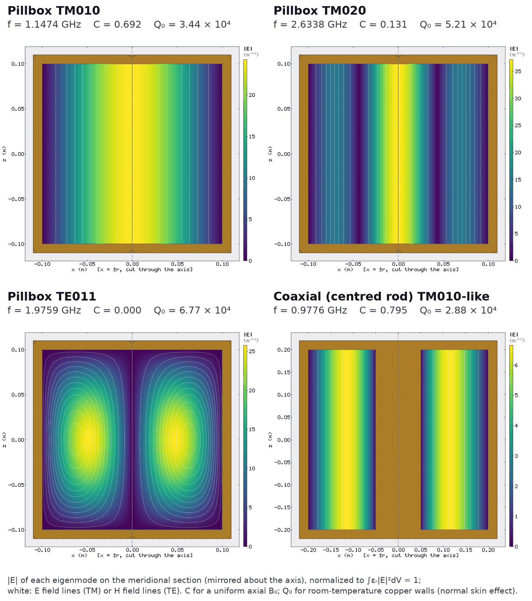

# Cavity haloscopes, axisymmetric — validation

**Beta.** Generated by `benchmarks/cavity_2d_validation.py` from `benchmarks/records/cavity_mc*.json`; references
are closed forms (pillbox and coaxial modes, form factors and geometry factors of `axionfem.cavity`, derived
independently of the solver; tests `tests/test_cavity.py`). Order-2
elements unless stated; `h` is the cavity element size (closed sphere R = 1 m, so the mesher's far-field
cap pi R/96 does not interfere). Design section: docs/design_format.md, "Cavity haloscopes".

## 1. Cavity domain, frequencies (pillbox a = 0.1 m, L = 0.2 m)

Relative frequency error. All energy lies in the cavity region (`energy_fraction`), the room outside
the wall is one excluded component.

| order | h [m] | DOFs | TM010 | TM011 | TE011 |
|---|---|---|---|---|---|
| 2 | 0.02 | 7547 | 1.92e-06 | 9.82e-06 | 6.49e-05 |
| 2 | 0.01 | 9127 | 1.30e-07 | 6.64e-07 | 4.17e-06 |
| 2 | 0.005 | 13435 | 9.13e-09 | 5.14e-08 | 3.19e-07 |
| 2 | 0.0025 | 28787 | 5.79e-10 | 3.03e-09 | 1.93e-08 |
| 3 | 0.02 | 16855 | 5.50e-09 | 1.35e-08 | 1.62e-07 |
| 3 | 0.01 | 20401 | 9.28e-11 | 2.21e-10 | 2.61e-09 |
| 3 | 0.005 | 30073 | 1.99e-12 | 4.37e-12 | 5.55e-11 |

Order 2 converges as h^4 (eigenvalues); 1e-5 is reached at h = a/5 = 2 cm for TM010/TM011 and at
h = 1 cm for TE011.

## 2. Targeted shift-invert

`fullwave.target_f_Hz` = 2.5 f(TM010) = 2.8686 GHz, 12 modes per family.
Every analytic TM0np/TE0np mode within +-20 % of the target is returned (the nearest in omega^2).

| mode | f exact [GHz] | rel (h = 5 mm) | rel (h = 2.5 mm) |
|---|---|---|---|
| TE012 | 2.364180 | 7.90e-07 | 4.70e-08 |
| TM013 | 2.524298 | 1.13e-06 | 6.86e-08 |
| TM020 | 2.633820 | 9.90e-07 | 6.22e-08 |
| TM021 | 2.738381 | 1.24e-06 | 7.59e-08 |
| TE013 | 2.897923 | 2.22e-06 | 1.35e-07 |
| TM022 | 3.030494 | 2.24e-06 | 1.31e-07 |
| TM014 | 3.210006 | 3.46e-06 | 2.10e-07 |
| TE021 | 3.430257 | 4.07e-06 | 2.55e-07 |

Factorization: LDLT (probe-checked); Lanczos steps 44.

## 3. Form factor (uniform axial B0)

| h [m] | C010 rel | C020 rel | C030 rel | max C(TM0np, p>0)/C010 | max C(TE) |
|---|---|---|---|---|---|
| 0.02 | 9.72e-06 | 3.94e-04 | 1.02e-03 | 3.61e-08 | 0.0 |
| 0.01 | 5.69e-07 | 3.99e-05 | 2.90e-04 | 8.59e-11 | 0.0 |
| 0.005 | 4.65e-08 | 2.42e-06 | 1.61e-05 | 2.29e-14 | 0.0 |
| 0.0025 | 3.02e-09 | 1.62e-07 | 1.13e-06 | 1.95e-17 | 0.0 |

Coaxial cavity b = 0.2 m, a = 0.05 m: exact kb = 4.0976855393, f = 977.573603 MHz, C = 0.7949373125 (vacuum volume).

| h [m] | f rel | C rel |
|---|---|---|
| 0.02 | 9.92e-06 | -4.77e-05 |
| 0.01 | 7.78e-07 | -3.78e-06 |
| 0.005 | 5.16e-08 | -2.48e-07 |
| 0.0025 | 3.37e-09 | -1.63e-08 |

Dielectric sleeve (eps_r = 4, 0.03 < r < 0.05 m, full length) in the pillbox: 1D Bessel matching
(`axionfem.cavity.sleeve_tm_mode`) f = 0.789879306 GHz, C = 0.3095125358 (eps-weighted).

| h [m] | f rel | C rel |
|---|---|---|
| 0.01 | 2.43e-06 | -9.81e-07 |
| 0.005 | 1.19e-07 | -1.70e-09 |
| 0.0025 | 8.79e-09 | -4.93e-10 |

## 4. Geometry factor G = Q0 R_s and dielectric loss

G(TM010) = Z0 chi01 L/(2(a + L)); G(TM011) = Z0 k a L/(2(L + 2a)); G(TE011) from
Pozar, Microwave Engineering, Sec. 6.4 (the TE_nml wall Q), with n = 0. TE: wall current from the consistent-flux recovery; the pointwise derivative
(`G_ohm_pointwise`) is shown for comparison.

| h [m] | TM010 | TM011 | TE011 | TE011 pointwise |
|---|---|---|---|---|
| 0.02 | -7.39e-06 | -2.89e-05 | -5.66e-04 | -4.26e-02 |
| 0.01 | -3.65e-07 | -1.92e-06 | -3.71e-05 | -1.02e-02 |
| 0.005 | -2.94e-08 | -1.43e-07 | -2.80e-06 | -2.93e-03 |
| 0.0025 | -1.87e-09 | -8.69e-09 | -1.86e-07 | -8.44e-04 |

Fully filled dielectric (eps_r = 2, tan delta = 1e-4, h = 5 mm): f/f_vac*sqrt(2) - 1 = 4.13e-09, Q_d tan delta - 1 = 0.00e+00, C eps_r/C010 - 1 = 4.65e-08 (eps-weighted C).

## Per-mode field export (Results.cavity_mode_field)

Exported fields of the pillbox (normalized to int eps_r |E|^2 dV = 1) against the closed forms
TM010: E_z = E0 J0(chi01 r/a), H_phi = (E0/Z0) J1(chi01 r/a); TE011: E_phi = E0 J1(kc r) sin(pi (z + L/2)/L)
and its H_r, H_z. Max pointwise error on a 41 x 21 grid (r <= 0.995 a, |z| <= 0.098 m) relative to the
field scale (E0, E0/Z0; H of TE011: E0 kc/(omega mu0)). E of TM and H of TE are derivatives of the order-2
unknown and converge as h^2; H_phi of TM and E_phi of TE (the unknown itself) as h^3. `norm`, `energy`:
int eps_r |E|^2 dV - 1 and Z0^2 int mu_r |H|^2 dV - 1 by 48 x 48 Gauss quadrature of the sampled fields
(the second checks that E, H and f belong to the same eigenpair). Both identities hold exactly with
element quadrature (the Rayleigh quotient of the discrete eigenpair; element-wise quadrature of the sampled
fields reproduces both to < 1e-9, tests/test_cavity_modefields.py); the residuals here are those of
the tensor Gauss rule on fields that are only piecewise smooth (kinks at element edges).

| h [m] | TM010 E_z | TM010 E_r | TM010 H_phi | TE011 E_phi | TE011 H | TM010 norm | TM010 energy | TE011 norm | TE011 energy |
|---|---|---|---|---|---|---|---|---|---|
| 0.02 | 1.27e-02 | 3.27e-03 | 3.51e-04 | 1.49e-03 | 3.73e-02 | -2.21e-05 | 8.94e-07 | 5.10e-06 | -2.40e-04 |
| 0.01 | 3.21e-03 | 6.44e-04 | 3.51e-05 | 1.93e-04 | 9.60e-03 | -2.93e-05 | 7.25e-08 | -2.36e-06 | -2.39e-04 |
| 0.005 | 8.04e-04 | 6.09e-05 | 3.24e-06 | 1.99e-05 | 2.42e-03 | -1.13e-05 | 4.66e-08 | 2.81e-07 | -1.85e-05 |
| 0.0025 | 2.01e-04 | 1.17e-05 | 4.10e-07 | 2.39e-06 | 6.05e-04 | -4.93e-06 | 6.18e-08 | 5.11e-07 | -3.36e-05 |

*|E| of pillbox TM010, TM020, TE011 and of the coaxial (centred rod) TM010-like mode from
`Results.plot_mode` (C++ renderer); f, C and Q0 (300 K copper) from the solve. Regenerate with
[docs/images/make_cavity_figure.py](../images/make_cavity_figure.py).*

## Limitations

- m = 0 modes only (TM0np, TE0np); hybrid and m != 0 modes need the 3D path ([cavity_3d.md](cavity_3d.md)).
- Losses are perturbative (lossless mode, Q >> 1); these cases use the `skin`, `power` and `table` R_s models
  (all models: [surface_resistance.md](../physics/surface_resistance.md)).
- Sharp re-entrant metal edges carry integrable field singularities; the wall-loss integral converges more
  slowly there (not exercised by these cases).
