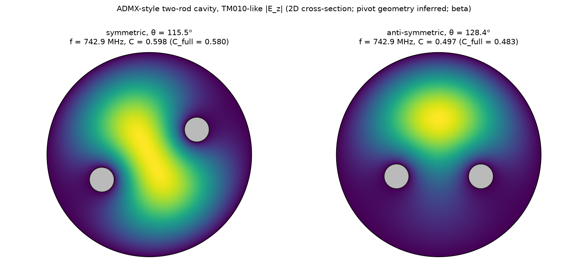
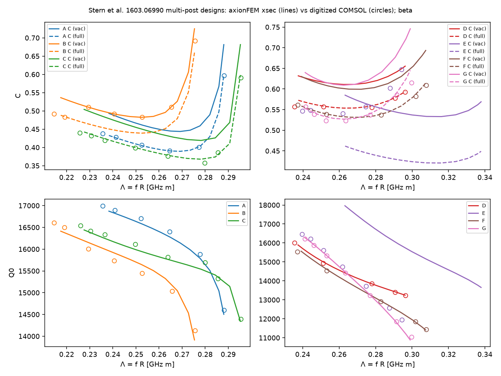

# Cross-section cavity solver (`"symmetry": "xsec"`): validation

**Beta.** Formulation: `cpp/include/axionfem/xsec.hpp`; design keys: [design_format.md](../design_format.md)
"Cross-section cavities". Tests: `tests/test_cavity_xsec.py`. Scripts in `benchmarks/cavity/xsec_*.py`,
records in `benchmarks/records/cavity_xsec_*.json`.

## Scope

z-independent modes of a z-uniform cavity: TM_z (E_z, Dirichlet on metal; exact TM_mn0 modes of the capped
cavity for any length) and optionally TE_z (H_z, natural; C = 0, not modes of a capped cavity). z-dependent modes
(TM/TE_mnp, p >= 1; hybrid modes with dielectrics), end gaps, armatures and field maps are the 3D solver's job.

## Convergence (benchmarks/cavity/xsec_convergence.py, record cavity_xsec_convergence.json)

Empty disk R = 50 mm, TM010, relative errors vs f = c j01/(2 pi R), C = 4/j01^2, G_2d = Z0 j01/2 and the capped
G = Z0 j01 L/(2(R + L)) (L = 0.25 m):

| order | h/R | DOFs | f | C | G_2d (consistent flux) | G_2d pointwise | G with caps |
|---|---|---|---|---|---|---|---|
| 2 | 1/8 | 2092 | 8.9e-7 | 4.2e-6 | -5.2e-6 | -1.9e-3 | -4.2e-6 |
| 2 | 1/16 | 6131 | 9.4e-8 | 4.2e-7 | -5.3e-7 | -4.9e-4 | -4.3e-7 |
| 2 | 1/32 | 19725 | 7.2e-9 | 3.1e-8 | -3.9e-8 | -1.3e-4 | -3.1e-8 |
| 3 | 1/8 | 4630 | 1.6e-8 | 1.8e-9 | -2.1e-9 | -3.8e-6 | 8.8e-10 |
| 3 | 1/16 | 13642 | 9.8e-10 | 3.8e-11 | -4.5e-11 | -3.5e-7 | 1.3e-10 |
| 3 | 1/32 | 44083 | 6.7e-11 | 8.8e-13 | -7.1e-13 | -4.2e-8 | 1.1e-11 |

The consistent-flux wall loss converges like the eigenvalue (order ~h^3.4 at P2 with the quadratic geometry); the
pointwise derivative, kept as `G_ohm_pointwise`, converges at h^2 (P2), as expected.

Off-centre PEC rod (R = 0.2 m, rod a = 0.05 m at x = 0.06 m), relative errors vs the method-of-particular-solutions
reference `cavity_xsec.eccentric_rod_tm_mode` (Bessel J_n about the axis + Y_n about the rod, boundary-integral C and
G; no FEM; it reproduces the coaxial closed form kb = 4.0976855 to 1e-9):

| h/R | f | C | G rod | G wall |
|---|---|---|---|---|
| 1/10 | 5.4e-6 | 4.5e-6 | -5.4e-5 | -1.0e-5 |
| 1/20 | 6.6e-7 | 3.6e-7 | -6.2e-6 | -1.1e-6 |
| 1/40 | 7.0e-8 | 1.8e-8 | -6.5e-7 | -8.5e-8 |

## Analytic and cross-solver checks (tests/test_cavity_xsec.py)

- Empty disk: TM010 and TM020 f and C = 4/j0n^2 (0.6916602761, 0.1312712271); TM110 doublet C < 1e-8; TE11, TE21,
  TE01 f and G_2d = Z0 j'_mn (1 - m^2/j'_mn^2)/2; end caps reproduce the pillbox G and Q0 = G/R_s, and the
  axisymmetric pillbox solver (f 1e-6, C, G, Q0 1e-5).
- Coax b/a = 4: kb = 4.0976855393 (5e-6 at h = (b-a)/12), C = 0.7949373125 (vacuum area), C_full, rod and wall G
  vs the closed form `coax_tm_G2d`; f and C equal to the axisymmetric coax.
- Centred dielectric rod (eps_r = 9.4, r = 0.3 R): f, C (eps-weighted, full area) and the electric energy fraction
  (Q_d = 1/(tan delta fe)) vs the 1D Bessel matching `cavity.sleeve_tm_mode`: checks the weak form (eps_r in the mass
  matrix, natural continuity of dE_z/dn).
- CAPP ideal sector cells (1710.06969 Tables 2-3; refs capp_multicell_1710.json): N = 2, 4, 6, 8 single cells
  (Rc = 25 mm, sigma = 5.96e7, no caps): f, C, G_2d vs the closed form `sector_cell_mode` (2e-6, 2e-5, 2e-4 at
  h = Rc/24); Q within 0.6 % of the paper's analytic column (the column used sigma ~ 5.998e7, refs inconsistency).
  The 2-cell cavity as a full disk with zero-thickness partitions (curves) gives the same mode. A centre gap joins the
  cells: TE_z H_z is split across the sheets and the free sheet edges are warned about.
- Fields: E_z(0) of the normalized TM010 = 1/(sqrt(pi) R J1(j01)) (1e-5), |H| at the wall / E_z(0) = J1(j01)/Z0
  (1e-3, pointwise derivative).

## ADMX two-rod cavity (benchmarks/cavity/xsec_admx_figure.py; record cavity_xsec_admx.json)

Geometry from `benchmarks/cavity/refs/admx_two_rod.json`: R = 210 mm, rods 50.8 mm, pivots at
+-122 mm, arm 57 mm (pivot radius and arm INFERRED there). The four configurations T1-T4 agree with that file's
independent finite-difference 2D model to < 1e-5, i.e. within that file's 0.01 MHz rounding (583.005, 888.546,
773.863, 653.765 MHz) and with the published
580 / 890 / 773 / 656.4 MHz to <= 0.5 % (the inference residual). Symmetric rods at 115.5 deg (1910.08638 Fig. 2):
742.874 MHz, C = 0.598 (C_full 0.580); the anti-symmetric configuration at the same TM010 frequency needs 128.4 deg
(the figure measures ~129.6 deg), C = 0.497 (0.483). Figure: docs/images/cavity_xsec_admx.png.

Single off-centre rod in the ADMX cavity (benchmarks/cavity/xsec_offcentre_field.py): rod at 120 deg on the inferred
arm, f = 625.4376 MHz, C = 0.61625 (MPS reference: 1.2e-8 and 1e-9), Q0 = 3.09e5 with builtin cold copper and the
end caps at L = 1.01 m. The script also writes a field export (`cavity_xsec_offcentre_field.npz`: E_z on a 501 x 501
grid, NaN in metal) and a figure of the mode into its work directory.

## Stern et al. 1603.06990 multi-post designs (benchmarks/cavity/xsec_stern.py; record cavity_xsec_stern.json)

R = 50 mm, d = 250 mm, 300 K copper (sigma = 5.8e7 S/m, skin), posts of Table I; the rotation range/phase is not
published, so the moving set is swept from 0.5 mm clearance to the symmetric position and the comparison is along
Lambda = f R with the digitized Fig. 6 points (TM010-like = largest C). rms relative deviation:

| design | C (vacuum A) | C_full (pi R^2) | Q0 | Lambda range ours / paper |
|---|---|---|---|---|
| A | 13.8 % | **0.3 %** | 0.6 % | 0.238-0.288 / 0.236-0.288 |
| B | **4.5 %** | 8.0 % | 1.0 % | 0.217-0.275 / 0.215-0.276 |
| C | 14.9 % | **1.6 %** | 0.7 % | 0.228-0.295 / 0.226-0.295 |
| D | 10.7 % | **0.4 %** | 0.3 % | 0.237-0.296 / 0.235-0.296 |
| E | 10.8 % | 28 % | 29 % | 0.263-0.338 / 0.240-0.294 |
| F | 13.4 % | **0.6 %** | 0.3 % | 0.239-0.307 / 0.237-0.308 |
| G | 16.4 % | **1.0 %** | 0.3 % | 0.241-0.299 / 0.241-0.300 |

Designs A, C, D, F, G agree with C_full (full cylinder volume) at the 0.3-1.6 % level, comparable to the
digitization and their ~20k-tetrahedron meshes; Q0 agrees to <= 1 %. This indicates, but does not prove, that Stern
et al. normalized by the full cylinder: design B agrees with the vacuum-area C instead, at 4 of its 5 points to
<= 0.2 % (its Lambda range and Q0 match the Table I geometry), so the paper's convention is not uniform across its
series (or B was post-processed differently); recorded as a discrepancy, not resolved. With
`benchmarks/cavity/repro/stern_B_variants.py` (record `cavity_repro_stern_B_variants.json`): of nine discrete B geometries (post diameters, post-location radii, the A and C
rows) only the Table I geometry reproduces the Lambda range and Q0 (1 %), and none brings C_full within 7 %: B is not a
Table I typo of the kinds tested; the most likely reading (4 of its 5 points) is a vacuum-volume normalization, not
proven ([cavity_reproductions.md](cavity_reproductions.md)).

Design E: with the Table I post diameter 0.375 R the moving and stationary posts touch radially
(0.375 + 0.1875 = 0.75 - 0.1875) and the Lambda range is 0.263-0.338 against the paper's 0.240-0.294, which suggests a
typo in Table I (a smaller post diameter). No alternative E geometry is tested with a record here; the table above
keeps the Table I geometry.

## Hard cases

- Off-centre dielectric rod (R = 50 mm, rod a = 7.5 mm at x = 20 mm, eps_r = 9.4) vs an independent
  method-of-particular-solutions reference with interface matching (`cavity_xsec.eccentric_dielectric_rod_tm_mode`;
  boundary residual 5e-9): h = R/12: f 5.5e-6, C 2.4e-5, rod energy fraction -1.7e-5, wall G -8.3e-6; h = R/24:
  5.5e-7, 2.5e-6, -1.8e-6, -9.7e-7 (order ~3.3). In the test suite
  (`test_off_centre_dielectric_rod_vs_particular_solutions`).
- A rod tangent to or overlapping the wall: solved; the post becomes part of the outer boundary, so `area_full`
  excludes it (overlap: C_full = C; tangent: an in-between value from the degenerate contact), reported in
  `fullwave.cavity.outer_boundary_bodies` with a warning (`test_post_touching_wall_is_reported`).
- Narrow gaps between two rods, or between a rod and the wall, have no automated test or record.

## Known limitations

- No z dependence (see Scope). TE_z modes have no end-cap losses (they are not modes of a capped cavity).
- Free sheet edges and re-entrant corners: singular fields, slow convergence of the wall loss (warned for sheets).
- Near-degenerate modes (e.g. two cells almost separated by a post) mix in the eigensolver: their individual C are
  not meaningful, their sum is.
- B0 is uniform and axial (C independent of its magnitude); `background.Bz` only sets |B| for magnetoresistance and
  flux-flow R_s (TM_z barrel wall currents are parallel to B0: flux-flow orientation factor 0; TM_z end caps and TE_z: 1).
