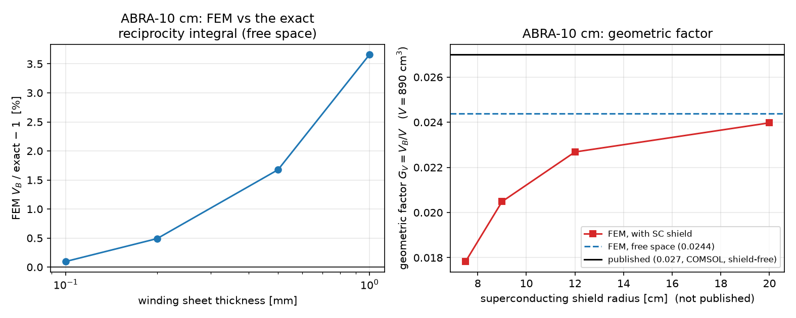
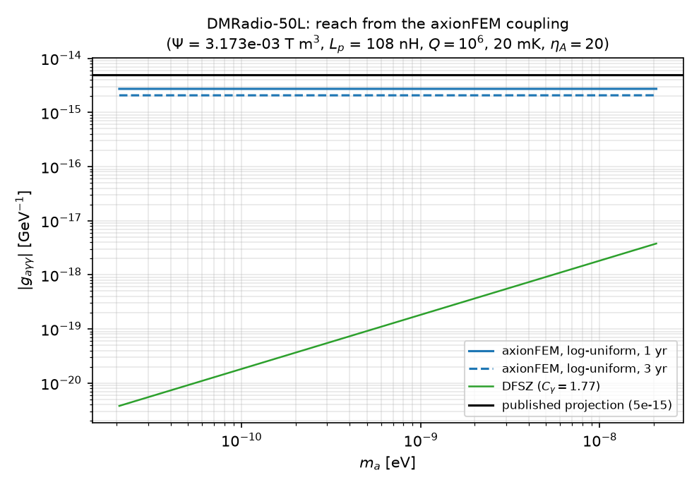
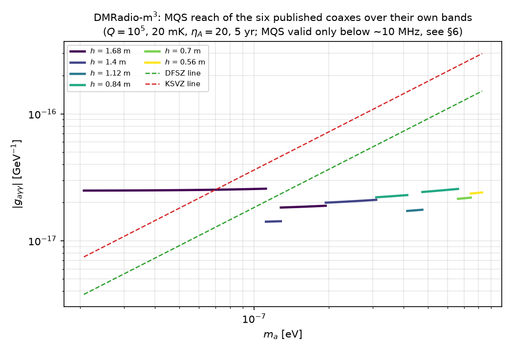
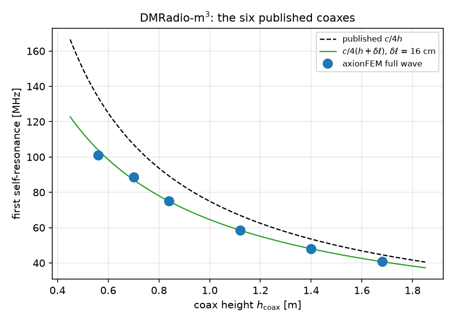
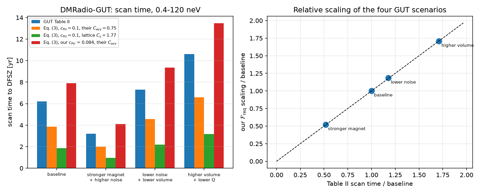
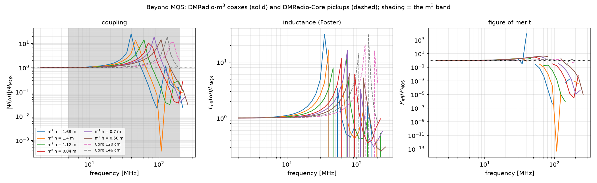
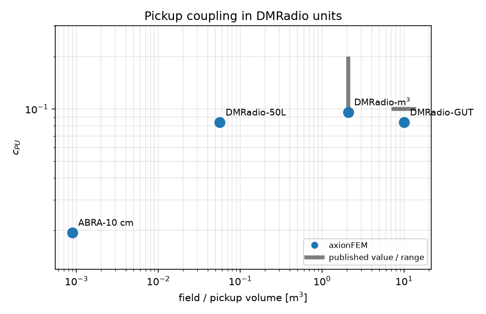

# Benchmarks against published geometry factors and sensitivities

**Scope.** ABRACADABRA-10 cm, DMRadio-50L, DMRadio-m³, DMRadio-GUT and
DMRadio-Core, built as axionFEM designs from public information only, solved,
and compared with the published coupling and sensitivity numbers.

**Generated** by `benchmarks/published_benchmarks.py`; every number below is read
from `benchmarks/records/published_*.json`. Designs: `benchmarks/published/*.json`.
Every dimension and its source: `benchmarks/published/sources.json`.
Fast regression checks: `tests/test_published.py`.

---

## 0. Converting the published coupling definitions to ours

axionFEM reports, in natural Heaviside–Lorentz units with the readout current
divided out (docs/physics/scan_and_signal.md §1.2),

$$\Psi=\frac1I\int \mathbf A_I\cdot\mathbf B_{\rm lab}\,d^3x\ [\mathrm{T\,m^3}],
\qquad L_p\ [\mathrm m],\qquad \mathcal F=\Psi^4/L_p^2 .$$

### 0.1 ABRACADABRA's effective volume $V_B$ and geometric factor $G$

Kahn, Safdi & Thaler (arXiv:1602.01086, "KST") Eq. (7) writes the pickup flux as
$\Phi_{\rm pickup}(t)=g_{a\gamma\gamma}B_{\max}\sqrt{2\rho_{\rm DM}}\cos(m_at)\,V_B$
with the triple integral of its Eq. (8) for $V_B$. Our convention is
$\Phi_a=\kappa_a\Psi$ with $\kappa_a=g_{a\gamma\gamma}\sqrt{2\rho_{\rm DM}}$
(flux *amplitude*), so

$$\boxed{\ \Psi\ [\mathrm{T\,m^3}]\ =\ B_{\max}\,V_B\ }$$

**This is an identity, not an approximation, and it is verified numerically
below:** KST Eq. (8), evaluated exactly as written, equals our reciprocity
integral $2\pi R\int\!ds\!\int\!dz\,A_\phi(s,z)/(\mu_0I)$ with the exact
elliptic-integral vector potential of a filament loop, to round-off.

ABRACADABRA-10 cm (arXiv:1810.12257, "ABRA10") Eq. (3) writes
$|\Phi_a|^2=g^2\rho_{\rm DM}V^2G^2B_{\max}^2$ for the *time-averaged* squared
flux, i.e. half the squared amplitude, so $V_B=G\,V$ and

$$\Psi=G_V\,V\,B_{\max}.$$

**One assumption, stated explicitly, because the published definition of $G_V$ is
not self-contained.** The instrument paper (arXiv:1901.10652) gives $G_V$ two
ways, and they are not the same object:

- *footnote 1*: "In the notation of [15], $G_V=V_B/V$", with [15] = KST — a pure,
  dimensionless ratio;
- *its Eq. (4)*: a bare Biot–Savart double integral of
  $\hat n\cdot\mathbf B_0\times(\mathbf r-\mathbf r')/|\mathbf r-\mathbf r'|^3$,
  which **as printed carries neither the $1/(4\pi)$ of the Biot–Savart kernel nor
  the $1/V$ normalisation**, and is therefore dimensionally inconsistent.

Every $G_V$ in this report is the footnote's $V_B/V$, i.e. **we supply the missing
$1/(4\pi)$ and the missing $1/V$ ourselves** and assume that is what was
computed. The assumption cannot be verified from the published text. It is at
least self-consistent: taking their Eq. (4) literally would put our $G$ a factor
$4\pi$ (and a power of length) away from theirs, not the ~10 % seen in §1.4.

Which $V$ goes in the denominator matters as much. The paper states
$V\approx890$ cm³, its "total volume of magnetic field", which is 12.6 % below
the rectangular annulus $\pi(R_{\rm out}^2-R_{\rm in}^2)H=1017.9$ cm³. The
published $V_B$ is therefore $0.027\times890$ cm³ = **24.03 cm³**, and *not*
$0.027\times1017.9$ cm³ = 27.5 cm³; comparing against the latter would give a
spurious −22 %.

### 0.2 DMRadio's $c_{PU}$

DMRadio-m³ (arXiv:2204.13781, "M3") Eq. (A4) is the Biot–Savart flux
$\tilde\Phi_a=\frac{\kappa_a}{4\pi}\,\mathcal I$ with
$\mathcal I=\int\!dA\int\!dV'\,\hat n\cdot\mathbf B_0(\mathbf r')\times
(\mathbf r-\mathbf r')/|\mathbf r-\mathbf r'|^3$, so $\mathcal I=4\pi\Psi$.
Substituting into its Eq. (A5),
$c_{PU}^2=\mu_0\mathcal I^2/[2(4\pi)^2B_0^2V_{PU}^{5/3}L_{\rm eff}]$ with
$L_{\rm eff}=\mu_0L_p$ (SI henries), gives

$$\boxed{\ c_{PU}=\frac{\Psi}{B_0\,V_{PU}^{5/6}\sqrt{2L_p}}
=\frac{\mathcal F^{1/4}}{\sqrt2\,B_0\,V_{PU}^{5/6}},
\qquad \mathcal F=\frac{\Psi^4}{L_p^2}=4\,c_{PU}^4B_0^4V_{PU}^{10/3}\ }$$

which is the mapping already used to cross-check the scan rate in
docs/physics/scan_and_signal.md §5.1. Note that $c_{PU}$ is **not** a pure
geometric number: it depends on which "characteristic" $B_0$ (peak, RMS, on-axis)
and which $V_{PU}$ the authors chose. Every $c_{PU}$ below names its convention.
It *is* invariant under a uniform rescaling of the design at fixed $B_0$, which
is checked explicitly for DMRadio-50L.

DMRadio-Core (Ankel et al. 2026) does not use $c_{PU}$; its Eq. (3) uses the
slit voltage $|V|$ and $L_{\rm eff}$ directly, with
$|V|=m_a\kappa_a\Psi/\hbar$ (peak EMF) and $L_{\rm eff}=\mu_0L_p$, so
$|V|^4/L_{\rm eff}^2\propto\mathcal F$ and its scan rate is ours.

---

## Summary: published vs axionFEM

| detector | quantity | published | axionFEM | deviation | verdict |
|---|---|---|---|---|---|
| ABRA-10 cm | $V_B$ (= $\Psi/B_{\max}$), $t_w\to0$ | 24.03 cm³ (= $0.027\times890$ cm³) | 21.6 cm³ | -10.1 % | **disagrees**; one unreplicated COMSOL number (§1.4) |
| ABRA-10 cm | geometric factor $G_V=V_B/V$, $t_w\to0$ | 0.027 | 0.024267 | -10.1 % | as above; $V$ = 890 cm³, the published field volume |
| ABRA-10 cm | the same, FEM at the finest mesh | 0.027 | 0.024386 | -9.7 % | carries the +0.5 % bias of the modelled $t_w$ = 0.2 mm winding sheet |
| ABRA-10 cm | pickup $L_p$ | 95.5 nH | 95.22 nH | -0.3 % | **agrees** |
| ABRA-10 cm | calibration-loop $L_C$ | 300 nH ("≈") | 298.1 nH | -0.6 % | **agrees** |
| ABRA-10 cm | calibration coupling $M_{CP}$ | 19.3 nH | 19.18 nH | -0.6 % | **agrees** (the PRL's 50 nH disagrees with its own instrument paper) |
| ABRA-10 cm | KST Eq. (8) $V_B$ vs our $\Psi/B_{\max}$ | identity | ratio − 1 = 0 | — | **exact** |
| DMRadio-50L | field volume | ~50 L | 56.11 L | +12 % | rounding-level note, **not** an independent check (§2) |
| DMRadio-50L | $B_{\rm rms}/B_{\rm peak}$ | 0.75 | 0.7457 | -0.6 % | agrees (fixes the aspect ratio) |
| DMRadio-50L | $c_{PU}$ | not published ("~0.1") | 0.08363 | — | prediction |
| DMRadio-50L | live time for the published $5\times10^{-15}$ GeV⁻¹ | not published | 0.0885 yr | — | consistent |
| DMRadio-m³ | $Z_c$ of the published coax | 37.53 Ω (their Eq. 3 with $Z_0$ = 377 Ω; not printed) | 37.5 Ω | -0.08 % | consistent (arithmetic) |
| DMRadio-m³ | $L_p$ of all six coaxes vs $Z_ch/c$ | DMRadio's own formula | -0.7 % to -2.1 % | — | **agrees**; the deficit is the open end |
| DMRadio-m³ | $c_{PU}$, typical | 0.1–0.2 | 0.0954–0.164 | — | overlaps |
| DMRadio-m³ | $c_{PU}$, lowest-frequency coax | 0.16 | 0.09535 | -40 % | **disagrees**; 0.16 is above the uniform-field bound 0.111 for their $V_{PU}$ (§3.2) |
| DMRadio-m³ | $V_{PU}$ (tallest coax) | 2 m³ | 2.082 m³ | +4 % | agrees |
| DMRadio-m³ | live time, DFSZ, 30–200 MHz | 2.9 yr | 1.06 yr | ×0.37 | implies $Q$ = 3.7e+04; modelled $10^4$–$10^6$ |
| DMRadio-m³ | live time, KSVZ, 10–30 MHz | 1 yr | 2.8 yr | ×2.8 | implies $Q$ = 2.8e+05; modelled $10^4$–$10^6$ |
| DMRadio-m³ | live time, g = 1.87e-17 GeV^-1, 5–30 MHz | 3.5 yr | 1.15 yr | ×0.33 | implies $Q$ = 3.3e+04; modelled $10^4$–$10^6$ |
| DMRadio-GUT | stored energy vs 573 MJ | 573 MJ | 577.8 MJ | +0.8 % | **circular, not a check**: 573 MJ is $(2\mu_0)^{-1}B_{\rm rms}^2V$ and the aspect ratio was chosen for it; $W$ spans 569.2–612.2 MJ over the unpublished $t_w$ (§4.2.1) |
| DMRadio-GUT | stored energy vs the analytic ideal toroid | closed form (not published): 566.4 MJ | 577.8 MJ | +2.0 % | closed-form check passes; the non-circular energy check (winding sheet + fillet + sheath) |
| DMRadio-GUT | $c_{PU}$ | 0.1 ("typical") | 0.08363 | -16 % | **inconclusive**: set by an unpublished $H/R_{\rm in}$, over which $c_{PU}$ runs 0.06847–0.0983 (§4.2.2) |
| DMRadio-GUT | scan-time *scaling* over 4 scenarios | Table II | $\mathcal F_{\rm req}$ (S5.4) | < 1 % | **agrees** |
| DMRadio-GUT | scan time, baseline, at GUT's own $C_{a\gamma\gamma}=0.75$ | 6.2 yr | 3.86 yr (their $c_{PU}$) / 7.9 yr (ours) | ×1.60 | **disagrees** with Table II's own Eq. (3); ×3.34 would be the lattice-$C_\gamma$ artefact (§4.3) |
| DMRadio-Core | magnet stored energy at 5 T peak | 4.3 MJ | 4.427 MJ | +3.0 % | **agrees** |
| DMRadio-Core | DFSZ scan time, 70–140 MHz (MQS) | 0.75 yr | 8.51, 4.99 yr | ×11, ×6.7 | **disagrees**; published $\eta$ = 9.75 (§5.2) |
| DMRadio-Core | $L_{\rm eff}$, $\lvert V\rvert $ | not published | see §5.2 | — | prediction |
| DMRadio-m³ | coax self-resonance, all six | $c/4h$ (their Eq. 2) | $c/4(h+\delta\ell)$, $\delta\ell$ = 16.1 cm | ≤ +2.8 % | **agrees** with one open-end correction (§6.1) |
| DMRadio-Core | DFSZ scan time, 120cm, beyond MQS | 0.75 yr | 5.51 yr | ×7.3 | MQS gave 7.35 yr (§6.4) |
| DMRadio-Core | DFSZ scan time, 146cm, beyond MQS | 0.75 yr | 2.98 yr | ×4 | MQS gave 4.31 yr (§6.4) |

Deviations are signed, (ours − published)/published.

> **What `[SELF-CHECK PASS]` does and does not mean.** The pass flag printed by
> `benchmarks/published_benchmarks.py`, stored as `"pass"` in every
> `benchmarks/records/published_*.json`, and asserted by `tests/test_published.py`, tests
> **internal consistency only**: identities (Ψ = B_max V_B against KST Eq. 8, the c_PU
> algebra), mesh and parameter convergence, agreement with our own closed forms (the
> thin-ring inductance, the ideal-toroid energy, the coax $Z_ch/c$), and regression against
> stored reference values. **It asserts nothing about agreement with any publication.** Every check in
> this report passes its self-check while the table above records genuine disagreements —
> ABRA-10 cm's $G_V$ by 10 %, DMRadio-m³'s $c_{PU}$ by 40 %, DMRadio-GUT's Table II scan time
> by ×1.6 and DMRadio-Core's by ×4–11. Each record carries a `pass_scope` field naming
> exactly what its flag covers and what it excludes. The `verdict` column above is the only
> statement in this repository about agreement with the literature.

---

## 1. ABRACADABRA-10 cm

**Design** `benchmarks/published/abra10cm.json`: a counter-wound toroid of rectangular
cross-section 3 cm < r < 6 cm,
|z| < 6 cm, 1280 turns at 121 A, with a single
superconducting pickup loop of radius 2.01 cm and wire radius
0.5 mm in the bore. The counter-winding ("counter-wound to cancel
azimuthal currents") is exactly our `poloidal` winding: a purely toroidal field with no net
azimuthal current.

- `NI` gives $B(R_{\rm in})=\mu_0NI/2\pi R_{\rm in}$ = 1.033 T,
  consistent with the quoted 1 T at the stated ~1 % Hall-probe precision.
- the published field volume is $V$ = 890 cm³,
  which is -12.56 % relative to the rectangular annulus
  $\pi(R_{\rm out}^2-R_{\rm in}^2)H$ = 1017.9 cm³;
  $V$ is the denominator of the published $G_V=V_B/V$, so it is the one to use.
- The cross-section is a frame of 80 Delrin wedges with a winding groove between each
  adjacent pair (16 winds, "laid down in pairs 8 layers deep"); no taper or fillet is stated
  and no engineering drawing is published, so we model the rectangle.
- The winding is modelled as a thin sheet just outside the field box; the sheet thickness
  is not published and is extrapolated to zero below.

### 1.1 The published $V_B$ definition is our reciprocity integral

| check | value |
|---|---|
| KST Eq. (8) / our exact reciprocity integral − 1, at $r=R=a=h/3=0.85$ m | +6.7e-16 |
| Eq. (8) / exact − 1, at the ABRA-10 cm geometry | 0 |
| KST Eq. (8) at $r=R=a=h/3=0.85$ m | 1.00453 m³ |
| KST's own quoted value there ("$V_B=1$ m³") | 1 m³ (+0.45 %) |

So the two definitions agree to round-off, and KST's own benchmark number is reproduced to
+0.45 %. **$\Psi=B_{\max}V_B$ is therefore exact, and any disagreement
below is in the geometry, not in the coupling definition.**

### 1.2 FEM convergence (free space, no shield)

Winding sheet thickness $t_w\to0$ at mesh size 4 mm, order 2:

| $t_w$ [mm] | DOFs | $V_B$ [m³] | $G$ | FEM/exact − 1 |
|---|---|---|---|---|
| 1 | 115475 | 2.23882e-05 | 0.025155 | +3.66 % |
| 0.5 | 104222 | 2.19599e-05 | 0.024674 | +1.68 % |
| 0.2 | 95382 | 2.17037e-05 | 0.024386 | +0.49 % |
| 0.1 | 92014 | 2.16185e-05 | 0.02429 | +0.10 % |

Mesh refinement and order at $t_w = 0.2$ mm (the $V_B$ and $L_p$ columns carry
9 digits, because the variation is at the $10^{-7}$ level):

| mesh [mm] | order | DOFs | $V_B$ [m³] | $V_B$ / finest − 1 | $L_p$ [nH] | $L_p$/thin-ring − 1 |
|---|---|---|---|---|---|---|
| 8 | 2 | 43234 | 2.1703715e-05 | -7.9e-07 | 95.2047 | -0.108 % |
| 4 | 2 | 95382 | 2.17037266e-05 | -2.6e-07 | 95.2167 | -0.096 % |
| 2 | 2 | 226808 | 2.17037322e-05 | 0 | 95.21957 | -0.093 % |
| 4 | 3 | 214402 | 2.17037389e-05 | +3.1e-07 | 95.22171 | -0.090 % |

The residual at finite $t_w$ is the field inside the winding sheet, which the idealised
integral does not have; it falls roughly linearly in $t_w$ and is 0.09 % at 0.1 mm. The
mesh and order are converged to $10^{-7}$ at every size tried, because the toroid's
$B_{\rm lab}=\mu_0NI/2\pi r$ is exact pointwise and the pickup loop's potential is smooth
away from the wire. The pickup inductance reproduces the thin-ring formula
$\mu_0r(\ln 8r/a-2)$ to -0.093 %.

**Which number is the headline.** Both tables above are at the *modelled* winding sheet
$t_w$ = 0.2 mm, which is not published, and every row therefore carries the same
+0.49 % bias: the sheet holds field that the idealised
integral does not. Because the mesh is converged to $10^{-7}$ while the $t_w$ bias is
+0.49 %, picking the FEM row *closest to* the
semi-analytic value would select the **coarsest** mesh and dress up the bias as accuracy.
The headline quoted below and in the summary table is therefore the $t_w\to0$ value,
**$G_V$ = 0.024267** ($V_B$ = 21.5977 cm³, i.e.
0.021218 if $V$ were the rectangular annulus
instead), which is the exact free-space elliptic-integral result that the FEM converges
to; the FEM rows are quoted separately at the most refined mesh (2 mm,
order 2, 226808 DOFs).

### 1.3 The superconducting shield

ABRA10 mounts the toroid inside a tin-coated copper shell that is superconducting below
3.7 K at the 1.2 K operating temperature. **Its dimensions are not published.** A closed
superconducting can *reduces* the flux through the bore, because the return flux of the
axion-induced azimuthal current is forced inside it:

| shield radius [cm] | $V_B$ [m³] | $G$ | $V_B$/free space | $L_p$ [nH] |
|---|---|---|---|---|
| 7.5 | 1.58679e-05 | 0.017829 | 0.7347 | 94.5 |
| 9 | 1.8231e-05 | 0.020484 | 0.8441 | 94.78 |
| 12 | 2.01872e-05 | 0.022682 | 0.9347 | 95 |
| 20 | 2.13354e-05 | 0.023972 | 0.9879 | 95.13 |

### 1.4 Comparison with the published numbers

| quantity | published | axionFEM | deviation |
|---|---|---|---|
| **geometric factor $G_V=V_B/V$, $t_w\to0$** | **0.027** | **0.024267** (free space) | **-10.12 %** |
| the same, FEM at the finest mesh | 0.027 | 0.024386 | -9.68 % (+0.49 % of it is $t_w$) |
| the same with $V$ = the rectangular annulus (**not** the published $V$) | 0.027 | 0.021218 | -21.41 % |
| $G_V$ with a 9 cm superconducting shield | 0.027 | 0.020484 | -24.13 % |
| **$V_B=\Psi/B_{\max}$** (= $0.027\times890$ cm³) | **24.03 cm³** | **21.6 cm³** ($t_w\to0$); 21.7 (FEM) | **-10.12 %**; -9.68 % |
| $\Psi$ (mixes in the $B_{\max}$ convention — see below) | 2.403e-05 T m³ | 2.241e-05 T m³ | -6.74 % |
| pickup inductance $L_p$ | 95.5 nH | 95.22 nH | -0.29 % |
| calibration-loop inductance $L_C$ | 300 nH ("≈") | 298.1 nH | -0.62 % |
| calibration-loop mutual $M$ | 19.3 nH | 19.18 nH | -0.62 % |

**$L_p$, $L_C$ and the calibration coupling all agree.** The instrument paper quotes calculated
values ($L_p$ = 95.5 nH, $L_C$ ≈ 300 nH,
$M_{CP}$ = 19.3 nH from "both an analytic calculation based on the
geometry, as well as with a COMSOL simulation"), and we reproduce all three to better than
1 %. Note that the PRL quotes ≈ 50 nH for the same $M_{CP}$, which disagrees with its own
instrument paper by 2.6×; 19.3 nH is the value consistent with the stated 2.01 cm / 4.5 cm
coplanar geometry, and it is what we get.

(KST Eq. (11)'s energy floor $\mu_0\pi R_{\rm in}^2/H$ =
29.61 nH, so the loop is ~3× above it.)

**On the $\Psi$ row.** $\Psi=B_{\max}V_B$, so the $\Psi$ comparison is the $V_B$
comparison *times the ratio of the two $B_{\max}$ conventions*: ours is
$\mu_0NI/2\pi R_{\rm in}$ = 1.03253 T from the published $N$,
$I$ and $R_{\rm in}$, theirs is the quoted 1 T
(+3.25 %; their quoted Hall-probe precision is ~1 %, so
the two $B_{\max}$ values differ by more than that). That is why the $\Psi$ row reads
-6.74 % and not -9.68 %: the two differ
by exactly that factor. **$V_B$, or $G_V$, is the geometric comparison; $\Psi$ is not.**

**$V_B$ does not agree, by 10 %.** This is the
whole of the disagreement, and none of the candidate explanations closes it:

- the **volume convention** is already applied. The published $G_V$ is $V_B/V$ with
  $V$ = 890 cm³, the paper's "total volume of
  magnetic field", which is 12.56 % BELOW the
  rectangular annulus, so the published $V_B$ is $0.027\times890$ cm³ = 24.03 cm³ and
  that is what the table compares against;
- the **pickup radius** is 20.1 mm, not the PRL's rounded 2.0 cm, worth +1 % — already in;
- the **superconducting shield** moves $G_V$ the wrong way, and in any case the published
  $G_V$ is a bare vacuum Biot-Savart integral (their Eq. 4) with no shield in it;
- a **field region of exactly 890 cm³** makes it worse, not better (next table).

Shrinking the field box from the 3–6 cm × 12 cm envelope to the published 890 cm³, three
ways, all at $t_w\to0$ and $r_p$ = 20.1 mm:

| 890 cm³ field region | $V_B$ [cm³] | $G_V$ | vs published $V_B$ | the same with the $t_w$ = 0.2 mm bias restored |
|---|---|---|---|---|
| shorter: R 3-6 cm, H reduced | 20.645 | 0.023196 | -14.09 % | -13.67 % |
| narrower: R_out reduced, H = 12 cm | 20.235 | 0.022736 | -15.79 % | -15.38 % |
| bored out: R_in raised, H = 12 cm | 19.018 | 0.021369 | -20.86 % | -20.47 % |

A smaller field region removes field *and* flux, so it lowers $V_B$ faster than it lowers
$V$: the published 890 cm³ cannot be read as "the rectangle minus the corners" and still
give $G_V$ = 0.027. What is left is the 10 %
deficit in $V_B$ itself, which corresponds to an effective pickup radius of
21.19 mm instead of the
stated 20.1 mm, or to a field
volume of 803.8 cm³ *with the
flux of the full envelope*. The instrument paper gives no engineering cross-section (80
Delrin wedges with a winding groove between each adjacent pair, 16 winds "laid down in
pairs 8 layers deep", and no taper or fillet stated), does not say how the 890 cm³ was
obtained, quotes no uncertainty on $G_V$, and reports no analytic cross-check for it —
unlike $M_{CP}$, where it did both and we agree. We therefore report the
10 % as an open difference against a single
unreplicated COMSOL number, not as a defect on either side.

### 1.5 Sensitivity

ABRA-10 cm used a **broadband (untuned)** readout and does not publish its SQUID noise PSD,
so its limit cannot be recomputed from the resonant optimal-scan machinery of
docs/physics/scan_and_signal.md (the white flux-noise floor, 0.6 µΦ₀²/Hz, is published but
the measured PSD is not). What is well defined is the rescaling at fixed data,
$g_{95}\propto1/\Psi$:

| | published | implied by our $V_B$ (free space) |
|---|---|---|
| best 95 % limit | 1.4e-10 GeV⁻¹ | 1.55e-10 GeV⁻¹ |
| weakest 95 % limit | 3.3e-09 GeV⁻¹ | 3.654e-09 GeV⁻¹ |

i.e. the published limits would be weaker by ×1.11 (free space) or
×1.32 (9 cm shield). For scale, the paper itself reports a
measured flux-to-current gain ~6× below expectation from parasitic impedances — a far larger
effect than this geometric difference.

In DMRadio units the ABRA-10 cm pickup has
$c_{PU}$ = 0.01943 ($B_0=B_{\max}$, $V_{PU}=V_{\rm toroid}$), about 5× below the sheath pickups below;
this is the quantitative content of DMRadio-GUT's statement that DMRadio-50L "will
significantly improve the coupling factor by enclosing the axion effective current in a
superconducting pickup sheath".



---

## 2. DMRadio-50L

**There is no public DMRadio-50L design paper** (cited as "in preparation" by M3 ref. [61]
and "to appear" by DMRadio-Core ref. [35]). The magnet dimensions come from a
public conference talk, and are confirmed by **two** independent consistency checks:

- **Dimensions** (Patras 2023 status talk, slide 20): inner radius 14 cm,
  outer radius 24 cm, height 47 cm,
  5040 turns (140 grooves × 36), counter-wound, ~140 A for 1 T peak.
- **Check 1:** $\mu_0NI/2\pi R_{\rm in}$ = 1.008 T, matching the
  quoted 1 T peak field at 140 A — the slide's own turns, current and inner radius have to
  reproduce the field it quotes, and they do.
- **Check 2:** the aspect ratio 1.7143 gives
  $B_{\rm rms}/B_{\rm peak}$ = 0.7457, matching DMRadio-GUT's
  "12 T RMS (equivalent to a 16 T peak field for a toroid with the same approximate aspect
  ratio as DMRadio-50L)" = 0.75 — an independent, refereed publication.
- *Not* a third check: $\pi(R_{\rm out}^2-R_{\rm in}^2)H$ = 56.11 L
  against the "~50 L" (+12 %). "50 L" is a round number in
  the experiment's own name, with no stated precision, so this is a rounding-level
  consistency note and nothing is confirmed by it beyond the order of magnitude.

**Design** `benchmarks/published/dmradio_50l.json`: the `toroid` template — magnet plus a slit
superconducting sheath carrying the readout current around the axis — which is the published
topology ("a superconducting sheath is then wrapped around the magnet ... by cutting vertical
slits in the toroidal sheath, the currents flow from the inner walls of the sheath onto the
outer walls"). The sheath thickness and its clearance from the winding are **not published**;
template defaults are used and their effect is quantified below.

### 2.1 Mesh convergence

| mesh [mm] | DOFs | $\Psi$ [T m³] | $\Psi$/finest − 1 | $L_p$ [nH] | $W$ [kJ] | $\mathcal F$ [T⁴m¹⁰] | $g$ | $c_{PU}$ |
|---|---|---|---|---|---|---|---|---|
| 16 | 78939 | 0.00317316607 | -7.2e-07 | 108.2497 | 12.8673 | 1.3663e-08 | 0.12063 | 0.08363 |
| 10 | 109731 | 0.00317316713 | -3.9e-07 | 108.2498 | 12.8673 | 1.3663e-08 | 0.12063 | 0.08363 |
| 6 | 201329 | 0.00317316794 | -1.3e-07 | 108.2498 | 12.8673 | 1.3663e-08 | 0.12063 | 0.08363 |
| 4 | 381386 | 0.00317316836 | 0 | 108.2498 | 12.8673 | 1.3663e-08 | 0.12063 | 0.08363 |

Last refinement: $\Psi$ +1.3e-07, $L_p$ +1.3e-07, $\mathcal F$ +2.7e-07 — the sheath surface mesh
(`surface_size`, set by the wall thickness) controls these, not the bulk size.

### 2.2 The unpublished sheath clearance

| clearance [mm] | $\Psi$ [T m³] | $L_p$ [nH] | $\mathcal F$ [T⁴m¹⁰] | $c_{PU}$ |
|---|---|---|---|---|
| 0.6 | 0.00320437 | 109.31 | 1.3933e-08 | 0.08404 |
| 1.2 | 0.00317317 | 108.25 | 1.3663e-08 | 0.08363 |
| 2.4 | 0.00311134 | 106.14 | 1.3135e-08 | 0.08282 |
| 6 | 0.00293061 | 99.975 | 1.1654e-08 | 0.08037 |

### 2.3 Scale invariance of $c_{PU}$ (a property of the definition, and a code check)

| scale | $V$ [m³] | $\mathcal F$ [T⁴m¹⁰] | $c_{PU}$ | $g$ |
|---|---|---|---|---|
| ×0.5 | 0.0070136 | 1.3343e-11 | 0.083634 | 0.12063 |
| ×1 | 0.056109 | 1.3663e-08 | 0.083634 | 0.12063 |
| ×2 | 0.44887 | 1.3991e-05 | 0.083634 | 0.12063 |

$\mathcal F$ scales as $s^{10}$ and $c_{PU}$, $g$ are invariant, as the definitions require.

### 2.4 Comparison with the published numbers

| quantity | published | axionFEM |
|---|---|---|
| field volume | ~50 L | 56.11 L |
| $B_{\rm peak}$ | 1 T | 1.008 T (from $NI$) |
| $B_{\rm rms}$ | — | 0.7516 T |
| $\Psi$ | not published | 0.0031732 T m³ |
| $L_p$ | not published | 108.25 nH |
| $W_{\rm mag}$ | not published | 12.867 kJ |
| $\mathcal F=\Psi^4/L_p^2$ | not published | 1.3663e-08 T⁴m¹⁰ |
| $c_{PU}$ | not published (GUT: "typical ~0.1") | 0.08363 |
| $g=\Psi^2/(L_pWR^2)$ | — | 0.12063 |

Nothing about the 50L coupling is published, so these are predictions. The one anchor is
GUT's "a typical value is $c_{PU}\sim0.1$" for a sheathed toroid, which our
0.0836 matches.

### 2.5 Reach

The published projection (arXiv:2210.07215 Fig. 1) is a **flat** block at
5e-15 GeV⁻¹ over 20 peV – 20 neV. A reach that is flat in $g$ is the
log-uniform (equal time per $\ln\nu$) allocation, so that is what we use. The live time is
not published; we solve for it.

| input | value | source |
|---|---|---|
| $Q$ | 1e+06 | GUT L247-251: 'a resonator with a Q-factor of ~10^6' |
| $T$ | 20 mK | P50L Sec. 3: resonator base temperature ~20 mK |
| $\eta_A$ | 20 | DC SQUID at 20× the SQL |
| band | 5 kHz – 5 MHz | arXiv:2210.07215 |
| $\rho_{\rm DM}$, SNR, $Q_a$ | 0.45 GeV/cm³, 3, 6.4e+05 | DMRadio conventions |

| quantity | value |
|---|---|
| $g_{95}$, log-uniform, 1 yr | 2.727e-15 GeV⁻¹ (flat to +0.2 % over the band) |
| $g_{95}$, log-uniform, 3 yr | 2.072e-15 GeV⁻¹ |
| published projection | 5e-15 GeV⁻¹ |
| **live time our coupling needs for it** | **0.0885 yr (32.3 days)** |
| $g_{95}/g_{\rm DFSZ}$, DFSZ-target allocation, 1 yr | 3.149e+05 (50L is far above the QCD line here) |

Our coupling reaches the published 5e-15 GeV⁻¹ in
32 days of live time; equivalently, in one
year it would reach 2.73e-15 GeV⁻¹, 1.83× better than the published block.
The live time, the allocation and whether $5\times10^{-15}$ GeV⁻¹ is a best or a flat reach are
all unpublished, so this is a one-parameter consistency check and not an independent
reproduction: the published number is reachable with our coupling in a commissioning-length
run, and nothing stronger can be said until the 50L design paper appears.



---

## 3. DMRadio-m³

**The m³ pickup geometry is fully published**, in the electromagnetic-modelling paper
arXiv:2302.14084 (not in the science paper): a coaxial pickup of inner radius
$r_i$ = 0.336 m and outer radius $r_o$ = 0.628 m
(so $x = r_i/r_o$ = 0.5350, within 0.3 % of the long-coax optimum 0.534), shorted at one
end and read out across the annular gap at the open top, in **six interchangeable heights**
each assigned to its own frequency range (their Table I). The magnet envelope (1.45 m bore,
1.72 m OD, 1.35 m tall) comes from the DMRadio-Core paper. Only the wall thickness, the port
gap and the coax's axial position are chosen by us.

**Designs** `benchmarks/published/dmradio_m3*.json` (one per height).

The real magnet is segmented and bucked; **neither is modelled**. We set the ampere-turns to
the published characteristic on-axis field $B_0$ = 4.0 T
($NI$ = 6.627e+06 A, achieved 4 T), which gives
$|B|_{\max}$ = 4.787 T against the published
6.7 T and $W$ = 24.22 MJ against the
~43 MJ inferred from the Core paper.

### 3.1 The six published coaxes

| $h$ [m] | published band(s) [MHz] | $V=\pi r_o^2h$ [m³] | $\Psi$ [T m³] | $L_p$ [nH] | $Z_ch/c$ [nH] | dev | $\Psi$ / uniform-field ideal | $c_{PU}$ ($\pi r_o^2h$) | $c_{PU}$ (annulus) |
|---|---|---|---|---|---|---|---|---|---|
| 1.68 | 5–27, 31–47 | 2.082 | 0.40492 | 208.68 | 210.14 | -0.69 % | 0.8563 | 0.09535 | 0.1263 |
| 1.4 | 27–31, 47–75 | 1.735 | 0.35954 | 173.66 | 175.12 | -0.83 % | 0.9123 | 0.108 | 0.1431 |
| 1.12 | 100–115 | 1.388 | 0.30248 | 138.64 | 140.1 | -1.04 % | 0.9594 | 0.1225 | 0.1623 |
| 0.84 | 75–100, 115–160 | 1.041 | 0.23494 | 103.61 | 105.07 | -1.39 % | 0.9936 | 0.1399 | 0.1853 |
| 0.7 | 160–180 | 0.8673 | 0.19809 | 86.101 | 87.56 | -1.67 % | 1.005 | 0.1506 | 0.1995 |
| 0.56 | 180–200 | 0.6938 | 0.15967 | 68.589 | 70.048 | -2.08 % | 1.013 | 0.1638 | 0.217 |

**The inductance is a direct, independent check and it passes.** DMRadio's own
$L = Z_c h_{\rm coax}/c$ with $Z_c = (Z_0/2\pi)\ln(r_o/r_i)$ gives
37.5 Ω against 37.53 Ω from their Eq. (3) with $Z_0$ rounded
to 377 Ω (-0.08 %; the paper does not print the number), and our FEM $L_p$ sits
-0.7 % to -2.1 % below it,
the deficit growing as the coax gets shorter — exactly the end-effect of a finite line. The
tallest coax gives 208.7 nH against the science paper's
"nominal $L_{PU}\lesssim$ 200 nH".

$\Psi$/ideal rises from 0.856 for the tallest
coax to 1.01 for the shortest: the 1.68 m coax
sticks out of the 1.35 m magnet, the 0.56 m one sits entirely in the high field.

### 3.2 $c_{PU}$: the published 0.16 needs a smaller $V_{PU}$ than the paper's own

| quantity | published | axionFEM |
|---|---|---|
| $c_{PU}$, typical | 0.1–0.2 | 0.0954–0.164 ($V = \pi r_o^2h$), 0.126–0.217 (annulus) |
| $c_{PU}$, lowest-frequency (tallest) coax | 0.16 | 0.09535 / 0.1263 |
| **upper bound for that coax at a perfectly uniform $B_0$** | — | **0.111 / 0.147** |

The band of $c_{PU}$ we get across the six coaxes overlaps the published 0.1–0.2 well. But
the specific statement "for the lowest frequency coax $c_{PU}\approx0.16$" cannot be
reproduced with the paper's own $V_{PU}$: with $V = \pi r_o^2h$ = 2.082 m³ (its "bore volume $V\approx2$ m³") the long-coax result
$\Psi = hr_o^2B_0(1-x^2)/4$, $L_p = (h/2\pi)\ln(1/x)$ caps $c_{PU}$ at
0.111 **even for a perfectly uniform
field**, below the quoted 0.16. The cap is independent of $B_0$ (both $\Psi$ and the
normalisation scale with it), so no field strength rescues it. Using the coax annulus
$\pi(r_o^2-r_i^2)h$ instead raises the cap to
0.147 and our value to
0.1263. **Conclusion: the published $c_{PU}$ uses a
smaller $V_{PU}$ than the stated bore volume; $c_{PU}$ numbers from different DMRadio papers
should not be compared without their volume convention.**

### 3.3 Mesh convergence (tallest coax)

| mesh [mm] | DOFs | $\Psi$ [T m³] | $\Psi$/finest − 1 | $L_p$ [nH] | $\mathcal F$ [T⁴m¹⁰] |
|---|---|---|---|---|---|
| 50 | 86102 | 0.404921522 | -3.3e-08 | 208.6848 | 0.974813 |
| 30 | 130236 | 0.404921535 | +2.9e-10 | 208.6848 | 0.974814 |
| 20 | 217886 | 0.404921535 | +4.7e-12 | 208.6848 | 0.974814 |
| 13 | 435194 | 0.404921535 | 0 | 208.6848 | 0.974814 |

### 3.4 Scan time against the published live times

arXiv:2302.14084 Table III gives three live times, the sharpest published m³ sensitivity
numbers. We use its per-band $\eta_A$ (10 below 30 MHz, 20 above) and the science paper's
$Q$ = 1e+05, $T$ = 20 mK, SNR = 3, $\rho_{\rm DM}$ = 0.45 GeV/cm³.

| target | band [MHz] | $\eta_A$ | published | axionFEM (best coax) | ratio | $Q$ implied by the published time |
|---|---|---|---|---|---|---|
| DFSZ | 30–200 | 20 | 2.9 yr | 1.06 yr | ×0.366 | 3.66e+04 |
| KSVZ | 10–30 | 10 | 1 yr | 2.8 yr | ×2.8 | 2.8e+05 |
| g = 1.87e-17 GeV^-1 | 5–30 | 10 | 3.5 yr | 1.15 yr | ×0.328 | 3.28e+04 |

The implied $Q$ values are to be read against the modelled $Q(\nu)$ of arXiv:2302.14084
Fig. 7, which spans $10^4$–$10^6$ over this band and is published only as a figure. They sit
inside that range, so the published live times and our geometry are consistent to within the
frequency dependence of $Q$ that we cannot read off. **This is a consistency check, not a
reproduction**: a single $Q$ and a single $\eta_A$ per band cannot reproduce a calculation
that used both as functions of frequency.

### 3.5 Reach

Each coax is used only over its own published band, as the experiment intends.

| $h$ [m] | band [MHz] | model | $g_{95}/g_{\rm target}$, min–max over the band | fraction of the band reached |
|---|---|---|---|---|
| 1.68 | 5–27 | DFSZ | 1.26–6.58 | 0 % |
| 1.68 | 5–27 | KSVZ | 0.639–3.33 | 33 % |
| 1.68 | 31–47 | DFSZ | 0.531–0.78 | 100 % |
| 1.68 | 31–47 | KSVZ | 0.269–0.395 | 100 % |
| 1.4 | 27–31 | DFSZ | 0.608–0.693 | 100 % |
| 1.4 | 27–31 | KSVZ | 0.308–0.351 | 100 % |
| 1.4 | 47–75 | DFSZ | 0.371–0.562 | 100 % |
| 1.4 | 47–75 | KSVZ | 0.188–0.285 | 100 % |
| 1.12 | 100–115 | DFSZ | 0.202–0.227 | 100 % |
| 1.12 | 100–115 | KSVZ | 0.102–0.115 | 100 % |
| 0.84 | 75–100 | DFSZ | 0.303–0.388 | 100 % |
| 0.84 | 75–100 | KSVZ | 0.154–0.197 | 100 % |
| 0.84 | 115–160 | DFSZ | 0.212–0.279 | 100 % |
| 0.84 | 115–160 | KSVZ | 0.107–0.141 | 100 % |
| 0.7 | 160–180 | DFSZ | 0.161–0.177 | 100 % |
| 0.7 | 160–180 | KSVZ | 0.0814–0.0897 | 100 % |
| 0.56 | 180–200 | DFSZ | 0.159–0.173 | 100 % |
| 0.56 | 180–200 | KSVZ | 0.0805–0.0877 | 100 % |

These use the MQS $\Psi$ and $L_p$. **That is only valid at the bottom of the band**: §6
shows the MQS $\Psi$ is within 5 % only below 8–14 MHz, and every coax self-resonates inside
or just above its own assigned range. The beyond-MQS treatment is in §6.





---

## 4. DMRadio-GUT

GUT is a requirements paper: it fixes $V=10$ m³, $B_{\rm peak}=16$ T, $B_{\rm rms}=12$ T and
573 MJ, says the magnet will most likely be a toroid with a superconducting sheath "as in
DMRadio-50L", and gives no absolute dimensions. Two of its statements over-determine the
aspect ratio, and they disagree with a third:

| aspect ratio $R_{\rm out}/R_{\rm in}$ | source | $W$ (analytic) | vs 573 MJ | $B_{\rm rms}/B_{\rm peak}$ | vs 0.75 |
|---|---|---|---|---|---|
| 2 | GUT L198 'r_out/r_in = 2' | 470.7 MJ | -17.9 % | 0.6798 | -9.4 % |
| 1.7143 | DMRadio-50L aspect ratio 24/14 | 566.4 MJ | -1.2 % | 0.7457 | -0.6 % |

The paper's "$r_{\rm out}/r_{\rm in}=2$" is inconsistent with its own 573 MJ and 12 T RMS; the
DMRadio-50L aspect ratio 24/14 reproduces both. (573 MJ is in fact *defined* by them:
$(2\mu_0)^{-1}(12\,\mathrm T)^2(10\,\mathrm m^3)=573.0$ MJ.) We therefore scale the 50L toroid
uniformly by 5.6276 to
$R_{\rm in}$ = 0.78786 m, $R_{\rm out}$ = 1.3506 m,
$H$ = 2.645 m, and set $NI$ for 16 T at the inner radius.

**Design** `benchmarks/published/dmradio_gut.json`.

### 4.1 Mesh convergence

| mesh [mm] | DOFs | $\Psi$ [T m³] | $\Psi$/finest − 1 | $L_p$ [nH] | $W$ [MJ] | $\mathcal F$ [T⁴m¹⁰] | $g$ | $c_{PU}$ |
|---|---|---|---|---|---|---|---|---|
| 90 | 78935 | 8.97672443 | -7.4e-07 | 609.1795 | 577.797 | 27631.3 | 0.12063 | 0.08363 |
| 55 | 112109 | 8.976728 | -3.4e-07 | 609.1798 | 577.797 | 27631.3 | 0.12063 | 0.08363 |
| 35 | 191339 | 8.97672967 | -1.5e-07 | 609.1799 | 577.797 | 27631.3 | 0.12063 | 0.08363 |
| 22 | 397012 | 8.97673104 | 0 | 609.18 | 577.797 | 27631.3 | 0.12063 | 0.08363 |

Last refinement: $\Psi$ +1.5e-07, $W$ +3.0e-09, $\mathcal F$ +3.1e-07.

### 4.2 Comparison with the published numbers

| quantity | published | axionFEM | deviation |
|---|---|---|---|
| stored energy $W$ vs 573 MJ (**circular**, see below) | 573 MJ | 577.8 MJ | +0.84 % |
| $W$ vs the **analytic ideal toroid** at the same $a,b,H,NI$ (closed form, not published) | 566.35 MJ | 577.8 MJ | +2.02 % |
| $B_{\rm peak}$ | 16 T | 16 T | by construction |
| $c_{PU}$ (set by an unpublished $H/R_{\rm in}$, see §4.2.2) | 0.1 | 0.08363 | -16.4 % |
| $\Psi$ | not published | 8.9767 T m³ | — |
| $L_p$ | not published | 609.18 nH | — |
| $\mathcal F$ | 56477 T⁴m¹⁰ (from $c_{PU}=0.1$) | 27631 T⁴m¹⁰ | -51 % |

#### 4.2.1 The stored-energy "agreement" is circular

The FEM gives 577.8 MJ against the published 573 MJ,
+0.84 %. **That is not a validation**, for three reasons:

1. **573 MJ is a definition, not a measurement.** $(2\mu_0)^{-1}B_{\rm rms}^2V$ with GUT's
   own 12 T and 10 m³ is 572.96 MJ. The paper quotes
   $V$, $B_{\rm peak}$, $B_{\rm rms}$ and $W$, and only two of the four are independent.
2. **The aspect ratio was chosen to reproduce it.** §4 above picks 24/14 precisely because
   it lands on the (573 MJ, 12 T RMS) pair while the paper's stated $r_{\rm out}/r_{\rm in}=2$
   does not. Feeding that choice back in as a test is a tautology.
3. **It is inside the spread of an unpublished parameter**, the winding-sheet thickness:

| $t_w$ [mm] | $t_w$ / nominal | DOFs | $W$ [MJ] | vs 573 MJ | $c_{PU}$ |
|---|---|---|---|---|---|
| 3.377 | ×0.25 | 174760 | 569.21 | -0.7 % | 0.08299 |
| 6.753 | ×0.5 | 109378 | 572.07 | -0.2 % | 0.08321 |
| 13.51 | ×1 | 112109 | 577.8 | +0.8 % | 0.08363 |
| 27.01 | ×2 | 120923 | 589.25 | +2.8 % | 0.08443 |
| 54.02 | ×4 | 133020 | 612.16 | +6.8 % | 0.08582 |

$W$ spans 569.2–612.2 MJ over a
factor 16 in a thickness that neither the DMRadio-GUT publication nor the 50L talk publishes, so the
nominal design's proximity to 573 MJ is a statement about $t_w$. **The check that does
mean something** is $W_{\rm FEM}$ against the closed form for the *same* dimensions:
+2.02 %, the excess being the winding sheet, the fillet and
the sheath, which the ideal rectangular toroid does not have. That is what the
self-check in `published_benchmarks.py` tests.

#### 4.2.2 $c_{PU}$ is set by an unpublished parameter too

GUT fixes $V$ and $B_{\rm peak}$ but neither $H$ nor $R_{\rm in}$. At fixed $V$ and aspect
ratio the ideal-toroid energy $VB_{\rm peak}^2\ln(ar)/[\mu_0(ar^2-1)]$ is **independent** of
$H/R_{\rm in}$ — but $\Psi$, $L_p$ and $c_{PU}$ are not:

| $H/R_{\rm in}$ | $R_{\rm in}$ [m] | $R_{\rm out}$ [m] | $H$ [m] | $W$ [MJ] | $\Psi$ [T m³] | $L_p$ [nH] | $c_{PU}$ |
|---|---|---|---|---|---|---|---|
| 1 | 1.18 | 2.022 | 1.18 | 582.36 | 18.353 | 1843 | 0.0983 |
| 2 | 0.9363 | 1.605 | 1.873 | 579.11 | 12.675 | 1018.8 | 0.09132 |
| 3.357 | 0.7879 | 1.351 | 2.645 | 577.8 | 8.9767 | 609.18 | 0.08363 |
| 5 | 0.6899 | 1.183 | 3.449 | 577.16 | 6.6475 | 395.67 | 0.07685 |
| 8 | 0.5899 | 1.011 | 4.719 | 576.67 | 4.5171 | 230.17 | 0.06847 |

$W$ moves by +1.0 % across the whole
range, as the analytic result requires, while $c_{PU}$ runs
0.06847–0.0983 — a factor
1.44. The published "typical
$c_{PU}\sim0.1$" lies at the top of that range, our nominal
0.08363 (-16 %) sits in the middle of it, and
**the quoted deviation is therefore set by our choice of $H/R_{\rm in}$ = 3.357, not measured by it.** It is not evidence either
way about the GUT coupling. A toroid of this aspect ratio and $H/R_{\rm out}$ = 1.96 is not in the long limit, where
$g_{\rm tor}=y^2\ln(1/y)$ would give 0.183 instead of our $g$ = 0.1206.

### 4.3 Scan time

GUT Eq. (3) states the scan rate numerically (41 kHz/yr at its fiducial point), which
docs/physics/scan_and_signal.md §8 already reproduces as 41.28 kHz/yr. Integrating it over
0.4–120 neV with a DFSZ target gives the scan time. Table II tabulates four scenarios.

**The DFSZ convention has to be theirs, not ours.** GUT fixes
$C_{a\gamma\gamma}\approx0.75$, i.e.
$C_\gamma=8/3-0.75$ = 1.917 ≈ 1.92, the
chiral-perturbation-theory value — **not** axionFEM's lattice default $C_\gamma=1.77$. Since
$t\propto g^{-4}\propto C_{a\gamma\gamma}^{-4}$ that is a factor
2.08 in time, so the column to read is the
$C_\gamma=1.92$ one. The lattice column is kept only to show the size of the convention.

| scenario | $B_0$ | $V$ | $Q$ | $\eta_A$ | Table II | Eq. (3), $c_{PU}=0.1$, **their $C_{a\gamma\gamma}$** | Eq. (3), $c_{PU}=0.1$, lattice $C_\gamma$ | Eq. (3), our $c_{PU}$, their $C_{a\gamma\gamma}$ | **Table II / Eq. (3)** |
|---|---|---|---|---|---|---|---|---|---|
| baseline | 16 T | 10 m³ | 2e+07 | 0.1 | 6.2 yr | 3.86 yr | 1.86 yr | 7.9 yr | **×1.60** |
| stronger magnet + higher noise | 29 T | 10 m³ | 2e+07 | 0.562 | 3.2 yr | 2.01 yr | 0.968 yr | 4.12 yr | **×1.59** |
| lower noise + lower volume | 16 T | 8 m³ | 2e+07 | 0.0562 | 7.3 yr | 4.57 yr | 2.2 yr | 9.35 yr | **×1.60** |
| higher volume + lower Q | 16 T | 17 m³ | 2e+06 | 0.1 | 10.6 yr | 6.59 yr | 3.17 yr | 13.5 yr | **×1.61** |

**The relative scaling of the four scenarios is reproduced exactly.** Table II's times
follow $t\propto\eta_A/(QB_0^4V^{10/3})$, which is our $\mathcal F_{\rm req}$ (S5.4):

| scenario | Table II / baseline | our $\mathcal F_{\rm req}$ scaling / baseline |
|---|---|---|
| baseline | 1 | 1 |
| stronger magnet + higher noise | 0.5161 | 0.5211 |
| lower noise + lower volume | 1.177 | 1.183 |
| higher volume + lower Q | 1.71 | 1.705 |

**The absolute normalisation still does not agree, by ×1.60.** With Table II's own
inputs *and its own DFSZ convention*, GUT Eq. (3) implies
3.86 yr for the baseline, not the
tabulated 6.2 yr, even though the paper says "the total scan
times in the table are calculated from Equation (3)". The remaining factor is
+13 % in $g$ and we
cannot resolve it from the public text.

The size of the two effects, for the record:

- **The DFSZ target convention** is the larger of the two and is applied. $g_{\rm DFSZ}\propto|E/N-C_\gamma|$ and $t\propto g^{-4}$, so GUT's
$C_{a\gamma\gamma}\approx0.75$ ($C_\gamma=1.92$)
  instead of axionFEM's lattice default 1.77 lengthens the baseline from
  1.86 yr to
  3.86 yr at $c_{PU}=0.1$. Quoting the
  lattice number instead would have made the discrepancy look like
  ×3.34, which is wrong.
- **Our geometry.** Our $c_{PU}$ is below 0.1, which lengthens the baseline further to
  7.9 yr — but §4.2.2 shows that $c_{PU}$ is set by
  an unpublished $H/R_{\rm in}$, so this is not a discrepancy with the paper either.

With our geometry, the published noise inputs and the published 6.2 yr live time,
the DFSZ-target allocation gives $g_{95}/g_{\rm DFSZ}$ = 0.8847 across the band.



---

## 5. DMRadio-Core

DMRadio-Core publishes its magnet in full and its pickup dimensions, but **no coupling
number at all**: its Eq. (3) uses the COMSOL-simulated slit voltage $|V|$ and $L_{\rm eff}$,
and neither is quoted (the scan rates are in a Zenodo dataset). So only the magnet admits a
quantitative comparison.

### 5.1 The magnet (published: 5 T peak, 4.3 MJ)

**Design** `benchmarks/published/dmradio_core_magnet.json`: a uniform-current solenoid over the
published envelope — 37 cm bore, 60 cm
outer diameter, 2.95 m tall. The 9-fold axial segmentation and the three soft-iron
flux-return segments are **not** modelled (their positions are not published).

| $NI$ [A] | source | $B_z(0)$ [T] | $\lvert B\rvert _{\max}$ [T] | $W$ [MJ] |
|---|---|---|---|---|
| 1.2439e+07 | from 3 mm NbTi at 330 A filling the winding cross-section | 5.227 | 5.229 | 4.842 |
| 1.1894e+07 | rescaled to the published 5 T peak | 4.998 | 5 | 4.427 |

The published conductor (3 mm NbTi at 330 A) fills the winding cross-section with
~37694 turns, which already gives 5.23 T — the
published ~5 T, confirming that the conductor, current and envelope are mutually consistent.

| quantity | published | axionFEM | deviation |
|---|---|---|---|
| $\lvert B\rvert _{\max}$ | 5 T | 5 T | by construction |
| stored energy | 4.3 MJ | 4.427 MJ | +2.95 % |

**This passes.** At the published 5 T peak our stored energy agrees with the published 4.3 MJ
to +2.95 %; the small excess is expected, since the real magnet's nine
inter-segment gaps remove winding volume that our continuous solenoid keeps.

### 5.2 The pickup

**Design** `benchmarks/published/dmradio_core_pickup_*.json`: the `core` template — a
superconducting toroidal cavity around the split solenoid, read out across a neck gap in
its inner wall — with the published pickup radii (64 cm
inner diameter, 120 and
146 cm outer diameters,
29 cm tall).

| outer diameter [cm] | $\Psi$ [T m³] | $L_{\rm eff}=L_p$ [nH] | $\mathcal F$ [T⁴m¹⁰] | $g$ | $\lvert B\rvert _{\max}$ [T] | DOFs |
|---|---|---|---|---|---|---|
| 120 | 0.025072 | 36.449 | 0.00046971 | 0.01064 | 5.036 | 136319 |
| 146 | 0.032821 | 47.83 | 0.00080101 | 0.009413 | 5.038 | 142549 |

> The CORE template is a superconducting toroidal cavity around the solenoid, read out across a neck gap in its inner wall.  DMRadio-Core's pickup instead closes across the bore with two copper plates (6 cm apart) and is read out through a 30-degree azimuthal sector of the slit; neither the copper plates nor the fractional port are axisymmetric, so these numbers are a model of the topology, not of the device.  CORE publishes no L_eff or |V| to compare with.

$\Psi$ and $L_{\rm eff}$ are **predictions with no published counterpart**. The scan time
they imply, with the published $Q$ = 1e+06, $T$ = 50 mK,
SNR = 3, $\rho_{\rm DM}$ = 0.45 GeV/cm³ over
70 MHz – 140 MHz, is the one quantity that can be
compared with the published 0.75 yr:

$\eta_A$ is the **published** dc-SQUID optimum: arXiv:2504.20398
Fig. 3 gives 8.13 at 70 MHz rising to
11.7 at 140 MHz, log-averaging to
9.75 over the band. (arXiv v1 of the Core paper
cites "Table 3" of that reference, which has none; later versions cite its Fig. 3, where the values are. The
SQL, $\eta_A=1$, is kept below as an unreachable floor; the paper's own first-stage limit is
$\eta_{TC}\approx3.7$.)

| $\eta_A$ | $\mathcal F_{\rm req}$ at 0.75 yr [T⁴m¹⁰] | $\mathcal F/\mathcal F_{\rm req}$ (120, 146 cm) | scan time for DFSZ [yr] | / published 0.75 yr | both pickups, coherent |
|---|---|---|---|---|---|
| 9.75 | 0.0053269 | 0.0882, 0.15 | 8.51, 4.99 | ×11.3, ×6.65 | 1.6 yr |
| 1 | 0.00054634 | 0.86, 1.47 | 0.872, 0.512 | ×1.16, ×0.682 | 0.164 yr |

The last column applies CORE Eq. (5) (rates add as $[\sum_i\sqrt{r_i}]^2$) to both pickup
sizes at once; CORE in fact assigns them to different sub-bands (80–86 MHz to the 120 cm
pickup, 94–100 MHz to the 146 cm one), so it is an upper bound on what the pair can do, not
the published operating mode.

**The SQL column agrees better than the model deserves, and should be read with care.** At the
standard quantum limit ($\eta_A=1$) our two pickup models need 0.9 and 0.5 yr to cover
70–140 MHz at DFSZ, against the published 0.75 yr — within a factor 1.2 either way. But
the SQL is an unreachable floor, the geometry is a topology model rather than the
device (see the note above), and the band is at $kL\sim1$. Treat the agreement as evidence
that the published scan time is consistent with a pickup of roughly these dimensions, not as
a reproduction of the DMRadio-Core simulation.

> eta_A is the published dc-SQUID optimum (arXiv:2504.20398 Fig. 3; 8.1 at 70 MHz to 11.7 at 140 MHz), log-averaged over the band; eta_A = 1 (the SQL) is kept as a floor for reference.  These scan times use the MQS Psi and L_p, which at 70-140 MHz are only the omega -> 0 limit: the beyond-MQS values are in the `fullwave` record and are much larger (section 6).

---

## 6. Beyond magnetoquasistatics

DMRadio-m³ and DMRadio-Core both operate where the detector is not small compared with the
axion Compton wavelength — m³ says so itself ("DMRadio-m³ spans frequencies well above the
lumped-element limit"; 1.5 m wavelength at 200 MHz against a ~1.7 m pickup). The MQS $\Psi$
and $L_p$ of §3 and §5 are then only the $\omega\to0$ limit. axionFEM's axisymmetric
full-wave solver (`fullwave`, docs/validation/fullwave.md) gives $\Psi(\omega)$, $Z(\omega)$,
$L(\omega)$ and $\mathcal F(\omega)$ directly.

### 6.0 Two inductance conventions

axionFEM reports $L(\omega) = -\mathrm{Im}\,Z/\omega$, the instantaneous reactance. DMRadio
(arXiv:2302.14084 Eq. 6) uses the **series-RLC (Foster) equivalent** at the tuning frequency,

$$L_{\rm eff}(\omega)=\frac{\omega\,dX/d\omega+X}{2\omega},\qquad X=\mathrm{Im}\,Z_p=\omega L(\omega),$$

which is what enters its scan rate. The two agree in the MQS limit ($X=\omega L$ gives
$L_{\rm eff}=L$). They differ near a resonance, and crucially $dX/d\omega>0$ always (Foster's
reactance theorem), so **$L_{\rm eff}$ stays positive above a self-resonance**, where
$-\mathrm{Im}\,Z/\omega$ is negative and the structure is tuned with an inductance instead of
a capacitance (arXiv:2302.14084 L392-396). $\mathcal F_{\rm eff}=|\Psi|^4/L_{\rm eff}^2$ is
therefore defined across the whole band. Both are tabulated in the record; the tables below
use $L_{\rm eff}$ where the distinction matters. We obtain $dX/d\omega$ by finite
differences on the sweep, so $L_{\rm eff}$ is only as good as the sampling: it is reliable
away from the poles and noisy within a point or two of one (visible as the spikes in the
middle panel of the figure below).

### 6.1 The m³ coax self-resonances reproduce the published transmission-line formula

arXiv:2302.14084 Eq. (2) models the pickup as a lossless coax shorted at one end,
$Z_p=iZ_c\tan(\omega h/c)$, whose pole is at $c/4h$. Our full-wave sweep finds the pole as the
sign change of $L(\omega)$, with no transmission-line assumption anywhere:

| $h$ [m] | published bands [MHz] | our pole [MHz] | $c/4h$ [MHz] | dev | end extension $\delta\ell$ [cm] | dev vs $c/4(h+\bar\delta\ell)$ |
|---|---|---|---|---|---|---|
| 1.68 | 5–27, 31–47 | 40.78 | 44.61 | -8.6 % | 15.8 | +0.14 % |
| 1.4 | 27–31, 47–75 | 48.08 | 53.53 | -10.2 % | 15.9 | +0.10 % |
| 1.12 | 100–115 | 58.47 | 66.92 | -12.6 % | 16.2 | -0.10 % |
| 0.84 | 75–100, 115–160 | 75.11 | 89.22 | -15.8 % | 15.8 | +0.27 % |
| 0.7 | 160–180 | 88.7 | 107.1 | -17.2 % | 14.5 | +1.85 % |
| 0.56 | 180–200 | 101.1 | 133.8 | -24.5 % | 18.1 | -2.83 % |

Our poles sit up to 24 % below $c/4h$, and the deficit
grows as the coax gets shorter. **A single open-end length extension absorbs all of it**:
$\delta\ell$ = 16.1 cm, i.e.
0.55 × the gap width $r_o-r_i$ =
0.292 m, independent of $h$, leaving residuals of at most
+2.8 %. That is the standard fringing correction the
ideal lossless-line formula omits, and the agreement is a real validation of the full-wave
solver against an independent published model.

**What we cannot see:** the TE₁₁₁ mode at
~99 MHz (their Eq. 4) is an $m=1$ mode, invisible to an
axisymmetric solver. arXiv:2302.14084 places it at 125–185 MHz for coaxes 1–5 and it is the
mode their single-mode requirement is about, so our resonance list is the $m=0$ TEM-like
poles only and is not the whole story for mode planning.

### 6.2 Where the MQS numbers stop being usable

| pickup | MQS $\Psi$ within 5 % up to | within 20 % up to | first self-resonance | published band | resonance inside it? |
|---|---|---|---|---|---|
| m^3 coax, h = 1.68 m | 7.77 MHz | 14.8 MHz | 40.78 MHz | 5–27, 31–47 | yes |
| m^3 coax, h = 1.4 m | 8.81 MHz | 16.9 MHz | 48.08 MHz | 27–31, 47–75 | yes |
| m^3 coax, h = 1.12 m | 10.1 MHz | 19.5 MHz | 58.47 MHz | 100–115 | no |
| m^3 coax, h = 0.84 m | 11.7 MHz | 22.9 MHz | 75.11 MHz | 75–100, 115–160 | yes |
| m^3 coax, h = 0.7 m | 12.8 MHz | 24.9 MHz | 88.7 MHz | 160–180 | no |
| m^3 coax, h = 0.56 m | 13.9 MHz | 27.4 MHz | 101.1 MHz | 180–200 | no |
| Core pickup, outer diameter 120 cm | 28.5 MHz | 55.2 MHz | 154.7 MHz | 70–140 | no |
| Core pickup, outer diameter 146 cm | 25 MHz | 47.8 MHz | 128.6 MHz | 70–140 | yes |

For m³ the MQS coupling is good to 8–14 MHz depending on the coax, i.e. only the bottom of a
5–200 MHz programme; for the Core pickups it holds only to ~25–29 MHz, well below their
70–140 MHz band.
**Every MQS number quoted in §3 and §5 for these two detectors should be read as the
$\omega\to0$ limit, not as the operating value.**

### 6.3 $\mathcal F(\omega)$ over the published bands

| pickup | sweep points in the band | $\lvert \Psi\rvert /\Psi_{\rm MQS}$ min–max | $\mathcal F_{\rm eff}/\mathcal F_{\rm MQS}$ min–max | capacitive ($L<0$) |
|---|---|---|---|---|
| m^3 coax, h = 1.68 m | 16 | 1.02–25.08 | 0.316–8052 | 1 |
| m^3 coax, h = 1.4 m | 7 | 0.603–13.63 | 0.106–1.952 | 3 |
| m^3 coax, h = 1.12 m | 1 | 0.133–0.1329 | 0.00175–0.001747 | 1 |
| m^3 coax, h = 0.84 m | 5 | 0.123–7.139 | 0.0018–0.3135 | 5 |
| m^3 coax, h = 0.7 m | 1 | 0.111–0.1111 | 0.00159–0.001593 | 1 |
| m^3 coax, h = 0.56 m | 1 | 0.221–0.2212 | 0.0268–0.02675 | 1 |
| Core pickup, outer diameter 120 cm | 7 | 1.35–4.112 | 0.667–1.419 | 0 |
| Core pickup, outer diameter 146 cm | 7 | 1.53–18.84 | 0.814–1.31 | 1 |

The sweep is log-spaced over the whole 2–220 MHz range, so a narrow published sub-band gets
only a point or two; read the spread as indicative and the figure below as the full picture.
The pattern is the same for every pickup: $\mathcal F$ is *enhanced*, by orders of
magnitude, as the band approaches the self-resonance from below, and *suppressed* above it.
Coaxes 1 and 2 and both Core pickups work below their resonance and gain; coaxes 3-6 are
assigned bands that sit above theirs in our model, and lose. (Those assignments are the
published ones, so either the real resonances are higher than our axisymmetric $m=0$ poles
— plausible, the real feed is not uniform and the TE₁₁₁ mode is in that range — or the
higher coaxes are meant to be tuned inductively above resonance, which §6.0's
$L_{\rm eff}$ permits.) Above the resonance $-\mathrm{Im}\,Z/\omega$ turns negative and the
naive $\mathcal F$ is undefined; with $L_{\rm eff}$ it stays finite.

### 6.4 DMRadio-Core: how much of the published scan time is beyond-MQS

Time to cover 70–140 MHz
at DFSZ with the published $Q$ = 1e+06, $T$ = 50 mK,
SNR = 3, and the **published frequency-dependent amplifier noise**
($\eta$ = 8.13 at the bottom of the band to
11.7 at the top; see §5.2), integrating the local scan
rate frequency by frequency:

| pickup | MQS | full wave, $L=-\mathrm{Im}Z/\omega$ | full wave, $L_{\rm eff}$ | published | ratio (ours / published) |
|---|---|---|---|---|---|
| 120cm | 7.35 yr | 2.45 yr | 5.51 yr | 0.75 yr | ×7.35 |
| 146cm | 4.31 yr | 0.961 yr | 2.98 yr | 0.75 yr | ×3.98 |

> The middle column drops the band points where $L<0$, so it is biased low; the
> $L_{\rm eff}$ column uses every point and is the one to read.

Going beyond MQS shortens the predicted scan by
1.33–1.45×, confirming that DMRadio-Core's
band sits where the pickup response is already enhanced. We remain 4–7× slower than the
published 0.75 yr.

With $\eta$ pinned by the published dc-SQUID projection there is no agreement at the
SQL to lean on, and the residual factor is the result. It is the expected direction: our pickup is the CORE *topology* (a toroidal cavity read out
across a neck gap), not DMRadio-Core's pillbox closed by two copper plates across the
bore and read out through a 30° sector of the slit, which couples more and is not
axisymmetric at all.

### 6.5 Validity of the axisymmetric model here

> Axisymmetric m = 0 full wave (docs/validation/fullwave.md).  The readout is driven uniformly around the axis: exact while the readout loop's circumference is small compared with the wavelength, and the uniform-feed limit otherwise.  DMRadio-m^3's coax 'funnels to a narrow neck coupled to the matching circuit above', i.e. an on-axis (axisymmetric) feed, so the model is appropriate; DMRadio-Core is read out through a 30-degree sector of its slit, so for Core these are the uniform-feed limit only.

The axisymmetric solver feeds the readout uniformly around the axis. For m³ that is the
right model: the coax "funnels to a narrow neck coupled to the matching circuit above",
an on-axis feed. For DMRadio-Core it is not — the readout spans 30° of the slit — so the
Core numbers here are the uniform-feed limit, and a point-fed slit also carries $m\neq0$
standing waves around the circumference that resonate lower. Section 7 makes
that check in 3D full wave (`to_3d(..., pickup="slit")` with a `fullwave` section,
[fullwave3d.md](fullwave3d.md)).



---



## 7. DMRadio-Core 30° port: 3D full wave

!!! warning "Beta"
    This section uses the 3D current ports and the exact dZ/dω; section 7.3 also uses the imposed background, which
    is beta in 3D.

Section 6.5 leaves open how much a localized readout costs against the uniform feed of the axisymmetric model. This
section compares, in 3D full wave, a 30° port, other port layouts and the 360° control (a full-circumference port,
`c360`) with the axisymmetric uniform-feed limit. The sections below are written by hand from their records;
`benchmarks/published_report.py` does not generate them.

### 7.1 Converged solves on the reduced design

The reduced design (a 0.6 m coil instead of the published 2.95 m magnet) is meshed with 400,549 tetrahedra:
2,569,994 order-2 DOFs for the 30° port and 2,572,804 for the 360° control, 16 MPI ranks, four frequencies from 70 to
140 MHz (`benchmarks/published_benchmarks.py core3d_fast`, record `benchmarks/records/published_core3d_fast.json`;
the self-check covers internal consistency only). The mesher's high-order optimizer leaves no inverted curved
element, the static anchor solve converges (AMS-PCG, maximum relative residual 8.2e-11), and every frequency of both
ports is accepted at true relative residuals of 0.9e-9 to 1.4e-9. Ratios 3D / axisymmetric uniform feed (same
reduced design; axisymmetric 29244 DOFs):

| f [MHz] | 30°: F_eff | 30°: L | 30°: Ψ | 360°: F_eff | 360°: L | 360°: Ψ |
|---:|---:|---:|---:|---:|---:|---:|
| 70.0 | 0.199 | 2.603 | 1.0029 | 0.995 | 1.003 | 1.0029 |
| 88.2 | 0.247 | 2.428 | 1.0054 | 0.995 | 1.006 | 1.0055 |
| 111.1 | 0.466 | 2.119 | 1.0120 | 0.948 | 1.012 | 1.0123 |
| 140.0 | 0.681 | 1.536 | 1.0524 | 1.082 | 1.054 | 1.0539 |

- The 360° control reproduces the axisymmetric engine: L_MQS 3.644909e-08 vs 3.644930e-08 H and Ψ_MQS equal to
  2.2e-5.
- The 30° port raises L_MQS by ×2.87 and leaves Ψ_MQS unchanged.
- Volume-mesh dependence: the `core3d` variant (0.12 m volume size, the same 0.025 m surface size, 7 frequencies, 32
  ranks; record `benchmarks/records/published_core3d.json`; 2.69 M DOFs) against `core3d_fast` at the four common
  frequencies:

  | f [MHz] | 30°: F_eff fast / fine | 30°: L fast / fine | 360°: F_eff fast / fine | 360°: L fast / fine |
  |---:|---:|---:|---:|---:|
  | 70.0 | 0.199 / 0.188 | 2.6030 / 2.6031 | 0.995 / 0.998 | 1.0030 / 1.0031 |
  | 88.2 | 0.247 / 0.236 | 2.4280 / 2.4280 | 0.995 / 0.999 | 1.0056 / 1.0058 |
  | 111.1 | 0.466 / 0.389 | 2.1185 / 2.1185 | 0.948 / 0.993 | 1.0124 / 1.0127 |
  | 140.0 | 0.681 / 0.737 | 1.5360 / 1.5364 | 1.082 / 1.065 | 1.0540 / 1.0556 |

  The inductance ratios agree to ≤ 1.4e-3. The F_eff columns of these two records differ by 4-17 % because both take
  dX/dω in L_eff = (ω dX/dω + X)/(2ω) as a finite difference over the sweep (4 points in one run, 7 in the other);
  recomputed on the same 4-point stencil they agree to ≤ 2.3e-3. The surface mesh was not refined. Section 7.2
  replaces the finite difference by the exact derivative.

### 7.2 Exact dZ/dω and multiport readouts

`benchmarks/core_readout_ports.py` solves the same reduced design on the `core3d_fast` mesh settings, with L_eff
taken from the solver's exact `dZ_domega_H`, for several readout-port layouts and the uniform-feed control `c360`.
Record `benchmarks/records/core_readout_ports.json`. On the identical design, L and Ψ reproduce section 7.1 to
≤ 1.5e-5. The section checks the exact derivative against the finite difference, and the multiport features (port
matrices, their bus combination and distributed ports) on these layouts. Where the F_eff and scan-time ratios differ
from section 7.1, the ones below, from the exact derivative, are the accurate ones.

**The finite difference is badly off near the band edge.** Ratio of the exact L_eff to the 4-point finite
difference:

| f [MHz] | 70 | 88 | 111 | 140 |
|---|---:|---:|---:|---:|
| 30° port | 0.93 | 0.96 | 0.75 | 2.29 |
| 360° control | 0.88 | 0.93 | 0.65 | 2.59 |

At 140 MHz, near the first self-resonance, the one-sided endpoint difference fails; even the 7-point fine-mesh value
is 43 % low there. The errors largely cancel in the port/control ratio.

**Port configurations against the uniform feed (exact derivative throughout):**

| Configuration | F_eff / c360 at 70 / 88 / 111 / 140 MHz | L / c360 at 70 MHz | scan time / c360 |
|---|---|---:|---:|
| one 30° port (published) | 0.180 / 0.233 / 0.372 / 0.806 | 2.60 | **×4.55** |
| one 60° port | 0.244 / 0.303 / 0.444 / 0.837 | 2.19 | ×3.45 |
| one 90° port | 0.314 / 0.375 / 0.514 / 0.865 | 1.90 | ×2.75 |
| one 180° port | 0.568 / 0.623 / 0.731 / 0.936 | 1.37 | ×1.63 |
| two 30° ports, opposite | 0.513 / 0.595 / 0.742 / 0.955 | 1.48 | ×1.74 |
| three 30° ports, 120° apart | 0.734 / 0.793 / 0.881 / 0.982 | 1.21 | ×1.28 |
| four 30° ports, 90° apart | 0.852 / 0.889 / 0.939 / 0.991 | 1.10 | ×1.14 |
| six 30° ports, 60° apart | 0.952 / 0.965 / 0.981 / 0.997 | 1.03 | ×1.04 |

- **Wiring:** the N ports are combined as if on a common ideal bus, Y = Z⁻¹, Z_eq = 1/(1ᵀY1). For equally spaced
  identical ports Z is circulant, so this also equals separate equal capacitors at each port for the axion-driven mode.
- **Quadrature:** the scan time integrates the published Q, T and η(ω) in ln f over the 4 solved points.
- **MQS limit:** L_MQS / L_MQS(360°) is 2.87, 2.38, 2.03 and 1.42 for one 30°, 60°, 90° and 180° port.
- **Consistency of the layouts:** the ratios approach the uniform feed as the ports cover more of the slit, as they
  must, since N equal ports tiling the slit are by symmetry the 360° control.
- **Distributed-port check.** `u2` is one port region holding the two opposite 30° pieces of `n2`; axionFEM splits
  the current of such a port by conductance, equally for identical pieces. It reproduces n2's common-bus combination
  at 70 / 88 / 111 / 140 MHz to 1.7e-5 / 3.3e-5 / 8.1e-5 / 4.1e-4 in Z and 2.4e-5 / 4.6e-5 / 1.0e-4 / 4.5e-4 in Ψ,
  in one solve per frequency instead of two (the record's `distributed_port_check`). On n2's own matrix the
  conductance split wᵀZw equals the bus to 1e-9, so the u2-n2 differences are the two region layouts' meshes; they
  grow toward the 140 MHz self-resonance.

### 7.3 The full 2.95 m magnet as a background

3D full-wave sweeps can couple an imposed `background` ([fullwave_background.md](../physics/fullwave_background.md)),
so the magnet need not be meshed. On the meshes of 7.2 (the coil regions kept as a μr = 1 material), the full split
solenoid is a background field (analytic, on a grid to r = 3 m, |z| = 4 m), and its field outside R1 ≈ 1.08 m enters
through the background's exterior term (2.3–6.5 % of Ψ). `benchmarks/core_full_magnet.py`, record
`benchmarks/records/core_full_magnet.json`; details in [fullwave3d_background.md](fullwave3d_background.md) section 7.

- The 360° control against the axisymmetric engine's full design (the magnet as windings): Ψ ratio 1.0028 / 1.0054 /
  1.0122 / 1.0541 at 70 / 88 / 111 / 140 MHz, the ratios the reduced design gave with windings (7.1); they track L's
  ratio.
- L and L_eff of both ports equal 7.2's: the magnet changes only Ψ (×1.48 at 70 MHz).
- So the reduced design's port ratios carry over to the full magnet: the 30° port costs ×4.51 in scan time against
  the uniform feed here, against ×4.55 in 7.2.

**Scan times of this model** (DFSZ over 70–140 MHz with the published Q, T and η_A; the integrand of
`core_readout_ports.scan_time_yr`, a 4-point trapezoid in ln f): 5.93 yr for the uniform feed and 26.7 yr for a 30°
port. They are numbers of the CORE topology model of 5.2, not of DMRadio-Core's pickup, and they read as two factors
against the published 0.75 yr:

- ×7.9 for the topology model with the uniform feed (5.93/0.75; the axisymmetric engine gives ×7.3 in 6.4);
- ×4.5 for a 30° port on this model (26.7/5.93). DMRadio-Core's 30° sector is in the slit of a pillbox closed by two
  copper plates across the bore, a different structure, and a localized port's penalty depends on the structure
  through the slit's m ≠ 0 resonances.

The four-point quadrature is coarse. The axisymmetric engine on a 61-point sweep (L_eff by finite differences there)
gives 5.92 yr with the same four points and trapezoid, which the 3D uniform feed matches to 1.7e-3 (F_eff ratios
0.999, 0.999, 1.000 and 0.968), and 5.58 yr with all 61 points: the four-point value is 6 % high. (The 5.51 yr of 6.4
uses 7 points with a finite-difference L_eff: a different method, not a check of these numbers.)

**What a reproduction of the published 0.75 yr would need:**

- DMRadio-Core's own pickup: the pillbox with the copper plates across the bore, the 30° sector of its slit, and the
  unpublished slit and plate dimensions;
- the magnet's segmentation and iron flux return (5.1);
- the conducting bore and cryostat at RF (a background makes the magnet transparent to the RF field);
- a comparison with the published per-frequency rates (the Zenodo dataset) rather than the integrated time, since |V|
  and L_eff are not published.

## Sources

| key | reference |
|---|---|
| `ABRA10` | Ouellet et al. (ABRACADABRA), First Results from ABRACADABRA-10 cm, arXiv:1810.12257, PRL 122 121802 (2019) |
| `KST` | Kahn, Safdi & Thaler, Broadband and Resonant Approaches to Axion Dark Matter Detection, arXiv:1602.01086, PRL 117 141801 (2016) |
| `ABRA10_DET` | Ouellet et al., Design and Implementation of the ABRACADABRA-10 cm Axion Dark Matter Search, arXiv:1901.10652, PRD 99 052012 (2019).  The source of the geometric factor G_V = 0.027, of the field volume V = 890 cm^3, and of the pickup and calibration inductances. |
| `M3_EM` | AlShirawi et al., Electromagnetic modeling and science reach of DMRadio-m^3, arXiv:2302.14084, PRD 112 052001 (2025).  The source of the m^3 coax radii, the six pickup heights and their frequency assignment, the L_eff convention, and the COMSOL 'bulk electron shuttling' source recipe. |
| `SQUID` | Ankel et al., Noise limits for dc SQUID readout of high-Q resonators below 300 MHz, J. Appl. Phys. 138 094505 (2025), arXiv:2504.20398.  Reference [45] of CORE for the frequency-dependent amplifier noise eta(omega_r). |
| `M3` | Brouwer et al. (DMRadio), Projected sensitivity of DMRadio-m^3, arXiv:2204.13781, PRD 106 103008 (2022) |
| `GUT` | Brouwer et al. (DMRadio), Introducing DMRadio-GUT, arXiv:2203.11246, PRD 106 112003 (2022) |
| `CORE` | Ankel et al. (DMRadio), DMRadio-Core: A new approach for GUT-scale axion searches, arXiv:2604.16602, PRD 114 092004 (2026) |
| `P50L` | Status of DMRadio-50L and DMRadio-m^3, arXiv:2210.07215, SciPost Phys. Proc. 12 036 (2023) |
| `T50L` | M. Simanovskaia for the DMRadio Collaboration, 'DMRadio-50L Overview and Status Update', 18th Patras Workshop on Axions, WIMPs and WISPs, Rijeka, 5 July 2023 (INFN Indico event 34455), slide 20.  A public conference talk, not a refereed paper: the only public source of the 50L magnet dimensions. |
| `C50L` | The Cryogenic System of DMRadio-50L, arXiv:2607.05771 (2026) |
| `NOTE_50L_PAPER` | There is no public DMRadio-50L design paper: it is cited as 'in preparation' by M3 ref. [61] and as 'to appear' by CORE ref. [35]. |

Records: `published_abra10cm.json`, `published_dmradio_50l.json`, `published_dmradio_core.json`, `published_dmradio_gut.json`, `published_dmradio_m3.json`, `published_fullwave.json`; axionFEM 0.1.0.

---

## Appendix: reproducing this report

```bash
source scripts/env.sh        # with AXIONFEM_DEPS pointing at the dependency install
PYTHONPATH=$PWD/python AXF_MESHER=$PWD/build/axf-mesher \
  python benchmarks/published_benchmarks.py all        # ~25 min, 40 axisymmetric solves
```

Individual detectors: `... published_benchmarks.py abra10cm dmradio_gut`.
Figures and this file only, from existing records: `... published_benchmarks.py report`.
